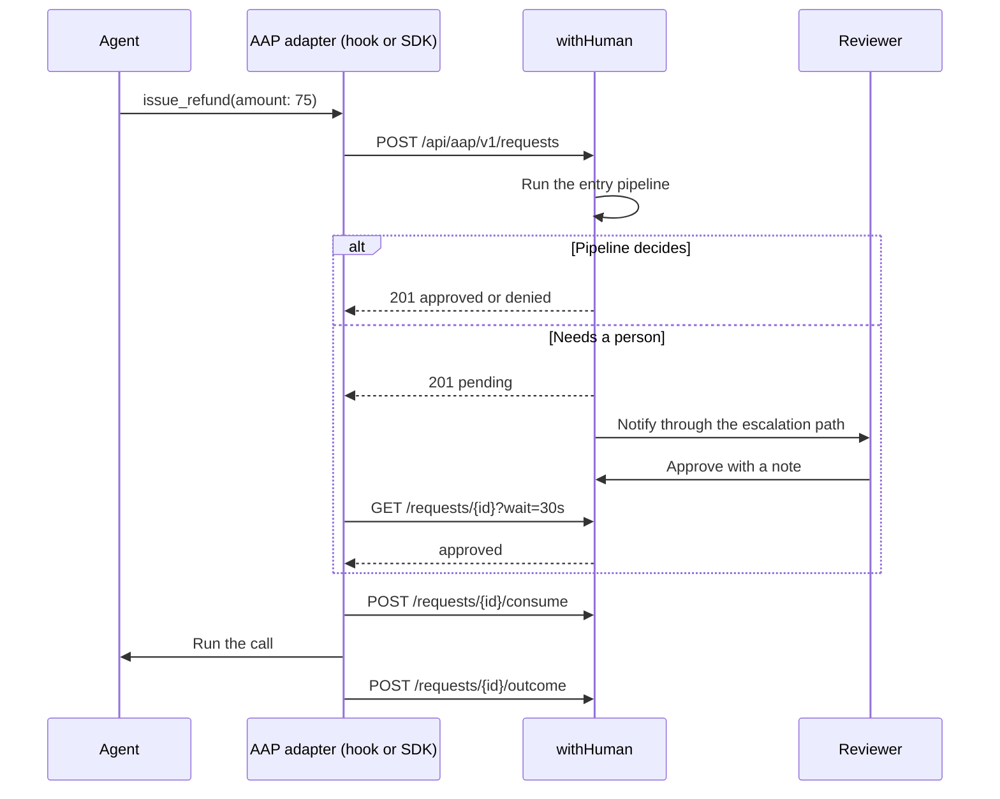

<p align="center">
  
  
</p>

<p align="center"><strong>Approval layer for AI Agents</strong></p>

<p align="center">
  <a href="https://github.com/withHumanAI/withHuman/tags"></a>
  <a href="https://github.com/withHumanAI/withHuman/actions/workflows/release.yml"></a>
  <a href="https://quay.io/repository/withhuman/bundle"></a>
  <a href="go.mod"></a>
  <a href="LICENSE"></a>
  <a href="https://agentapprovalprotocol.io"></a>
  <a href="https://x.com/withHumanAI"></a>
</p>

<p align="center">
  <a href="https://withhuman.ai">Website</a> ·
  <a href="https://withhuman.ai/docs">Docs</a> ·
  <a href="#quickstart">Quickstart</a> ·
  <a href="https://agentapprovalprotocol.io">Protocol</a> ·
  <a href="CONTRIBUTING.md">Contributing</a>
</p>

---

withHuman lets you decide which actions agents can take automatically,
which they can't, and which need a human's approval first.

Connect your agents and manage their approval rules, reviewers, and
decision history in one place.

An adapter (a runtime hook or an SDK wrapper) intercepts each call before it executes
and sends the tool name and arguments to withHuman over the
[Agent Approval Protocol](https://agentapprovalprotocol.io) (AAP). The
server runs the organization's approval pipeline and answers `approved` or
`denied`, or holds the request as `pending` and notifies reviewers along an
escalation path.

Pipelines and escalation paths are configured per organization, not per
agent, so every connected agent is gated by the same rules.

This repository contains:

- **`withhuman`** ([`cmd/withhuman`](cmd/withhuman)): the server. One Go
  binary with embedded PostgreSQL and Temporal, the product and AAP HTTP
  APIs, the review web app, and a management MCP server.
- **`withhuman` CLI** ([`cmd/withhuman-cli`](cmd/withhuman-cli)): installs
  AAP hooks into coding agent runtimes and enrolls them as agent instances.
- **[Agent skills](skills/)** for coding agents that set withHuman up.
- **[Examples](examples/)**: the same refund support agent built on nine
  frameworks (LangGraph, Deep Agents, Pydantic AI, Google ADK, OpenAI
  Agents SDK, Claude Agent SDK, CrewAI, Vercel AI SDK and Mastra). Each
  wraps its tools with an AAP SDK, so every tool call, including calls
  from sub-agents, waits for withHuman before it runs.

<p align="center">
  
  
</p>

## How a request flows



1. **Intercept.** The adapter turns the tool call into an approval request:
   `tool`, `server` (the MCP server alias), `arguments`, `agent_reasoning`
   and a `timeout` between 1 second and 7 days. The request carries the
   agent and the instance that made it.
2. **Decide.** The server runs the organization's `entry` pipeline
   synchronously in the request path. An automatic `approve` or `deny`
   commits with the request and returns in the same response.
3. **Route.** If a person is needed, the request commits as `pending` and
   is pinned to an escalation path. A Temporal workflow walks the path's
   levels and sends notifications.
4. **Wait.** The adapter long-polls `GET /requests/{id}?wait=30s`, or
   receives a signed `request.resolved` webhook if the instance registered
   a receiver.
5. **Execute.** An approved call must be consumed before it runs, once per
   approval, within 5 minutes of the decision (30 with a webhook
   receiver). The adapter reports `succeeded` or `failed` afterwards.

A request ends in one of `approved`, `denied`, `expired` or `cancelled`
and never changes after that. An adapter that stops waiting withdraws its
own pending request with `DELETE /requests/{id}`.

Creating a request:

```sh
curl -X POST "$WITHHUMAN_URL/api/aap/v1/requests" \
  -H "Authorization: Bearer $AAP_INSTANCE_TOKEN" \
  -H "Idempotency-Key: 6f1c2f0e-call-1" \
  -H "Content-Type: application/json" \
  -d '{
    "tool": "issue_refund",
    "server": "stripe",
    "arguments": { "customer": "cus_123", "amount": 75, "currency": "USD" },
    "agent_reasoning": "The customer was charged twice for order 4411.",
    "timeout": "30m"
  }'
```

The [AAP reference](https://withhuman.ai/docs/reference/agent-approval-protocol)
covers every endpoint, status and error code.

## Approval pipelines

A pipeline is an ordered list of blocks. The first block that answers
`approve`, `deny` or `human` ends the run, and `next` passes the request
on. Every request starts in the reserved `entry` pipeline.

| Block | What it does |
|---|---|
| `outcome` | Answers `approve`, `deny` or `human` for every request that reaches it. |
| `branch` | Runs its own blocks only for requests its condition matches. |
| `delegate` | Hands matching requests to another pipeline, owned by another team. |
| `webhook` | Posts a signed request to a service you run and maps its answer to an outcome. |

Conditions are JSON pointers into the request (`/request/tool`,
`/request/server`, `/request/arguments/...`, `/agent/slug`) with
operators such as `equals`, `in`, `regex`, `greater_than` and `some`.
A refund policy looks like this:

```text
entry
├─ branch   tool = issue_refund and amount > 500   → deny
├─ branch   tool = issue_refund and amount > 20    → human, path support-refunds
└─ outcome                                          → approve
```

Pipelines are append-only numbered revisions with
exactly one active. You can test a revision against sample requests
before you activate it, and roll back to any earlier one.

## Escalation paths

An escalation path decides who is asked and when. It is a document of
levels that page people or teams, with `if_else` on working hours,
urgency or request fields, `defer`, `raise_urgency` and `repeat`. A team
can keep its own policy for which members are paged. Reviewers can claim
a request so others know it is taken. Each person chooses how they are
reached: [email](https://withhuman.ai/docs/web-app/email-notifications),
[Slack](https://withhuman.ai/docs/web-app/slack-notifications) or
[Discord](https://withhuman.ai/docs/web-app/discord-notifications).

Only the targets the path reaches for a request, and reviewers they add,
can decide it. Holders of `request.decide.unrouted` (owners) can decide
outside routing with an explicit, audited `outside_routing: true`.

## Connect agents

**Coding agents.** The `withhuman` CLI installs the AAP hooks into Claude
Code, Codex, OpenClaw, Pi, Hermes Agent and DeepSeek Harness. Every
built-in and MCP tool call the hook intercepts becomes a request.

```sh
curl -fsSL https://downloads.withhuman.ai/install.sh | sh
withhuman agent install --url https://approvals.example.com
```

**Agents you build.** The AAP SDKs for Python and TypeScript wrap a
framework's tools. The [examples](examples/) run the same refund agent on
LangGraph, Deep Agents, Pydantic AI, Google ADK, the OpenAI Agents SDK,
the Claude Agent SDK, CrewAI, the Vercel AI SDK and Mastra.

**Management MCP server.** `POST /api/mcp/v1` exposes the management API
as MCP tools, authenticated by API key or OAuth 2.1. The
[agent skills](skills/) teach a coding agent to write pipelines and paths
through it:

```sh
npx skills add https://withhuman.ai
```

## Quickstart

You need [Docker](https://docs.docker.com/get-docker/).

**1. Start withHuman**

```sh
docker run -d --name withhuman -p 8080:8080 -v withhuman-data:/data \
  quay.io/withhuman/bundle:latest
```

**2. Create your account**

Print the one-time setup secret:

```sh
docker exec withhuman cat /data/bootstrap-secret
```

Open [http://localhost:8080](http://localhost:8080), choose **First
setup**, and enter the secret.

**3. Connect your agent**

The welcome page walks you through connecting a coding agent and choosing
which calls need your approval. It ends with a test call for you to
approve.

The [quickstart guide](https://withhuman.ai/docs/getting-started/quickstart)
covers each step, and the [CLI guide](deployment/cli/README.md) covers
every command.

<details>
<summary><strong>Run from source instead</strong></summary>

You need Go (the version in [`go.mod`](go.mod)) and Node 25.

```sh
make frontend
go run ./cmd/withhuman
```

State lives in `~/.withhuman` (set `--data-dir` or `WITHHUMAN_DATA_DIR` to
move it), and the setup secret is in `~/.withhuman/bootstrap-secret`. The
first start downloads PostgreSQL (about 32 MB); later starts work offline.

</details>

## Architecture

`withhuman` is one Go binary. It runs the HTTP server, the embedded React
app, a Temporal server and worker, and PostgreSQL as a child process. The
server and worker talk to Temporal and PostgreSQL through the same client
interfaces they would use against external services.

- **Pipelines run in the request path.** Synchronous blocks execute in the
  server. The request, any automatic decision and,
  for pending requests only, a workflow-start outbox row commit in one
  transaction. Automatic decisions never touch Temporal.
- **Asynchronous blocks suspend.** A `webhook` block parks the pipeline
  with its pinned revisions, and a worker activity resumes it.
- **Temporal owns the waiting.** One workflow per pending request walks
  the pinned escalation path, arms notification timers, enforces the
  deadline and lapses claims. Activities are idempotent; workflow code
  performs no I/O.
- **PostgreSQL is the read model.** The API, the review queue's event
  stream and AAP long polls read PostgreSQL only, never Temporal.
- **Decisions are checked atomically.** Deciding re-checks membership,
  permissions, routing and the request's state in the same transaction
  that writes the append-only decision.
- **Permissions are a code-owned registry.** Roles (owner, admin,
  reviewer, auditor) grant `resource.action` permissions at organization,
  team, agent or pipeline scope.

The HTTP contract is [`internal/httpapi/openapi.yaml`](internal/httpapi/openapi.yaml),
also served at `/api/openapi.yaml`. The architecture rules live in
[CLAUDE.md](CLAUDE.md).

## Configuration

Settings are environment variables. [`.env.example`](.env.example) lists
them for `docker run --env-file`. Nothing is required to try withHuman on
your own machine.

<details>
<summary><strong>All settings</strong></summary>

| Variable | Purpose |
|---|---|
| `WITHHUMAN_PUBLIC_ORIGIN` | The exact origin people use to reach the server, such as `https://approvals.example.com`. Default `http://localhost:8080`. |
| `WITHHUMAN_HTTP_ADDRESS` | Listen address. Default `:8080`. |
| `WITHHUMAN_DATA_DIR` | Where all state lives. Default `~/.withhuman`, or `/data` in the image. |
| `WITHHUMAN_BOOTSTRAP_SECRET` | The secret for creating the first owner. Generated into the data directory when unset. |
| `WITHHUMAN_TRUSTED_PROXIES` | CIDRs of reverse proxies whose forwarded headers to trust. |
| `WITHHUMAN_SECRETS_KEY` | Encrypts stored secrets. Required for webhook blocks, Slack and webhook delivery to agents. |
| `WITHHUMAN_SMTP_HOST`, `_PORT`, `_USERNAME`, `_PASSWORD`, `_FROM` | Email delivery for invitations, password resets and notifications. |
| `WITHHUMAN_SLACK_APP_ID`, `_CLIENT_ID`, `_CLIENT_SECRET`, `_SIGNING_SECRET` | Slack notifications. See [deployment/slack](deployment/slack). |
| `WITHHUMAN_DISCORD_CLIENT_ID`, `_CLIENT_SECRET`, `_BOT_TOKEN` | Discord notifications. See [deployment/discord](deployment/discord). |

Generate a secrets key with:

```sh
openssl rand -base64 32 | tr '+/' '-_' | tr -d '='
```

Interactive CLI commands check `downloads.withhuman.ai` for a newer CLI
once a day. Set `WITHHUMAN_NO_UPDATE_CHECK=1` to turn that off.

</details>

## Deploy to a server

<details>
<summary><strong>Checklist before you go beyond your own machine</strong></summary>

1. Put it behind an HTTPS reverse proxy and set `WITHHUMAN_PUBLIC_ORIGIN`
   to that origin.
2. Set `WITHHUMAN_TRUSTED_PROXIES` to your proxy's addresses only.
3. Set `WITHHUMAN_SECRETS_KEY` and keep it safe. Losing it makes stored
   webhook and Slack secrets unreadable.
4. Configure SMTP so invitations and password resets reach people.
5. Back up the whole data directory. It holds the database, the workflow
   state and the setup secret together.

</details>

## Hosted edition

[withhuman.ai](https://withhuman.ai) is built on this module from a
separate repository. It adds the MCP gateway, the AI judge block, the
audit log and request timeline, SMS, WhatsApp and push notifications,
organization API keys, and SSO with SCIM directory sync. None of these are
in this repository.

## Contributing

Bug reports, ideas and pull requests are welcome. Read
[CONTRIBUTING.md](CONTRIBUTING.md) to get set up, and follow our
[code of conduct](CODE_OF_CONDUCT.md). Report security vulnerabilities
privately as described in [SECURITY.md](SECURITY.md).

<details>
<summary><strong>Development commands and code layout</strong></summary>

```sh
make test        # build the frontend, then run Go tests and vet
make verify      # also validate the OpenAPI contract and deployment files
make frontend    # rebuild the React assets embedded in the binary
make smoke       # run one real approval against a running server
```

`webapp/assets` is generated and not committed, so use the Make targets
rather than plain `go test` or `go build` from a clean checkout. The smoke
test signs in as `owner@example.com` with `local-development-password`
(set `WITHHUMAN_SMOKE_PASSWORD` to change it).

```text
cmd/withhuman/               the single binary
cmd/withhuman-cli/           the agent-side CLI that installs AAP hooks
runtime/, singlebinary/      server and worker composition shared by both editions
domain/, application/        provider-neutral types and storage ports
approvalblock/, blockruntime/  pipeline block grammar and execution contract
internal/approvalpipeline/   pipeline executor and condition engine
internal/approvals/          request use cases behind the AAP routes
internal/aapdelivery/        signed request.resolved webhooks to agents
internal/escalation/         the escalation path state machine
internal/reviewrouting/      pins a request to its path and reviewers
internal/orchestration/      Temporal workflows and activities
internal/postgres/           the product read model and atomic authorization
db/migrations/               embedded schema migrations
authn/, authz/               sessions, credentials and permission checks
notifications/               the channel registry: email, Slack, Discord
internal/httpapi/            HTTP boundary, OpenAPI contract, management MCP server
frontend/                    React web application
skills/                      published agent skills
examples/                    agent framework examples
```

</details>

## License

withHuman core is licensed under the [Elastic License 2.0](LICENSE). In
short, you may use, modify and self-host it, but you may not provide it to
others as a hosted or managed service or remove its licensing notices. The
license text has the exact terms. The Agent Approval Protocol
specification and its Go library are licensed separately under the Apache
License 2.0.

withHuman and the withHuman logo are trademarks of Metoro, Inc. The
license covers the code, not the name or logo. Don't use them in a way
that suggests your product or service is withHuman or is endorsed by us.
