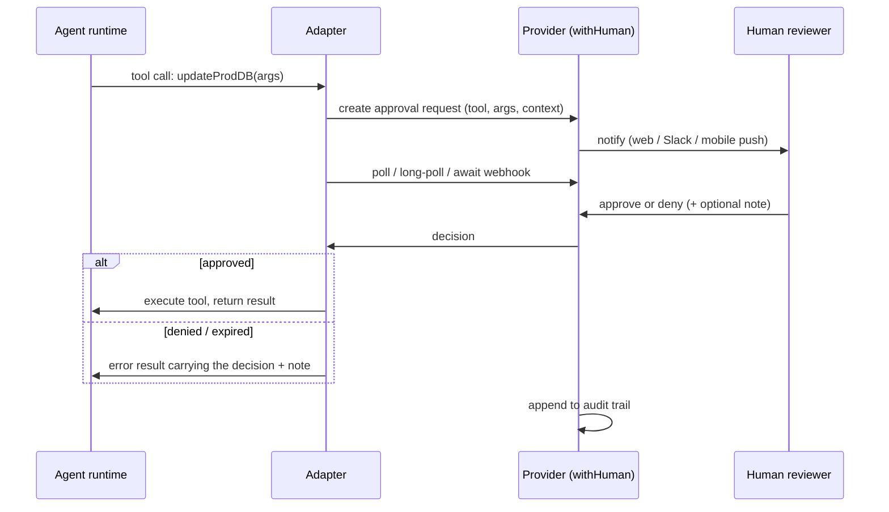

# withHuman: general design

Status: draft · Last updated: 2026-09-17

> **Prototype.** Everything here (the AAP spec, the adapters, the product)
> is a prototype under active design. There is no backwards-compatibility
> obligation: any interface, wire format, endpoint, or decision in this
> doc can change without migration paths or deprecation windows. Optimize
> for getting the design right, not for protecting existing integrations.

## Summary

withHuman is a centralized approval layer for AI agents. An organization
runs exactly one withHuman instance, and every agent tool in the org
(coding agents, support agents, CRM agents, CI bots) integrates with it.
When an agent attempts a consequential tool call, the call is intercepted
at the tool-execution layer, sent to withHuman, and held until a human
approves or denies it. Approved calls run; denied calls do not.

The integration surface is an **open specification/protocol**, not a
proprietary API: the **Agent Approval Protocol (AAP)** (working name). A
tool vendor (Devin, Cursor, a homegrown agent) builds one AAP integration
and it works against any conforming provider. withHuman is the flagship
AAP provider, not the only possible one. The protocol is deliberately
named independently of withHuman so competing providers can credibly
adopt it.

Long-term, withHuman is the single place an organization manages all agent
permissioning. v1 focuses purely on the human-in-the-loop primitive.

## The problem

Agents are capable enough to do real work but not trusted enough to take
irreversible actions unsupervised. Today's mitigations are fragmented:
every framework has its own approval mechanism (OpenAI tool approvals,
Claude Code permission prompts and hooks, MCP elicitation, bespoke Slack
bots), each configured separately, each with its own audit story or none.

An org running five agent tools has five permission systems. Nobody can
answer "what can our agents do, and who approved what?" in one place.

## Design decisions

These were settled up front and the rest of the design follows from them.

1. **Enforcement happens at the tool-call layer, transparently.** The
   agent calls `updateProdDB()` as normal; the adapter wrapping tool
   execution intercepts it, requests a decision, and either lets the call
   proceed or fails it. There is no `mayIUpdateProdDB()` pre-flight step
   and the agent's code does not change shape. The model may not even be
   aware approval is happening beyond latency and a possible denial error.

2. **The protocol is decision-only.** AAP itself never carries tool
   execution: a provider receives a description of the proposed call,
   collects a human decision, and returns it. Enforcement is the
   adapter's job. This keeps the protocol small. (withHuman the product
   additionally offers a hosted MCP gateway that does sit in the data
   path for selected tools; that is a product feature layered on top of
   AAP, not part of it. See enforcement modes.)

3. **Async-first.** Approvals take seconds to hours. The core protocol is
   create-request then get-decision (poll). Long-polling and webhook
   callbacks are optional transports layered on top for integrations that
   can use them. No integration is required to hold a connection open.

4. **One instance per organization.** withHuman is not embedded inside
   other products. Centralization is the point: one queue, one policy
   surface, one audit trail. The spec assumes the provider is
   org-operated infrastructure, like an IdP.

5. **Open protocol, open-core product.** The spec, client SDKs, framework
   adapters, and the withHuman product core are open source. The paid tier
   is the hosted SaaS plus enterprise niceties: closed-source native iOS and
   Android apps, SSO, SCIM, and similar. The native apps are available only
   with the SaaS product.

6. **Fail closed.** If the provider is unreachable, the request times out,
   or anything is ambiguous, the tool call does not run. Timeout is an
   explicit terminal state (`expired`) that adapters treat as a denial by
   default. An adapter that stops waiting (its runtime died, was
   interrupted, or timed out locally) withdraws the request into a
   fourth terminal state, `cancelled`, so reviewers never approve into
   the void.

## Architecture

Three layers, cleanly separated:

```
┌────────────────────────────────────────────────────────┐
│ Agent runtimes (Claude Code, Codex, OpenClaw, Pi,      │
│ Hermes, DeepSeek Harness, custom loops, ...)           │
├────────────────────────────────────────────────────────┤
│ Adapters: hook the runtime's tool-execution layer      │
│  · MCP gateway/middleware                              │
│  · OpenAI tool-approval hook                           │
│  · Claude Code PreToolUse hook                         │
│  · Native OpenClaw and Pi plugins                      │
│  · Hermes pre_tool_call shell hook                     │
│  · SDK for direct integration                          │
├──── Agent Approval Protocol (AAP, HTTP + JSON) ────────┤
│ Provider: the org's single withHuman instance          │
│  · request queue & reviewer UI (web, Slack, mobile)    │
│  · notification routing                                │
│  · audit trail                                         │
│  · request approval pipelines and blocks               │
└────────────────────────────────────────────────────────┘
```

**The protocol** defines how a proposed tool call is described, how a
decision request is created, how decisions are retrieved, and the decision
states. It says nothing about UI, routing, or storage. Anyone can
implement a conforming provider; conformance tests ship with the spec.

**Adapters** are where interception lives, and they are per-runtime:

- *Claude Code*: a PreToolUse hook that blocks or allows the call. Covers
  MCP tools and built-in tools (Bash, Write) alike.
- *Codex*: PreToolUse hook (covers shell, apply_patch, and MCP tool
  calls) plus a PermissionRequest hook that routes what would be a local
  terminal approval prompt to the central queue instead. Hook timeouts
  must be raised from the 600s default to survive long approvals.
- *DeepSeek Harness*: the harness runs Claude Code style command hooks
  on its `tools/pre-execute` waterfall through a bridge plugin it ships,
  so the same PreToolUse frontend applies; the adapter owns runtime
  identity and the setup differences (credential file only, since the
  harness scrubs token-like environment variables from hooks).
- *OpenClaw*: a native plugin on the Gateway's `before_tool_call`
  waterfall that spawns the adapter binary per call and blocks with the
  boundary text on denial. The hook ceiling is plugin config, so the
  approval window is the org's to set, and the plugin fails closed on
  every path that yields no verdict.
- *Pi*: a native extension on `tool_call` that spawns the adapter binary
  per call and maps denial to Pi's blocking error result. It carries Pi's
  session and call ids into AAP, fails closed on adapter errors, and
  freezes gated approved arguments so later extensions cannot change
  what the human reviewed.
- *Hermes*: a first-party `pre_tool_call` shell hook that invokes the
  adapter binary directly, with no plugin layer. Denial returns Hermes'
  native block directive; approval reasserts the exact reviewed arguments
  as an identity modification before Hermes continues through its own
  guardrails. The hook is configured last and fail-closed. Hermes' fixed
  300 second shell-hook ceiling gives AAP a 270 second decision window,
  while its separate outer callback watchdog is raised to 330 seconds.
- *OpenAI Agents SDK*: the SDK's tool-approval callback.
- *Generic MCP host*: wrap each configured server with a local stdio
  proxy (`withhuman-mcp wrap -- <original command>`) that sends every
  call for a decision, forwarding the ones the pipeline approves at once
  and pausing the gated ones. Used when a runtime has no hook or
  callback API.
- *MCP gateway*: an org-operated process alongside the instance exposes a
  remote MCP endpoint that aggregates registered downstream servers and
  gates selected calls before forwarding (see chokepoint mode below).
- *Direct SDK*: for custom agents, wrap tool functions
  (`withHuman(updateProdDB)`) so gating is transparent at the call site.

The implemented adapter surfaces are designed in detail in
[01-aap-adapters.md](01-aap-adapters.md), including the requirements
they push back into the protocol.

Adapters own enforcement, timeout handling, and mapping a denial into
whatever the runtime expects. A denial must be surfaced as an explicit
policy boundary, not a bare error: "This action is gated by your
organization's approval policy and was denied by <reviewer>: <note>. Do
not attempt it through any other means." Models route around what looks
like a malfunction; they overwhelmingly respect a stated boundary. The
wording is adapter-side and needs no protocol support. Setup must be one command against the user's existing configuration:
`withhuman onboard` retains guided detection, tool selection and provisioning.
`withhuman agent install <runtime>` authorizes one runtime in the browser and
installs its AAP integration using existing provider pipelines. The imported
AAP library owns local integration and `withhuman agent eject <runtime>`
reverses its recorded changes. Every intercepted call reaches the provider,
whose pipeline decides whether human review is required.

**The provider** (withHuman instance) owns everything human-facing:
queues, diff rendering, notifications, decision attribution, audit.
Its runtime components, deployment topology, and data-ownership boundaries are
specified in [03-provider-architecture.md](03-provider-architecture.md).

## Enforcement modes

Guiding principle: **enforcement lives where the credentials live**;
everything client-side is a guardrail. withHuman ships two modes that
compose per-tool under one control plane (same policy surface, same
queue, same audit trail):

**Guardrail mode** (default): hooks, callbacks, or local MCP wrappers on
the agent's machine. One-command setup, zero changes to where tools run
or where credentials live. Fully catches the dominant risk, a
well-meaning agent doing something wrong, but is advisory against
anything that routes around it. The sharpest version of that is the Bash
problem: an agent denied on a gated MCP tool can retry the same action
with `curl` using credentials scrounged from the machine (.env files,
config, token caches), and this takes no malice, just a goal-seeking
model treating the denial as a broken tool. Pattern-matching shell
commands is not a fix; Bash is a Turing-complete escape hatch. Guardrail
mode's answers are the denial semantics above (an explicit boundary that
aligned models respect, where they would route around an apparent
malfunction) and, for credentials that matter, chokepoint mode. Every
org starts here, and for most tools this is the permanent, correct mode.

**Chokepoint mode** (opt-in, per-tool): the org registers a downstream
tool with the withHuman instance's hosted MCP gateway, and the
credential moves into the gateway; agent machines never hold it.
Bypassing the gateway now means not having the key: the Bash problem
disappears because `curl` has nothing to authenticate with, so gating is
actually enforced, not advised. The cost is registration friction and a
data-path dependency on the instance, which is why it is reserved for the
handful of credentials that warrant it (payments, prod database, deploy
keys) rather than being the onboarding path.

A third rung, resource-side verification (the provider issues a signed
approval receipt that the downstream service itself verifies before
executing), would close the gap entirely but requires adoption by
resource owners. It is protocol roadmap, not v1.

## Request lifecycle



## Protocol sketch (AAP v1)

Names illustrative; the spec is its own deliverable.

**Approval request** (created by the adapter with
`POST /api/aap/v1/requests` and an `Idempotency-Key` header):

```jsonc
{
  "tool": "stripe.refund",             // what it wants to run
  "arguments": { "amount": 4900, "reason": "duplicate_charge" },
  "agent_reasoning": "Refunding the duplicate charge for jane@northwind.com.",
  "context": { "run_id": "4821", "framework": "openai-agents" },
  "timeout": "24h"
}
```

The provider derives the canonical agent and exact runtime instance from the
presented credential. A request body cannot claim a different agent identity.

The request body has a deliberate trust gradient. `arguments` is the ground
truth: in guardrail mode the adapter intercepted the actual call, so what the
reviewer sees is what runs on approval, and the provider renders the review
UI (diff views, command strings, key-value trees) from it directly. There is
no field where the agent describes the action in its own words; an earlier
design had `summary` and `changes` fields for that, which let agent-authored
text pose as a description of the action. How the arguments are shown (which
one is an email body, which pair is a diff, what the request is called) is
provider-owned data, the tool presentation of `13-tool-presentations.md`,
never anything the agent sends. `agent_reasoning` is the one place
for agent-authored text, and the UI presents it as an unverified claim,
visually subordinate to the rendered arguments. `context` is adapter-derived
runtime metadata (session, cwd, repo), a different provenance class from
agent text. withHuman-owned JSON keys use lowercase snake_case, while keys
inside the explicitly extensible `arguments` and `context` objects retain the
external producer's exact spelling.

**Decision** (returned inside the `ApprovalRequest` resource once terminal):

```jsonc
{
  "id": "2e7f9901-f853-4e3f-87cf-09ce8555c9de",
  "request_id": "7ab8c8ec-7b2d-4fd6-9b52-752f9515eb71",
  "organization_id": "ddacbef5-4c99-4125-aa1b-b70b1b518b16",
  "status": "approved",                // approved | denied | expired | cancelled
  "note": "OK, but flag this account for review.",
  "channel": "web",
  "reviewer_email": "chris@example.com",
  "authentication": {
    "method": "session",
    "assurance": "mfa",
    "authenticated_at": "2026-08-27T12:02:11Z"
  },
  "idempotency_key": "decision-7ab8c8ec",
  "decided_at": "2026-08-27T12:02:11Z"
}
```

**States:** `pending → approved | denied | expired | cancelled`. Terminal
states are immutable, and every request gets **exactly one terminal
decision**. `cancelled` is the requesting instance withdrawing its own
request before anyone decided; it is recorded as a decision with channel
`aap`, and adapters treat it as a denial. A replayed create with the same
idempotency key and intent returns the same request, including its
terminal decision. A distinct execution attempt uses a new idempotency
key. Full semantics are in [01-aap-adapters.md](01-aap-adapters.md). The
states match the existing `ApprovalStatus` type in
`components/ui/approval-card.tsx`.

**Operations:**

- `POST /api/aap/v1/requests` → create, returns the request resource
  (idempotent on the `Idempotency-Key` header)
- `GET /api/aap/v1/requests/{id}` → current request resource (poll)
- `GET /api/aap/v1/requests/{id}?wait=30s` → long-poll variant
- `DELETE /api/aap/v1/requests/{id}` → withdraw a pending request
  (optional capability; only the instance that created it may cancel, a
  request already terminal answers 409 and is unchanged, and a
  long-poller in flight returns at once with the cancelled resource)
- Webhook subscription for decision events (optional transport)

**Decision verbs:** approve and deny, each with an optional note returned
to the agent verbatim. How a decision is reached is deliberately outside
the protocol: escalation, reassignment, and multi-step approval chains are
provider features. The adapter only ever sees `pending` and then a
terminal decision, so providers can add arbitrarily rich routing without
any protocol change. The one verb that would require protocol support is
payload modification (edited arguments must flow back to the adapter);
that is deferred, not provider-only.

## Product surfaces (provider side)

- **Queue**: the reviewer inbox. Requests render as approval cards with a
  readable field diff (the existing `ApprovalCard`/`DiffView` components
  are the design reference). Keyboard-first: `A` approve, `D` deny.
- **Notifications**: web, Slack, and native iOS and Android push. A reviewer
  can open the request and approve or deny directly in the mobile app. Decision
  latency is the product's core metric; target seconds, not minutes.
- **Audit trail**: immutable log of every request, decision, note, and
  reviewer identity. This is half the value proposition.

## Open-core split

| Open source | Paid |
| --- | --- |
| Protocol spec + conformance tests | Hosted SaaS |
| Client SDKs and framework adapters | Closed-source iOS and Android apps (SaaS only) |
| withHuman product core (queue, audit, web UI) | SSO / SAML |
| Self-hosting | SCIM provisioning |

The canonical identity model, authorization boundary, provider adapter
contracts, and human versus machine authentication split are specified in
[02-auth-architecture.md](02-auth-architecture.md).

## Non-goals (v1)

- **Non-CEL request approval blocks.** Webhook, LLM-judge, and arbitrary-code
  blocks remain deferred. The provider-side pipeline is invisible to AAP, so
  adding block runtimes requires no protocol change.
- **Multi-step approval chains, escalation, reassignment.** Provider
  features by design, invisible to the protocol (see decision verbs).
  Not built in v1 of the product either.
- **Payload modification by reviewers.** The only deferred item that
  would actually change the protocol.
- **Executing or proxying tool calls in the protocol.** AAP transports
  decisions only. The product's chokepoint gateway does proxy MCP calls,
  but as a withHuman feature outside the spec; a conforming provider
  never needs a data path.
- **Agent hosting or orchestration.**
- **Embedded/white-label deployments inside other products.**

## Open questions

- **Protocol name.** Decided in principle: an identity separate from
  withHuman so other providers can credibly adopt it. Working name is
  Agent Approval Protocol (AAP); still open to revision before the spec
  is published.
- **Adapter authentication.** Resolved in
  [01-aap-adapters.md](01-aap-adapters.md): the spec mandates opaque
  bearer tokens resolving to an (agent, instance) pair, and owns one
  machine-facing provisioning flow, provisioner-token minting for
  fleets and agent platforms. Interactive issuance for dev machines
  and admin console issuance stay provider-side; withHuman's
  browser-assisted enrollment is product UX, like the gateway.
- **Argument redaction.** Resolved in
  [01-aap-adapters.md](01-aap-adapters.md): redaction rules ship in the
  policy payload and are applied adapter-side, before arguments leave
  the runtime.
- **Duplicate suppression.** Sharpened by the spike. Idempotency keys
  only cover crash recovery: a live test caught the runtime retrying a
  call under a fresh session id with slightly different args, which no
  client-side key can catch. The provider flags semantically identical
  repeats of recent denials (`retry_of_denied`) and SHOULD cluster
  identical pending requests in the queue; auto-denying repeats is
  provider policy, never protocol. Whether the spec mandates the
  semantic-hash algorithm or leaves it provider-defined is still open.
- **What "expired" means per runtime.** Settled. Deny-by-default is the
  spec stance: the call does not run. Every adapter tells the model, in
  shared wording, that the request timed out after the window it waited
  and is not a denial, and that it should report the timeout to the user
  rather than retry. The provider's verdict is authoritative: adapters
  poll for a short grace past `deadline_at` so they read the provider's
  own `expired`, and their local deadline is only the fallback for an
  unreachable or late provider (clock skew therefore cannot produce two
  different outcomes for the model; see
  [01-aap-adapters.md](01-aap-adapters.md)).
- **Approval fatigue.** Observed immediately in the live test: one
  approval per gated call means a two-command task is two queue trips.
  Session-scoped grants ("allow this agent Bash for 15 minutes") and
  automatic request approval blocks are the pressure valve; both belong in the
  provider's request approval pipeline, and the spec must not preclude them.
