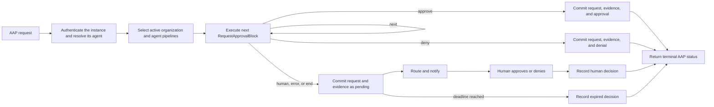

# withHuman: request approval lifecycle

Status: draft · Last updated: 2026-09-23

## Summary

The request approval lifecycle is the provider-side path from an incoming
Agent Approval Protocol (AAP) request to one immutable terminal decision. It
authenticates the agent instance and resolves its agent, selects the
organization's active `RequestApprovalPipeline` revisions in two scopes (the
organization pipeline and the agent pipeline, either of which may be empty),
executes their concatenated ordered `RequestApprovalBlock` values as one
effective pipeline, either decides automatically or obtains a human decision,
and returns the result to the calling adapter.

Every block evaluation, routing action, and decision is written to the audit
trail using identifiers and safe, redacted metadata. Raw request payloads and
sensitive metadata are never copied into logs.

The lifecycle and configurable pipeline are internal to withHuman. AAP
continues to expose only `pending`, `approved`, `denied`, and `expired`, so
pipeline and routing behavior can evolve without exposing provider internals.

## AAP boundary

The wire contract is defined by
[`openapi.yaml`](../withhuman_core/internal/httpapi/openapi.yaml). An adapter
creates a request with `POST /api/aap/v1/requests`, authenticated with its
bearer credential and carrying an `Idempotency-Key` header. The request body
is:

```jsonc
{
  "tool": "stripe.refund",
  "arguments": { "amount": 4900, "reason": "duplicate_charge" },
  "agent_reasoning": "Refunding the duplicate charge for jane@northwind.com.",
  "context": { "run_id": "4821", "framework": "openai-agents" },
  "timeout": "24h"
}
```

`tool` and `arguments` describe the proposed call and are the ground truth for
automatic evaluation and human review. `agent_reasoning` is an unverified
agent claim. `context` is adapter-derived runtime metadata.

The authenticated credential, not the request body, identifies the canonical
agent by its slug and the runtime instance that presented the credential.
Callers cannot claim a different agent. withHuman-owned fields use lowercase
snake_case.
`arguments` and `context` preserve external keys verbatim. Unknown
withHuman-owned top-level fields are rejected.

Create and read operations return an `ApprovalRequest` resource directly. A
terminal resource contains its immutable `decision`:

```jsonc
{
  "id": "7ab8c8ec-7b2d-4fd6-9b52-752f9515eb71",
  "organization_id": "ddacbef5-4c99-4125-aa1b-b70b1b518b16",
  "agent_slug": "billing-agent",
  "agent_name": "Billing agent",
  "agent_instance_id": "99a2179d-cd1f-4f92-9588-64695aef02d1",
  "agent_instance_name": "billing-agent-production",
  "tool": "stripe.refund",
  "arguments": { "amount": 4900, "reason": "duplicate_charge" },
  "status": "approved",
  "deadline_at": "2026-08-28T12:00:00Z",
  "created_at": "2026-08-27T12:00:00Z",
  "decision": {
    "id": "2e7f9901-f853-4e3f-87cf-09ce8555c9de",
    "request_id": "7ab8c8ec-7b2d-4fd6-9b52-752f9515eb71",
    "organization_id": "ddacbef5-4c99-4125-aa1b-b70b1b518b16",
    "status": "approved",
    "note": "OK, but flag this account for review.",
    "channel": "web",
    "reviewer_email": "chris@example.com",
    "authentication": {
      "method": "session",
      "assurance": "mfa",
      "authenticated_at": "2026-08-27T12:02:11Z"
    },
    "idempotency_key": "decision-7ab8c8ec",
    "decided_at": "2026-08-27T12:02:11Z"
  }
}
```

The create response is normally `pending` and omits `decision`. An automatic
pipeline outcome may instead make the create response terminal. The adapter
reads the same resource with `GET /api/aap/v1/requests/{id}`, optionally using
the `wait` query parameter for long polling.

## Goals

- Make the safest applicable decision through ordered, explainable blocks.
- Prevent request input from selecting a more permissive pipeline.
- Avoid human interruption when an organization has explicitly authorized an
  automatic outcome.
- Route requests that need judgment to the right reviewer.
- Produce a complete audit record for pipeline and human decisions.
- Fail closed: an action never executes without an `approved` terminal
  decision.

## Lifecycle



1. **Ingest and identify.** Validate the AAP payload, authenticate the agent
   instance, resolve its stable parent agent by slug, apply idempotency,
   redact configured sensitive fields, and prepare the canonical request for
   execution and persistence. Preserve `tool`,
   `arguments`, `agent_reasoning`, `context`, and `timeout` with their
   provenance. Provider identity and receipt metadata remain
   separate from the request body.

2. **Select the effective pipeline.** Select up to two active immutable
   pipeline revisions: the organization pipeline, which is agent
   independent, and the agent pipeline keyed by the authenticated agent's
   slug. The effective pipeline is the organization blocks followed
   by the agent blocks; either section may be empty. Request fields
   cannot select or override either revision. When
   both sections are empty, or a selected revision cannot be loaded or
   compiled, the request requires human review.

3. **Execute blocks in order.** Load the immutable ordered block bundles,
   concatenate them, and execute enabled blocks by ascending combined
   position. Each block receives the request, authenticated agent metadata,
   and namespaced metadata from earlier blocks, regardless of which section
   contributed the earlier block. `next` continues; `approve`, `deny`, or
   `human` stops immediately. Reaching the end after `next`, or encountering
   an invalid result, error, timeout, exhausted retry budget, or block
   compilation failure, requires human review.
   Persist the request, both pinned pipeline revisions, ordered block
   evidence, automatic decision when applicable, request state, and audit
   events in one idempotent transaction.

4. **Route human approval.** After the human-handoff transaction commits,
   evaluate routing against the same normalized metadata. Routing selects a
   reviewer or reviewer group, delivery channels, deadline, and optional
   escalation. Notification is retried and deduplicated, but delivery failure
   never changes the decision. If no route matches, use the organization's
   default queue and raise an operational alert.

5. **Collect and return the decision.** An authorized reviewer may approve or
   deny once. The write is compare-and-set against `pending`, so the first
   valid terminal transition wins and retries are idempotent. If the deadline
   passes first, the request expires.

## Request approval pipeline and routing

The request approval pipeline answers **whether** the request can be decided
automatically. Routing answers **who** should decide after a block returns
`human`, the pipeline falls through, or execution fails safely. They are
separate versioned configuration. Each evaluation stores the exact pair of
pipeline revisions used.

### Execution model: one function body

The effective pipeline reads like a function. Organization blocks are the
opening statements. Agent blocks follow, and each is in effect guarded
by `agent.slug`, because only the authenticated agent's section is
concatenated. `approve`, `deny`, and `human` are early returns; `next` falls
to the next statement; and the function ends with an implicit
`return human`. There is no code path that falls off the end without a
value, so an empty configuration in both scopes still returns human review.
Block errors, timeouts, invalid output, and exhausted retries behave like
exceptions caught by the runtime, and the handler returns `human`; a failure
can never keep executing and can never return `approve`.

Precedence falls out of reading order: organization blocks run first, so an
organization outcome always wins. In particular, an organization `approve`
short-circuits every agent block, including an agent `deny`.
Organization-wide rules therefore outrank agent rules by construction,
and the pipeline editor must make this ordering visible. Rules such as
"every refund under $20 is auto-approved regardless of agent" live once in
the organization section instead of being copied into every agent
section, and organizations that need no per-agent rules can configure only
the organization section and let everything else fall through to human
review.

This deliberately weakens one earlier invariant: an organization block can
decide a request for an agent whose own pipeline is empty. That is the
point of the organization scope, but it means an unconfigured agent no
longer guarantees human review on its own; only "both sections empty" does.
Every agent owns exactly one pipeline, keyed by its slug: creating the agent
seeds an empty active revision 1, archiving the agent archives the pipeline,
and restoring the agent re-activates its latest revision. An empty revision
is the pass-through form, and the organization pipeline works the same way.

The `always` block unconditionally returns its configured `approve`, `deny`,
or `human` outcome when reached. It follows normal reading order, including
organization precedence, and never handles an earlier block failure. Later
blocks remain valid configuration but are unreachable; the editor explains
this without preventing save or activation.

The `branch` block is a nested `if` statement whose body commits. Its
condition uses the same envelope as a `cel` block. When the condition
holds, the branch's own ordered blocks run as the body, with the same early
returns, and a body that ends without one returns `human` with the
branch's reason and escalation path: no statement after the branch runs
for a request that entered it, including the agent section when the branch
is in the organization section. When the condition does not hold, the body
is skipped and execution continues after the branch, so the statements
after a branch act as its `else`. A condition that fails to evaluate is a
block error and returns `human` to the pipeline default. Branches nest
without a depth limit, and an inner body that ends without a decision
returns too, instead of continuing the outer body. See
[branch blocks](15-branch-blocks.md).

The `cel` block type uses CEL inside a withHuman-owned condition
envelope. See [CEL request approval block](02-cel-policy-engine.md) for its
authoring and evaluation semantics. See
[request approval pipeline storage and APIs](05-request-approval-pipeline-storage.md)
for the relational model, immutable revision lifecycle, block contract,
management API, audit-backed evidence, and runtime cache behavior. The
routing and escalation model itself is specified in
[reviewer routing and escalation](06-routing-and-escalation.md).

An automatic decision uses `source: pipeline` and records the terminal block
and every earlier attempted block. A human decision uses `source: human`, while
expiration uses `source: system`. Human reviewers see a concise, value-free
pipeline explanation and the original request context, but their final
decision remains their own. LLM-judge and webhook blocks are asynchronous:
the request path suspends in front of them and the worker resumes the
pipeline (see [08-llm-judge-block.md](08-llm-judge-block.md) and
[08-webhook-block.md](08-webhook-block.md)).

## State and audit invariants

- Request state is monotonic: `pending -> approved | denied | expired`.
- Terminal decisions are immutable. Corrections require a new request.
- Duplicate creation with the same organization, operation, and
  `Idempotency-Key` reattaches to the same request in any state. Reusing the
  key for different intent returns `409 Conflict`.
- Each pipeline evaluation pins the pair of immutable revisions it executed
  (organization and agent) and records attempted blocks in combined
  execution order.
- The first `approve`, `deny`, or `human` outcome terminates pipeline execution.
  Later blocks do not run. Organization blocks always precede agent
  blocks, so an organization outcome takes precedence.
- An organization block may decide a request whose agent pipeline is
  empty. Human review is guaranteed only when both sections are empty or
  execution fails safely.
- Every stage appends an audit event with request ID, timestamp, actor, safe
  references, outcome, reason, and pipeline or routing version. Detailed block
  traces remain in the protected evaluation record and never copy observed
  request values.
- Block retries stay within their configured budget. Product writes and
  notifications remain idempotent.
- Block failure, timeout, missing configuration, or ambiguity cannot approve.
  A pending request eventually expires, which adapters treat as denial.

## Non-goals

- Executing or modifying the proposed tool call.
- Letting request content choose the agent or a pipeline.
- Exposing pipeline, block, routing, escalation, or reviewer workflow through
  AAP.
- Allowing an unconstrained webhook, LLM judgment, or code block to authorize
  an action without configured transitions and audit behavior.

## Open questions

- Resolved in [reviewer routing and escalation](06-routing-and-escalation.md):
  v1 routing supports ordered escalation over users and reviewer groups, but
  exactly one reviewer decision; quorum is deferred.
