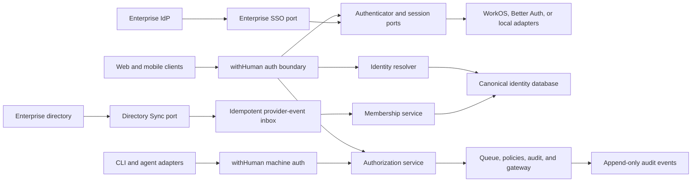

# withHuman authentication and identity architecture

Status: draft · Last updated: 2026-09-18

> **Prototype.** Same caveat as
> [00-general-design.md](00-general-design.md): everything here can change
> without migration paths or backwards-compatibility constraints. Optimize for
> the right model.

## Summary

withHuman has four related but distinct identity problems:

1. Authenticating human reviewers and administrators.
2. Authorizing those humans inside an organization.
3. Provisioning enterprise memberships from SSO and directory providers.
4. Authenticating stable agents and their concrete runtime instances.

They must not collapse into one vendor-owned model. Authentication and
enterprise protocol providers verify identities and normalize external
systems. withHuman owns canonical users, organizations, memberships,
authorization, machine credentials, and audit history.

This boundary makes providers replaceable without moving product data or
rewriting authorization. A provider change may still expire sessions and
require enterprise customers to reconnect SAML or SCIM. Avoiding that entirely
would require withHuman to operate the public SAML and SCIM endpoints itself,
which defeats much of the reason to use a specialist provider.

## Goals

- Keep all application authorization provider-independent.
- Preserve stable reviewer attribution for the lifetime of the audit trail.
- Support hosted multi-tenancy while maintaining one logical withHuman
  instance per organization.
- Support users who belong to multiple organizations.
- Make SAML SSO and SCIM self-service for customer IT administrators.
- Revoke access promptly when a membership is suspended or deprovisioned.
- Keep human authentication separate from AAP adapter authentication.
- Permit local authentication for self-hosted deployments.
- Make a provider replacement a controlled migration with contract tests and
  an explicit runbook.

## Non-goals

- Hiding every vendor capability behind a lowest-common-denominator API.
- Moving authorization roles or policies into an identity provider.
- Treating email addresses as permanent identity keys.
- Building hosted-scale MFA, SAML, or SCIM implementations merely to eliminate
  all external dependencies. The local self-hosted password adapter is
  intentionally limited to its own credential verification boundary.
- Guaranteeing that changing SSO or SCIM providers requires no action from
  customer IT administrators.
- Using the human-authentication provider for agent instance credentials.

## Ownership boundary

| Concern | Owner |
| --- | --- |
| Human credential verification and MFA mechanics | Authentication adapter |
| Browser session mechanics | Session adapter |
| SAML and OIDC federation mechanics | Enterprise SSO adapter |
| Directory connector mechanics | Directory Sync adapter |
| Canonical users and organizations | withHuman |
| Membership admission and lifecycle | withHuman |
| Roles, permissions, reviewer teams, and policy scopes | withHuman |
| Agents, agent instances, enrollment, and instance credentials | withHuman |
| Approval decisions and audit history | withHuman |

Provider SDK types stop at the adapter boundary. Domain and application code
only accept normalized withHuman types.

## Architecture



### Logical tenancy

The design decision in [00-general-design.md](00-general-design.md) says an
organization runs exactly one withHuman instance. In the hosted product this
is a logical boundary, not a requirement for one infrastructure deployment per
customer. A single hosted deployment may serve many organizations, but every
request, membership, credential, policy, and audit record belongs to exactly
one organization.

A human user is global and may have memberships in several organizations. An
authorization principal is always organization-scoped. There is no global
administrator role that silently crosses tenants.

## Canonical domain model

### Users and external identities

`users` represents a human independently of any authentication provider.

Suggested fields:

- `id`
- `display_name`
- `primary_email` as a mutable display and contact attribute
- `status`
- timestamps

`external_identities` links a provider assertion to a canonical user.

Suggested fields:

- `user_id`
- `provider_key`
- `issuer`
- `subject`
- last observed email and whether the provider verified it
- `linked_at`
- `last_authenticated_at`

The unique identity key is `(provider_key, issuer, subject)`. Email alone is
not an identity key. Two identities must not be linked solely because an
unverified email string matches. Linking by a verified email is allowed
under one explicit policy: an assertion from a registered social
authenticator whose provider verified the email links to the active user
with that primary email, globally, and the link is audited as
`membership.identity_linked` in every organization the user is an active
member of. Unverified emails never link. A linked identity keeps resolving
by its triple whatever email the provider reports later; the observed
email is recorded, the canonical `primary_email` never changes on its own.
The accepted trade-off is that a takeover of the provider account is a
takeover of the withHuman account with that email, mitigated only by the
provider's own verification.

Enterprise assertions are narrower, because every tenant's IdP speaks
through the same connector and a tenant controls what its IdP asserts.
Their issuer is the connector's public base scoped to the tenant
(`<polis base>/tenants/<organization id>`), so one organization's
subjects can never resolve another organization's users. An enterprise
assertion admitted through a pending invitation may attach an existing
global account by email only when the organization has verified the
email's domain by DNS challenge; for any other address the admission
refuses (`ErrUserExists`, surfaced as `account_exists`) and the person
signs in to the existing account and accepts the invitation from there.
Just-in-time admission already requires a verified domain, so it keeps
linking by email. Linking an assertion to an existing member of the same
organization by verified email is unaffected: the organization's own IdP
vouches for its own members.

### Organizations and memberships

`organizations` is the tenant and logical withHuman instance.

`organization_domains` records verified domains and their login routing. A
domain may help discover an SSO connection, but domain ownership does not by
itself grant membership.

`memberships` joins a user to an organization. A membership has one of these
states:

- `invited`
- `active`
- `suspended`
- `deprovisioned`

It also records its admission source:

- manual invitation
- SSO just-in-time provisioning
- SCIM or another directory connector

Suspension and deprovisioning never delete the membership. Historical
decisions must continue to resolve to the same reviewer. A directory-managed
membership cannot be manually reactivated while the directory still reports
it inactive, except through an explicit break-glass operation.

There is at most one membership for a `(user_id, organization_id)` pair.

### Roles, permissions, and teams

Roles are additive bundles of stable application permissions. The initial
roles are:

| Role | Purpose |
| --- | --- |
| `owner` | Ownership transfer, billing, destructive operations, and all other permissions |
| `admin` | Members, teams, connections, credentials, request approval pipelines, and integrations |
| `reviewer` | Read and decide requests within assigned scopes |
| `auditor` | Read requests, decisions, and audit history without making changes |

An administrator is not automatically a reviewer. A person may hold both
roles, but the assignments remain explicit. Every active organization must
have at least one owner.

Application code checks permissions, not role names. The initial permission
vocabulary is:

- `organization.read`, `organization.settings.write`, `organization.delete`
- `membership.read`, `membership.invite`, `membership.write`, `membership.role.assign`
- `role.read`, `role.write`
- `team.read`, `team.write`, `team.member.write`
- `agent.read`, `agent.write`, `agent.credential.issue`, `agent.credential.revoke`
- `pipeline.read`, `pipeline.write`, `pipeline.activate`
- `escalation_path.read`, `escalation_path.write`, `escalation_path.activate`
- `connection.read`, `connection.write`
- `gateway.read`, `gateway.write`, `gateway.call`
- `webhook.read`, `webhook.write`
- `request.create`, `request.claim`, `request.decide.unrouted`
- `request.read`
- `request.decide`
- `audit.read`

`teams` scopes review queues and policy routing. Teams are mutable ops
data managed behind `team.write` and `team.member.write` (held by owners and admins): create,
rename, delete, and replace the manual member set. Manual assignments and
directory-synced group assignments coexist per source in
`membership_teams`; a team a directory group links to is directory
managed, which locks manual rename and delete while manual member
assignment stays open. Whether a team is directory managed is derived
from the group link, never stored, so removing the link returns the team
to manual control. An external directory group does not grant a
permission merely because its name resembles a role or team. An
administrator explicitly maps external groups to withHuman teams or roles.

### Enterprise connections

`enterprise_connections` stores the withHuman organization, adapter key,
provider resource identifiers, protocol, connection state, safe metadata, and
timestamps for a SAML or OIDC connection.

`directory_connections` stores the equivalent information for SCIM and other
directory connectors, including reconciliation status and the last successful
sync.

`directory_object_links` maps provider directory users and groups to canonical
memberships and teams. Provider object identifiers never replace canonical
withHuman identifiers.

### Machine actors and credentials

`agents` represents stable organization-owned non-human actors such as a
release agent, support agent, or coding agent. An agent is identified by an
immutable `slug` (`^[a-z0-9][a-z0-9._-]{0,62}$`, chosen once at creation or
first connect and never reused in the organization, even after archive) and
carries an editable display `name`, unique among live agents only. It owns
its current AAP scopes and its status, `active` or `archived`. The slug is
what URLs (`/api/v1/agents/{slug}`), role scopes (`agent:<slug>`), permission
policies, pipeline scopes, audit data (`agent_slug`) and condition
expressions (`agent.slug`) carry; the request approval pipeline it selects
cannot be supplied or overridden by an approval request. The table keeps a
hidden UUID primary key for foreign keys, role-assignment principal ids and
audit subject ids; that id is never exposed in the API, URLs, CLI or UI.
Renaming is audited as `agent.renamed`. Archiving is reversible:
`POST /api/v1/agents/{slug}/restore` returns an archived agent to `active`
(audited as `agent.restored`) and re-activates its pipeline; credentials and
provisioner tokens revoked at archive stay revoked, and its instances remain
and can be re-enrolled. The human membership that created the agent is
retained for provenance, not as the agent's owner or runtime identity.

`agent_instances` represents concrete enrolled runtimes of an agent. A local
process, CI runner, container, or hosted replica is an instance, named
uniquely within its agent. An instance is durable across process restarts but
is not a workflow run or tool call.

`agent_credentials` stores:

- a credential identifier and secret hash
- the owning agent instance
- organization
- issued, expiry, last-used, and revoked timestamps
- rotation lineage

Raw bearer tokens are displayed once. Tokens are high-entropy opaque values,
organization-scoped, revocable, and replaceable without deleting their owning
agent or instance. Credential resolution reloads the current agent and
instance status and the agent's current scopes, so disabling either actor or
reducing agent scopes takes effect without rotating every credential.

`agent_enrollments` is short-lived bootstrap state for browser-assisted
instance registration. It is not a device inventory and does not become a
machine principal. Local tools, CI runners, containers, and hosted runtimes
all converge on the same `Agent -> AgentInstance -> AgentCredential` model.

## Request principal

Every authenticated request is translated into one provider-neutral internal
principal:

```text
principal
  actor type and canonical actor ID
  organization ID
  membership ID, or agent slug and agent-instance ID
  effective permissions
  team and policy scopes
  authentication method and assurance
  authentication time
  session or credential ID
```

The application never passes provider claims directly into an authorization
check. Authentication answers who presented the request. withHuman then loads
the current membership, permissions, and organization policy from canonical
storage.

This extra lookup is deliberate. A deprovisioned user loses access immediately
even if an upstream provider session remains technically valid.

## Provider ports

Do not define one large `AuthProvider` interface. Authentication, sessions,
enterprise federation, and provisioning have different lifecycles and may be
implemented by different systems.

### Authenticator port

An authenticator verifies an interactive login method and returns a normalized
assertion containing:

- provider key, issuer, and subject
- email and verification state
- display profile
- authentication time
- authentication methods and assurance level
- provider session reference when applicable
- optional organization or connection hint

It supports verifying a direct credential or beginning and completing a
redirected login or step-up flow. Password login, social login, passwordless
login, passkeys, and enterprise SSO are authenticator capabilities, not
application identities.

### Session port

The session implementation is responsible for:

- creating a browser or mobile session after successful authentication
- authenticating an incoming request
- rotating and expiring sessions
- logout and revocation
- reporting authentication time and assurance

The chosen implementation may store sessions locally or use a hosted service.
withHuman owns session policy, but it does not need to reimplement secure
session mechanics. An authenticator and session adapter must declare that they
are compatible; arbitrary combinations are not assumed to work.

A provider migration may invalidate all active sessions and require users to
log in again. That is an acceptable migration cost and safer than maintaining
parallel, long-lived compatibility shims.

### Enterprise SSO port

The SSO adapter supports:

- creating a self-service setup session for a customer IT administrator
- reading connection state and safe metadata
- beginning and completing SAML or OIDC authentication
- disabling and deleting a connection
- producing the same normalized authentication assertion as any other
  authenticator

The withHuman-facing login route remains stable. IdP-facing metadata such as
an ACS URL or entity ID may remain provider-specific unless the provider
supports a withHuman-controlled custom domain.

### Directory Sync port

The directory adapter supports:

- creating a self-service directory setup session
- verifying webhook authenticity from the raw request
- normalizing provider-specific events
- retrieving complete user and group snapshots for reconciliation
- reporting connector health

Its normalized output is a small set of application commands:

- upsert a directory user
- deactivate a directory user
- upsert a directory group
- remove a directory group
- replace group memberships

### Capability registry and contract tests

Each adapter declares capabilities such as password, passwordless, social
login, passkeys, step-up, SAML, OIDC, SCIM users, SCIM groups, custom
attributes, and custom domains. Product code may require a capability
explicitly rather than assuming all adapters are equivalent.

Every adapter runs against a shared contract-test suite. The suite covers
normalized assertions, session expiry, webhook verification, duplicate and
out-of-order events, connection lifecycle, user deactivation, group updates,
and provider failures. A wrapper without these tests will eventually become a
provider-specific abstraction in disguise.

## Human login flow

1. A withHuman-owned `/auth/*` route selects an authenticator from deployment
   configuration or organization login policy.
2. The authenticator validates the callback and returns a normalized assertion.
3. The identity resolver maps `(provider, issuer, subject)` to a canonical
   user, or runs an explicit account-creation or linking flow.
4. Organization admission policy decides whether the user may obtain or
   activate a membership.
5. The compatible session adapter creates a session.
6. Every protected request resolves that session to a principal and reloads
   current membership and authorization state.

Users may authenticate before selecting an organization. Organization-specific
SSO starts with an organization slug, verified domain, invitation, or explicit
organization choice. Email-domain guessing alone never grants access.

### Social login (hosted edition)

Google and GitHub are social authenticators registered by the hosted
composition root (`authn.Service.RegisterSocialAuthenticator`); the open
edition registers none, and the shared frontend learns which exist from
`/api/runtime-config`. Core owns what an assertion may do
(`LoginWithAssertion`: resolve or link, then the same organization step as
password login), the hosted repository owns the provider round trip:

1. `POST /auth/social/{provider}/begin` records a flow (id doubles as the
   OAuth `state`, PKCE verifier, hash of a browser-binding cookie secret)
   and returns the consent redirect; the cookie is `SameSite=Lax` and path
   scoped to the social routes because the provider redirect is a
   cross-site top-level navigation.
2. `GET /auth/social/{provider}/callback` claims the flow exactly once,
   checks the cookie binding, exchanges the code, stores the normalized
   assertion, and redirects to the access screen. It never mints a
   session: the multi-organization picker needs the login ticket in a
   response body, and a raw ticket must sit neither in a URL nor at rest.
3. `POST /auth/social/continue` (same origin) consumes the flow and
   returns the same body as password login: a session, or the ticket and
   organization list. A signup-intent flow instead founds the organization
   through the shared activation transaction with the provider identity
   triple in place of a password hash.

Login never creates users (`no_account`). Organizations with an enterprise
connection stay unreachable through social login exactly as with a
password: when every organization the person belongs to is connected, the
login answers `sso_required` with those organizations and the access
screen continues through SSO (directly for one, through the picker for
several) instead of refusing. Login tickets carry the authentication method and assurance that
earned them, so a session redeemed from the picker is labeled
`social_google`, not `local_password`.

## Organization authentication policy

Each organization owns policy independent of provider configuration:

```text
login_mode: any | sso_preferred | sso_required
admission_mode: invite_only | jit | directory_only
mfa_mode: optional | reviewers_required | everyone_required
self_approval: allow | deny
approval_reauth_window: duration
session_max_age: duration
```

For a directory-managed enterprise, `directory_only` is the safest admission
mode. SSO proves who the person is. The directory determines whether they are
an active organization member.

Organizations may require recent strong authentication for high-risk
administration or approvals. Authentication assurance is captured at decision
time so the audit trail can show not only who approved, but how recently and
strongly they authenticated.

## Decision authorization

Approving or denying a request is itself a consequential action. A decision is
accepted only if all of these checks pass atomically:

1. The membership remains active.
2. The principal has `request.decide`.
3. The pinned routing reaches the principal. A request with a matched
   routing snapshot is decidable only by the `user` targets, or members
   at decision time of the `team` targets, on the branches of its pinned
   revision that the request's own conditions select (both branches of a
   working-hours or urgency test, timing ignored; rejection code
   `not_targeted`), plus anyone added to the request since;
   `request.decide.unrouted` bypasses with an acknowledgement, a path
   that reaches nobody leaves the request to those holders, and requests
   without a matched snapshot are open to any authorized reviewer.
4. Organization self-approval policy allows the actor to decide this request.
5. Authentication strength and freshness satisfy organization policy.
6. The request is still pending.

The terminal decision stores the canonical membership, authentication context,
channel, timestamp, and optional note. Display name and email are denormalized
into the audit event for historical readability, but the canonical ID remains
authoritative.

## Directory provisioning flow

Provider webhooks are untrusted, asynchronous input:

1. The provider-specific endpoint verifies the signature against the raw body.
2. The server persists the raw event in `provider_event_inbox` with a unique
   `(provider_key, external_event_id)` key.
3. The endpoint acknowledges receipt without applying authorization changes
   inline.
4. A worker normalizes and applies the event transactionally.
5. User deactivation suspends or deprovisions the membership and removes
   active role and team authority. Organization-owned agents remain separate
   principals and are disabled explicitly.
6. The transaction emits an audit event and an outbox event for downstream
   session or notification work.

Consumers tolerate duplicate and out-of-order events. Each connection also
runs periodic full reconciliation so missed webhooks cannot cause permanent
drift.

External groups require explicit role or team mappings. Removing a user from a
group removes only authority derived from that mapping. Manually assigned roles
remain until explicitly revoked unless organization policy says the directory
is authoritative for all access.

## Agent and instance authentication

AAP mandates opaque bearer tokens and specifies one machine-facing
provisioning flow, provisioner-token minting; see
[01-aap-adapters.md](01-aap-adapters.md). The browser-assisted enrollment
below is withHuman product UX, not protocol surface. withHuman issues and
validates the credentials themselves because they represent its own product
actors, not human login sessions.

### Browser-assisted enrollment

1. `withhuman agent install <runtime> [--agent <slug>]` names the concrete
   runtime instance, creates an enrollment request carrying the
   `requested_agent_slug` (the runtime key unless the flag names another
   agent), and opens or prints a browser URL.
2. The user authenticates normally, selects an organization, and authorizes the
   enrollment. The authorize call carries the chosen `agent_slug`: the page
   shows the requested slug and picks a live agent by slug, creating the agent
   with that slug and a display name if it does not exist, then registers a
   new instance beneath it. A slug held by an archived agent cannot be
   enrolled until the agent is restored. Enrolling another instance under an
   existing agent cannot change that agent's slug.
3. The CLI exchanges the one-time enrollment code for an opaque instance
   credential.
4. Requests made with it resolve to the canonical agent and the exact instance
   that presented the credential.

### Direct registration

An administrator creates an agent with a slug and a name, assigns narrow
scopes, registers an instance, and receives that instance's credential once.
This works for local runtimes, CI, replicated containers, and hosted agents
without separate device or fleet actor types. Rotation creates a new instance
credential before revoking the old one. Deleting a credential does not delete
its instance, agent, or audit history.

### Provisioner-token minting

For fleets and hosted agent platforms that create instances on the fly, an
administrator issues a provisioner token scoped at issuance to one existing
agent and hands it to the platform. The platform mints instance credentials
with it: the mint call carries an optional instance name, optional metadata,
and a requested TTL; withHuman generates the instance identity and returns
the canonical instance and the credential once, exactly as the other paths
do. A provisioner can only mint under its own agent, cannot create approval
requests, and cannot mint further provisioners; instance credentials cannot
mint anything. Provisioner tokens are a distinct credential class from agent
instance credentials and human sessions, and revoking one severs the
platform's ability to mint without touching credentials already issued.

Agent credentials cannot call human administration or decision
endpoints unless a future capability explicitly grants that authority. An AAP
agent credential authorizes request creation and policy retrieval, not human
approval.

## Slack and mobile decision identity

Every decision channel is an authentication surface.

Slack requests must have a valid Slack signature and map `(Slack workspace,
Slack user)` to a canonical withHuman user. Slack channel membership alone
does not grant reviewer authority. The membership and decision checks are
re-evaluated in withHuman when the interaction arrives.

Mobile decisions in the closed-source SaaS iOS and Android applications use
the normal human session and record the application session and device
context. Organizations may disallow lower-assurance channels or require
step-up before high-risk decisions.

A native app obtains that session two ways. Email and password use the
same endpoints as the browser; the app keeps the session cookie in its own
HTTP client. Enterprise SSO cannot ride a browser cookie back into the
app, so the app runs a native hand-off: it opens `/auth/sso/begin` with
`client`, a registered `callback`, and a PKCE S256 `code_challenge`; the
server records that request as a native login flow keyed by the SSO state
parameter, and when the identity provider returns, the callback redirects
to the app's callback with a single-use exchange code instead of setting a
cookie. The app redeems the code with its verifier at
`POST /auth/sessions/exchange`, which mints the session with the client
kind and the device context the app reports (`client`, `client_context` on
the session). Client kinds and callbacks are an allowlist, codes live for a
minute and are consumed on first use whatever the outcome, and the PKCE
verifier makes an intercepted code useless, since a custom URL scheme can
be claimed by any app on the phone. On iOS, Google and GitHub use the
hosted social flow with the same app-side PKCE proof. The browser sheet
visits `/auth/social/{provider}/native/begin`, which records the app
callback and challenge separately from provider PKCE and sends the sheet
on to the provider without setting the browser-binding cookie: the
sheet's cookie jar does not reliably return a `SameSite=Lax` cookie
through the provider's cross-site redirect, so a native flow is located
by the OAuth state alone and bound to the app by PKCE, as the enterprise
hand-off is. After verifying the provider callback, the server returns a
hashed-at-rest, single-use `whsn_` code with at most one minute to redeem
it at `POST /auth/social/exchange`; once the flow is found, any failure
also returns to the app's callback with `social_error` rather than to a
web page inside the sheet. The result is a session,
an organization-selection ticket, or enterprise SSO. Device context travels
through the selection ticket. Social authentication never bypasses enterprise
SSO, creates an account on login, or shares a browser session cookie with the
app. Android does not yet offer social login buttons.

## Self-hosting

The self-hosted product ships with a local email-and-password authenticator and
session adapter so it has no runtime dependency on withHuman's hosted service.
The local adapter stores Argon2id password hashes in an adapter-owned credential
table, separately from canonical users. Initial setup creates a local bootstrap
owner and credential through a one-time bootstrap secret or console flow. The
bootstrap path disables itself after the first owner exists.

Enterprise SSO and Directory Sync are optional adapters. Whether a particular
adapter is commercially licensed is a product decision, not a domain-model
constraint.

## Security invariants

- Every protected resource and principal is organization-scoped.
- Authorization never trusts provider roles or groups directly.
- Membership status is checked from canonical storage on every request.
- Email changes never change canonical user identity.
- Provider access and refresh tokens never enter product-domain tables.
- Raw machine credentials are never stored after issuance.
- SCIM deprovisioning preserves historical attribution.
- Provider events are authenticated, idempotent, replayable, and reconcilable.
- External groups grant authority only through explicit mappings.
- Terminal approval decisions are immutable.
- Human sessions cannot be used as agent credentials, or vice versa.
- Provider SDK imports are restricted to provider adapter packages.
- A configured provider outage fails protected authentication and provisioning
  work safely without silently granting access.

## Provider replacement

Provider replaceability means application code and canonical data remain
stable. It does not mean the migration is invisible.

A human-authentication migration proceeds as follows:

1. Install and contract-test the new adapter.
2. Run old and new authenticators concurrently for a bounded transition.
3. Link new external identities through a flow authenticated by the old
   identity, or through a verified administrator-assisted process.
4. Change the default authenticator.
5. Expire old sessions and require reauthentication.
6. Disable the old adapter after the transition window.

An enterprise-provider migration additionally recreates SAML and directory
connections in the new provider. Customers may need to update IdP metadata or
SCIM endpoints. The old and new connections run in parallel where the upstream
directory allows it, and canonical memberships prevent duplication.

No compatibility shim remains after migration. Once the new adapter and
connections are confirmed, remove the old implementation.

## Delivery sequence

1. Canonical users, organizations, memberships, roles, and authorization.
2. Provider ports, a deterministic in-memory adapter, and shared contract
   tests.
3. Human login and session validation through the first production adapter.
4. Agents, browser-assisted instance enrollment, and credential revocation.
5. Enterprise SSO setup, login enforcement, and organization login policy.
6. Provider-event inbox, SCIM users, and immediate deprovisioning.
7. Directory groups, explicit team and role mappings, and full reconciliation.
8. A second adapter or reference adapter to prove that the boundary is real.

## Decided
- Account recovery for the local adapter is a mailed, single-use, hashed
  reset link valid for one hour (`password_resets`), requested from the
  access screen. The request answers identically for every email so it is
  not an account oracle; the link is mailed only when an active account
  holds a local credential. Completing it, like changing the password
  while signed in, revokes every session of the account (the acting
  session survives a change, never a reset). SSO accounts have no local
  credential and are never reachable this way.

- Hosted v1 ships Google and GitHub social login (login and organization
  founding) on top of email and password; passwordless and passkeys are
  not in v1.

## Open questions

- Which approval categories require step-up by default?
- Are directory-managed roles authoritative, additive, or configurable per
  organization?
- Which enterprise adapter capabilities are part of the open-source product
  versus a paid package?
- Do Slack approvals meet the default assurance requirement, or must an
  organization opt in?
- Which provider is the first production adapter? WorkOS is the current
  leading candidate, but this architecture does not depend on that choice.
