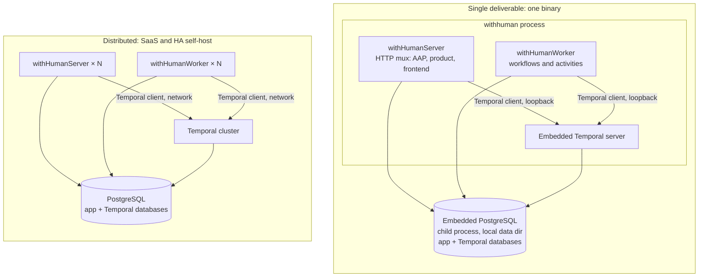

# Single-binary deployment mode

Status: draft · Last updated: 2026-08-27

> **Prototype.** Same caveat as
> [00-general-design.md](00-general-design.md): everything here can change
> without migration paths or backwards-compatibility constraints. Optimize for
> the right model.

## Summary

The withHuman provider must ship as **one self-contained deliverable**, a
single `withhuman` binary that runs the entire product with no external
services to install: no separate Temporal deployment, no PostgreSQL server to
provision, no Compose stack. Starting that binary with zero configuration
yields a working provider for local use, evaluation, demos, and hermetic
integration tests.

At the same time, the distributed topology described in
[03-provider-architecture.md](03-provider-architecture.md) remains the
hosted edition's production shape: independently scalable `withHumanServer`
and `withHumanWorker` replicas, a Temporal cluster, and managed PostgreSQL.
The single binary is what core ships. It is not a fork or a simplified
re-implementation: the same components, compiled together, wired over
loopback instead of a network.

Persistence in single-binary mode is **embedded PostgreSQL**, not SQLite. The
binary manages a real PostgreSQL server as a child process using
`github.com/fergusstrange/embedded-postgres`: platform-specific PostgreSQL
binaries (32 MB compressed, from the zonky.io builds) are extracted once into
the data directory and started with `pg_ctl` against a local data path. An
earlier revision of this document specified SQLite behind a portable-SQL
store. Implementation disproved that plan's cost estimate: the store layer
depends on serializable transactions with row locks, `text[]`, jsonb, and
plpgsql triggers that enforce product invariants (append-only decisions and
audit events, terminal-request immutability, the last-owner rule). Porting
that to a second dialect meant rewriting the entire store and weakening the
schema, plus a permanent dual-engine CI matrix. Embedded PostgreSQL deletes
all of that: one engine, one store, one schema, perfect dev/prod parity.

The embedded engine was validated by spike against the real store and
migrations before this revision:

- All store code, the plpgsql triggers, and the serializable and
  `FOR UPDATE` paths run unchanged.
- Data persists across restarts when the data path is separated from the
  library's runtime path.
- Start is roughly 170 ms and stop roughly 110 ms once binaries are
  extracted; only the first-ever run pays download and extraction (about
  10 s).
- `kill -9` on the postmaster followed by a fresh start recovers by WAL
  replay in under 200 ms with committed data intact.

Concretely, the single-binary mode:

- Runs embedded PostgreSQL as a managed child process, one instance holding
  the withHuman application database and the Temporal databases, mirroring
  the shared-instance shape in
  [03-provider-architecture.md](03-provider-architecture.md).
- Embeds the Temporal server in-process, persisting to that PostgreSQL
  instance through Temporal's standard production SQL plugin (avoiding
  Temporal's dev-grade SQLite persistence entirely).
- Runs the `withHumanWorker` workflow and activity code in-process,
  connected to the embedded Temporal over loopback.
- Serves the embedded React frontend, the AAP API, and the product API from
  one port, as `withHumanServer` already does.
- Applies Temporal schema setup and application migrations automatically at
  startup.

## Goals

- One `withhuman` binary that starts a complete provider with zero required
  configuration.
- Identical component boundaries, lifecycle semantics, consistency rules,
  and persistence engine in both topologies. Only process placement and who
  operates PostgreSQL differ.
- A hermetic in-process harness so `go test` can boot the full product
  without Docker or external services.
- Keep the distributed binaries lean: SaaS builds of `withhuman-server` and
  `withhuman-worker` should not pay for the embedded Temporal server's
  dependency graph or the embedded-PostgreSQL machinery.

## Non-goals

- Replacing the distributed topology. The hosted SaaS and serious self-hosted
  deployments continue to run the shape in
  [03-provider-architecture.md](03-provider-architecture.md).
- Supporting a second database engine. PostgreSQL is the only persistence
  engine in every topology.
- Running the single binary as root inside a bare container. PostgreSQL
  refuses to run as root; containerized deployments are what the Compose
  stack and distributed binaries are for. The single binary targets laptops,
  VMs, and CI.
- A plugin or dynamic-loading system. Both topologies are compiled,
  statically wired Go programs.
- Bundling the marketing website or the closed-source mobile applications.

## The load-bearing rule

Both topologies stay possible only if one invariant holds everywhere:

> **No component may assume co-location.** Server, worker, Temporal, and
> PostgreSQL communicate through the same client interfaces in both modes.
> In the single binary those interfaces happen to cross loopback sockets,
> but no code path shares in-memory state across the server/worker boundary
> or calls across it directly.

This is already stated as a requirement in the component architecture ("any
potentially out-of-band process communicates over the network so it can
split into its own container"). This document makes it symmetric: the
network boundary must also be collapsible. The earlier revision's second
invariant ("no component may assume PostgreSQL") is withdrawn: PostgreSQL is
now a stated assumption of the whole system, and store code may use it
fully.

## Topologies

The boxes are the same modules in both diagrams, and the database layout is
the same shared-instance, separate-logical-databases shape in both. The
composition roots differ.

## Composition roots

The distributed deployment's binaries (`saas-server`, `saas-worker`,
`saas-migrate`) are the hosted edition's, composed from core's exported
`runtime` package. Core's own composition root is the single binary:

- **`cmd/withhuman`**: starts embedded PostgreSQL, creates the application
  and Temporal logical databases, applies Temporal schema setup and
  application migrations, starts the embedded Temporal server, and runs the
  worker and HTTP server in the same process. Shutdown proceeds in reverse
  order, stopping PostgreSQL last.

Each component is a constructor-shaped module that takes its dependencies
(a store, a Temporal client, listeners) as arguments. The distributed
binaries instantiate one module each from network configuration;
`cmd/withhuman` instantiates all of them from defaults.

A separate `main` is preferred over a Loki-style `--target` flag on one
binary for a specific reason: the embedded Temporal server drags in a very
large module graph and adds on the order of 100 MB to the binary, and the
embedded-PostgreSQL machinery adds its own weight. Keeping both behind
`cmd/withhuman` and its wiring package (which nothing else imports) means
`withhuman-server` and `withhuman-worker` builds never pay for them.

### Embedded PostgreSQL lifecycle

The library wipes its runtime path on every start, so the layout separates
concerns inside the data directory:

- `<data-dir>/postgres/binaries`: extracted PostgreSQL binaries, written
  once and reused (this is what makes warm starts fast).
- `<data-dir>/postgres/data`: the persistent database cluster.
- `<data-dir>/postgres/runtime`: the library's disposable runtime path.
- `<data-dir>/postgres/cache`: the downloaded archive cache.

Because PostgreSQL is a child process, the composition root owns two pieces
of lifecycle hygiene:

- **Stale postmaster sweep.** If the parent dies hard, the orphaned
  postmaster keeps running and correctly blocks the next start via
  `postmaster.pid`. On startup, if the pid file names a live process that is
  using our data directory, terminate it before starting.
- **Ordered shutdown.** Stop the HTTP server, worker, and Temporal before
  stopping PostgreSQL, so nothing writes into a closing database.

Unclean shutdown of PostgreSQL itself is handled by PostgreSQL: the spike
confirmed automatic WAL recovery after `kill -9`.

### Defaults

`withhuman` with no flags:

- Creates or opens a data directory (default `~/.withhuman` or
  `--data-dir` / `WITHHUMAN_DATA_DIR`).
- Listens on one port for everything: AAP API, product API, SSE, and the
  embedded frontend.
- Binds embedded PostgreSQL and the embedded Temporal service to loopback
  only, on ephemeral ports. Nothing internal is reachable from outside the
  machine except the single HTTP port.
- Generates and persists the bootstrap secret in the data directory on first
  run (environment override wins).

## Persistence

PostgreSQL is the only engine, in every topology. The embedded instance
holds the same logical databases the distributed deployment uses: the
withHuman application database and the Temporal-owned databases, with the
same ownership boundary rules as
[03-provider-architecture.md](03-provider-architecture.md): withHuman code
never touches Temporal's tables in either mode.

The store layer, schema, migrations, and triggers are shared verbatim
between topologies. There are no dialect shims, no portable-SQL subset, and
no second migration directory. The application migrations are embedded into
the binaries so `withhuman` and the hosted edition's `saas-migrate` carry
their schema with them.

### Binary distribution

The PostgreSQL archive for the running platform (about 32 MB) is fetched
from the binary repository on first run and cached in the data directory;
every later start is offline. Go binaries are already built per platform, so
the build can alternatively `go:embed` the matching archive to make even the
first run network-free. Ship the download-on-first-run behavior initially
and treat fully offline first-run as an open question below.

Platform coverage from the zonky.io builds: Linux amd64 and arm64, macOS
(universal binaries with native arm64), Windows amd64.

## Temporal in-process

The embedded Temporal server is started as a library inside `cmd/withhuman`,
bound to loopback, persisting to the embedded PostgreSQL through Temporal's
standard SQL plugin, the same persistence path production Temporal
deployments use. Server and worker modules receive an ordinary Temporal SDK
client pointed at that loopback address. No workflow, activity, or server
code knows whether Temporal is embedded.

Costs accepted deliberately: embedding pins Temporal server versions and
inflates build time and binary size for the `withhuman` target only, per the
composition-root split above.

Everything in the provider architecture doc about synchronous policy
evaluation, durable pending handoff, idempotent activities, creation
acknowledgement, and terminal-state ordering applies unchanged. In the single
process topology, a Temporal or worker failure does not affect automatic CEL
decisions while the HTTP server and PostgreSQL remain healthy. Requests that
require human review remain pending and fail closed until orchestration
recovers.

## Migrations and startup

Distributed mode keeps explicit migration steps
(the hosted edition's `saas-migrate`, Temporal-owned tooling) exactly as specified in
[03-provider-architecture.md](03-provider-architecture.md).

Single-binary mode runs the same steps embedded in startup, in the same
order: PostgreSQL available, Temporal schema setup, application migrations,
then worker and server start. There is no replica race because there is one
process. The process does not report ready until all steps complete.

## Testing

The single-binary composition root doubles as the integration-test harness.
A test helper boots the full product in-process on ephemeral ports with a
temporary data directory, and tests exercise the real AAP and product HTTP
APIs end to end: no Docker, no Compose, no shared state between tests. With
the extracted-binaries cache warm, PostgreSQL contributes well under a
second per boot. The harness is also the strongest structural guarantee that
single-binary mode keeps working: the test suite depends on it.

## Risks

- **Subprocess lifecycle.** PostgreSQL is a child process: orphan sweep on
  startup, ordered shutdown, and port hygiene are the composition root's
  job. The failure modes were exercised by spike and are conventional.
- **Dependency weight from the embedded Temporal server and PostgreSQL
  tooling.** Contained to the `withhuman` target via the composition-root
  split; can be moved to a separate Go module if it starts affecting the
  rest of the repo.
- **`embedded-postgres` maintenance cadence is slow** (roughly one release
  per year). The library's surface is small (download, extract, `pg_ctl`),
  it is MIT licensed, and vendoring or forking is a viable exit.
- **Accidental co-location assumptions.** The distributed Compose stack
  remains a supported deployment exercised by the smoke script, so a change
  that only works in one process fails there.

## Open questions

- Does single-binary mode ever graduate to a supported small-team production
  self-host, or does it stay a local/eval/test configuration? The engine is
  production PostgreSQL either way; graduating is mostly a backup story for
  the data directory plus stated scale limits.
- Should the platform PostgreSQL archive be `go:embed`ded for a fully
  offline first run, at the cost of about 32 MB of binary size, or does
  download-on-first-run with a cache suffice?
- Should `withhuman` expose optional flags to point at external PostgreSQL
  or Temporal (a hybrid mode), or is any external dependency a signal to use
  the distributed binaries?
- Where do notification provider credentials fit in single-binary defaults:
  disabled by default, or prompted into the data directory's config on first
  run?
