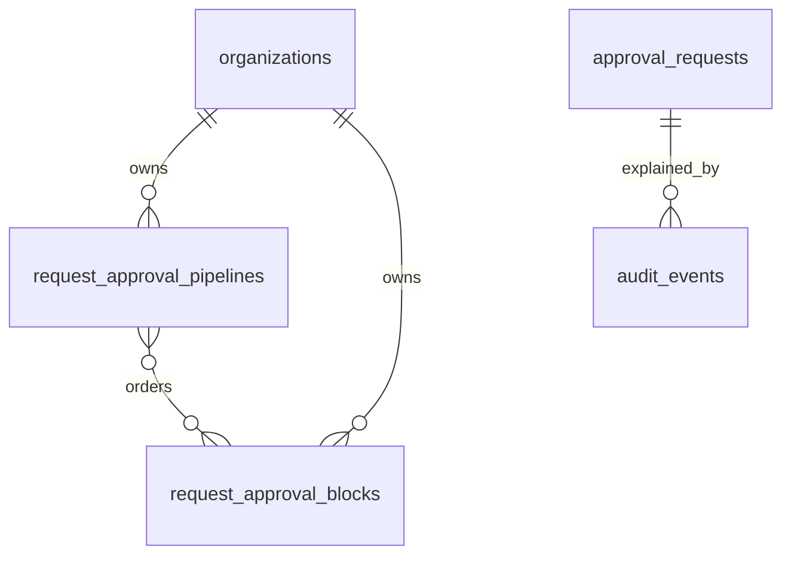
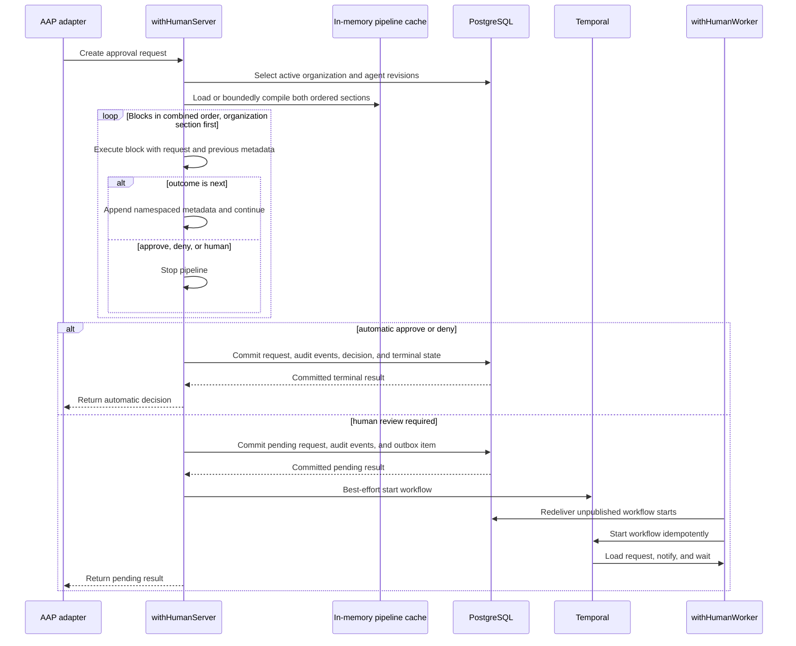

# withHuman: request approval pipeline storage and APIs

Status: accepted · Last updated: 2026-09-29 (agent-owner route keys)

## Summary

A `RequestApprovalPipeline` is an organization-owned, ordered program in one
of two scopes: the organization scope, which applies to every agent, or one
agent scope. At runtime the effective pipeline is the organization
pipeline's blocks followed by the agent pipeline's blocks; either section
may be absent. `RequestApprovalBlock` values run one after another
and return `approve`, `deny`, `human`, or `next`. The first terminal outcome
wins; falling through the combined list or encountering an execution failure
requires a human. A `branch` block holds its own ordered blocks and runs them
only for requests its condition matches (see
[branch blocks](15-branch-blocks.md)). See the
[execution model](01-request-approval-pipeline.md#execution-model-one-function-body)
for the concatenation and precedence semantics.

The persistence model deliberately uses only two new domain tables:

- `request_approval_pipelines` stores immutable numbered revisions, whether a
  revision is active, and its block-ID array, listing every block in
  pre-order, including the blocks inside branches;
- `request_approval_blocks` stores immutable block snapshots.

The existing append-only `audit_events` table stores pipeline selection,
ordered block outcomes, failure evidence, and the final pipeline result. There
are no separate version, artifact, pipeline-evaluation, block-evaluation, or
test-case tables.

Compiled CEL programs are process-local cache state, not audit data. Server
replicas compile and cache every active immutable revision before readiness,
then use bounded singleflight compilation for request-path misses after a
revision changes on another replica. Temporal workers hold the same compiled
state so they can resume pipelines suspended before an asynchronous block
(see [08-llm-judge-block.md](08-llm-judge-block.md)); the resume runs on the
revisions the suspension pinned, active or not.

## Terminology

- `RequestApprovalPipeline` is one immutable revision for one scope: an
  `(organization_id, agent_slug)` pair, or the organization scope where
  `agent_slug` is null.
- `revision` is the monotonic version number within that scope.
- The active revision is the only revision in its scope selected for new
  requests. Every live scope has exactly one active revision at all times;
  an archived agent's scope has none. A run selects two active revisions,
  one per scope.
- `RequestApprovalBlock` is an immutable executable snapshot referenced by one
  or more pipeline revisions.
- A pipeline run is identified by a generated `pipeline_evaluation_id` carried
  in audit-event data; it is not a standalone database resource.

Organization authentication policy and adapter gating/redaction policy remain
separate concepts. The overall approval lifecycle surrounds pipeline
execution, and routing begins after a `human` outcome.

## Selection and the effective pipeline

`agents` has a required immutable `slug` matching
`^[a-z0-9][a-z0-9._-]{0,62}$`, chosen once and unique per organization
across live and archived rows alike, and an editable display `name` that is
unique among live rows. Agent instances belong to their parent agent and
cannot select another. Request input cannot select a pipeline.

The runtime selects up to two rows with `is_active = true`: the organization
scope row (`agent_slug IS NULL`) and the row matching the authenticated
agent's slug. The effective pipeline is the organization revision's blocks
followed by the agent revision's blocks, executed as one ordered list.
Organization blocks run first, so an organization outcome takes precedence
over every agent block.

A live scope always has an active revision: the organization scope is
created with the organization and an agent scope with the agent, each as an
empty revision 1 that passes every request through. An empty section
decides nothing; when both sections are empty, the request requires human
review. An invalid block reference or a selected revision that cannot be
compiled, in either scope, also requires human review; the run never
executes a partial effective pipeline. There is no fallback to another
agent. The runtime still tolerates a scope it cannot find, as a defensive
path that the product never reaches: an archived agent's credentials are
revoked with it, so its inactive scope is never selected.

## Sequential block contract

Each block receives the canonical request, provider-owned agent metadata, and
namespaced metadata returned by earlier blocks:

```json
{
  "request": {
    "tool": "stripe.refund",
    "server": "stripe",
    "arguments": { "amount_cents": 900 }
  },
  "agent": {
    "slug": "billing",
    "name": "Billing agent"
  },
  "previous_metadata": {
    "organization/risk-classifier": { "risk": "low" }
  }
}
```

A block returns:

```json
{
  "outcome": "next",
  "reason": "No refund threshold matched.",
  "metadata": { "threshold_checked": true }
}
```

`approve` and `deny` terminate automatically. `human` terminates automation and
enters the built-in human approval process. `next` adds bounded metadata under
the current stable block key and advances. End of the combined list, invalid
output, error, timeout, or exhausted retries becomes `human`. A branch's
condition returns `enter` or `next` instead, and running out of an entered
branch becomes `human` with the branch's reason and escalation path.

Metadata flows across the section boundary: an agent block sees metadata
written by organization blocks. Block keys are unique within one revision,
including the blocks inside branches, but the two revisions are versioned
independently, so the runtime namespaces `previous_metadata` keys by scope,
as `organization/<block_key>` and `agent/<block_key>`, and equal keys across
sections cannot collide. Nesting adds no namespace: a block inside a branch
writes under its own key.

No later block runs after a terminal outcome, or after a branch the request
entered. Block order is authorization behavior and is frozen in each
pipeline revision; the organization section always precedes the agent
section.

## CEL block

The `always` block stores `config.outcome` (`approve`, `deny`, or `human`),
a required `config.reason`, and optional `config.escalation_path` for `human`,
with optional `config.ask_agent_owner` beside it (see
[06-routing-and-escalation.md](06-routing-and-escalation.md#agent-owner-route)).
It has no condition tree. Its synchronous runtime returns the configured
outcome and reason, with zero condition cost and no condition trace, through
the same fail-safe execution boundary as other blocks. It uses a 50ms default
timeout, a 1s maximum, and exactly one attempt. The Go DSL exposes
`DefineAlways(id, outcome, options...)`. Registry config version is 1.

An Always block ends execution, including before agent blocks when placed in
the organization section. Every later block still undergoes normal validation
and dependency checks. The editor marks later blocks and the fall-through
terminus unreachable without rejecting the revision. Default escalation paths
remain effective for human outcomes that inherit them.

The `cel` block stores a canonical condition
tree and a fixed `on_match` outcome:

```json
{
  "id": "small-refund",
  "name": "Approve small refunds",
  "type": "cel",
  "timeout": "50ms",
  "max_attempts": 1,
  "config": {
    "when": {
      "id": "21aa670a-734c-454c-a1e9-653d54be054b",
      "all": [
        {
          "id": "5d79dc6a-5f7d-4e70-aeb1-dcd682e77322",
          "field": "/request/tool",
          "operator": "equals",
          "value": "stripe.refund"
        },
        {
          "id": "833f08e6-c7b4-47c6-927b-1d27a93cd957",
          "field": "/request/arguments/amount_cents",
          "operator": "less_than",
          "value": 1000
        }
      ]
    },
    "on_match": "approve",
    "reason": "Small refunds are pre-authorized."
  }
}
```

A match returns `on_match`; a non-match returns `next`; a CEL error returns
`human`. v1 CEL fields are limited to `/request/tool`, `/request/server`,
`/request/arguments`, `/agent/slug`, `/agent/name`, and
`/previous_metadata/<scope>/<block_key>`. `request.server` is absent for a
runtime's built-in tools, so only `not_exists` matches them on that field.

The complete CEL authoring and evaluation model is defined in
[CEL request approval block](02-cel-policy-engine.md).

## Branch block

The `branch` block, the fifth type after `always`, `cel`, `llm_judge`, and
`webhook`, has a condition (`when`, the CEL envelope), its own ordered
blocks of any type, a required `reason`, and an optional `escalation_path`
(with optional `ask_agent_owner`).
A non-match skips its blocks; a match runs them, and a request that no block
inside decides goes to a human with the branch's reason and path, after
which nothing else runs. The envelope matches `cel`: a 50ms default timeout,
a 1s maximum, and exactly one attempt. Registry config version is 1.

Documents nest a branch's blocks under `config.blocks`. Storage does not:
every block, nested or not, is its own immutable snapshot row, and a branch
row stores its children by key:

```json
{
  "when": {
    "id": "6c1f0e2a-4b7d-4e35-9a1c-8d2b5f3e7a90",
    "field": "/request/tool",
    "operator": "equals",
    "value": "stripe.refund"
  },
  "block_keys": ["fraud-check", "refund-eligibility", "small-refunds"],
  "reason": "No refund check decided, so Payments reviews the refund.",
  "escalation_path": "payments-review"
}
```

`block_keys` names the branch's direct children in order, and the
revision's `block_ids` lists the branch before its subtree (pre-order), so
reads rebuild the tree from the rows alone. Because the stored config names
children by key, not by snapshot ID, an unchanged branch row is reused when
only a child changes. The semantics, execution, and evidence are defined in
[branch blocks](15-branch-blocks.md).

## Relational model



PostgreSQL cannot declare a normal foreign key over individual UUID array
elements. A constraint trigger validates every `block_ids` element during a
pipeline insert, including organization ownership and uniqueness. Application
validation performs the same check before the write for better errors.

### `request_approval_pipelines`

Each row is one immutable content revision. Only `is_active` and
`archived_at` may change after insertion.

| Column | Type | What it stores | Purpose |
| --- | --- | --- | --- |
| `id` | `uuid` | Identity of this pipeline revision | Gives audit events and operational logs a stable snapshot reference |
| `organization_id` | `uuid` | Owning organization | Enforces tenant isolation and participates in selection |
| `agent_slug` | `text`, nullable | The owning agent's slug; null means the organization scope | Selects which agent uses this revision; the organization scope applies to all |
| `revision` | `bigint` | Monotonic revision within the scope | Orders history and provides a human-readable rollback target |
| `is_active` | `boolean` | Whether new requests select this revision | Allows an atomic active-revision switch without another versions table |
| `block_ids` | `uuid[]` | Every immutable block snapshot ID in pre-order: each branch before the blocks inside it | Defines exact sequential execution order and nesting in one row |
| `created_by_membership_id` | `uuid` | Membership that created the revision | Preserves direct historical provenance without granting ownership |
| `created_at` | `timestamptz` | Revision creation time | Orders administrative history and supports audit correlation |
| `archived_at` | `timestamptz`, nullable | When the owning agent was archived; null while the scope is live | Keeps an archived agent's history readable while refusing new revisions and activation |

Required database behavior:

- `UNIQUE (organization_id, agent_slug, revision)` plus a partial unique
  index on `(organization_id, revision) WHERE agent_slug IS NULL`, so the
  organization scope (null `agent_slug`, which plain unique constraints do
  not constrain) has one revision sequence like any agent.
- `UNIQUE (id, organization_id)` for tenant-safe references.
- Partial unique indexes on `(organization_id, agent_slug) WHERE is_active`
  and `(organization_id) WHERE is_active AND agent_slug IS NULL`, so at most
  one revision per scope is selected.
- `revision > 0`, valid slug format when non-null, non-null block array,
  and no duplicate block IDs within the array.
- A trigger rejects update or delete except an `is_active` transition and
  the `archived_at` stamp or clear performed by agent archive and restore.
- Activating, rolling back, seeding, archiving, or restoring a scope obtains
  a transaction-scoped lock for the scope: `organization_id` plus the agent
  slug, or the `@organization` sentinel for the organization scope ('@' is
  outside the slug alphabet, so the sentinel cannot collide). This prevents
  two concurrent active rows in one scope.

The active revision acts as the concurrency token. A mutation supplies the
expected active revision through `If-Match`; if another administrator has
changed it, the operation returns `412 Precondition Failed`.

There is no mutable server-side draft row. Clients may keep local drafts or
preview a transient complete document. Creating a revision persists an
immutable candidate; activation is a separate operation.

### `request_approval_blocks`

Blocks are immutable and may be reused by multiple revisions in the same
organization. Editing a block creates a new block row and a new pipeline
revision referencing it.

| Column | Type | What it stores | Purpose |
| --- | --- | --- | --- |
| `id` | `uuid` | Immutable block-snapshot identity | Lets revision arrays reuse an unchanged block without copying its configuration |
| `organization_id` | `uuid` | Owning organization | Prevents cross-tenant block references |
| `block_key` | `text` | Stable user-facing identity such as `small-refund` | Correlates logical blocks across revisions and audit events |
| `name` | `text` | Display name | Supports administration and explanations |
| `block_type` | `text` | Executor registry key such as `cel` | Selects the validator and runtime implementation |
| `config_version` | `integer` | Version of the type-specific JSON shape | Lets the runtime reject configuration it cannot safely interpret |
| `config` | `jsonb` | Canonical immutable block configuration | Stores CEL condition trees, a branch's child keys, and other type-specific settings |
| `timeout_ms` | `integer` | Maximum duration for one attempt | Bounds block execution |
| `max_attempts` | `integer` | Maximum attempt count | Bounds retry behavior; CEL requires one attempt |
| `content_hash` | `text` | SHA-256 of canonical block content | Supports deduplication, integrity checks, and audit comparison |
| `created_by_membership_id` | `uuid` | Membership that created the block snapshot | Preserves direct provenance |
| `created_at` | `timestamptz` | Snapshot creation time | Supports history and audit correlation |

Required constraints include `UNIQUE (id, organization_id)`, a uniqueness rule
for `(organization_id, content_hash)`, positive bounded timeout and attempts,
and an append-only trigger. The application block registry validates
`block_type`, `config_version`, and `config`.

`block_key` need not be globally unique because several historical snapshots
may represent the same logical block. A single pipeline revision cannot contain
two block IDs with the same `block_key`; the array-validation trigger enforces
that invariant. Because `block_ids` includes the blocks inside branches, keys
are unique across the whole tree.

### Existing `audit_events`

Execution evidence uses the existing append-only table rather than dedicated
evaluation tables. Every event uses:

- `organization_id` from the authenticated request;
- `subject_type = 'approval_request'`;
- `subject_id = approval_requests.id`;
- a generated `pipeline_evaluation_id` inside `data` to correlate one run;
- both selected pipeline revision IDs and revision numbers inside `data`.

Three event types represent execution. A run that finds no active revision
in either scope (a defensive path the product never reaches, since every
scope has one) writes only the completed event; selected runs write all
applicable events:

| Event type | When written | Safe `data` fields |
| --- | --- | --- |
| `request_approval_pipeline.started` | After selecting the active revisions | Evaluation ID, agent slug, per-scope pipeline ID and revision, combined block count, runtime fingerprint |
| `request_approval_block.evaluated` | Once for every attempted block, plus a closing event for a branch the request runs out of | Evaluation ID, scope, owning pipeline ID, block ID/key/type, pre-order position, outcome (`enter` when a branch's condition matched), attempt count, cost, safe error code, bounded safe metadata, value-free node trace; `end_of_branch: true` on a branch's closing event |
| `request_approval_pipeline.completed` | After a terminal outcome or fall-through | Evaluation ID, outcome, reason code, terminal block ID/key and scope when present, attempted-block count, total attempts, total cost, duration |

Stable completion reason codes include `block_outcome`, `end_of_pipeline`
(the end of the combined list), `end_of_branch` (no block in an entered
branch decided; the branch is the terminal block), `no_active_revision`
(neither scope has an active revision), `compiled_cache_unavailable`,
`block_error`, `block_timeout`, `retries_exhausted`, and
`invalid_block_output`.

A branch's closing event records outcome `human`, the branch's reason,
`attempt_count` 0, cost 0, and an empty trace. It adds nothing to the
attempted-block count, total attempts, or total cost.

The request, all execution events, automatic decision when applicable, request
state, and request audit summary commit in one database transaction. `human`
creates a pending request without a decision. Event insertion order follows
block execution order and the table's `sequence` provides a stable read order.

Add this index for explanations:

```sql
CREATE INDEX audit_events_subject_sequence
    ON audit_events (organization_id, subject_type, subject_id, sequence);
```

The explanation endpoint reconstructs the run from these events. Audit data
never includes raw request values, configured comparison values, credentials,
or free-form internal errors.

### Existing `agents`, `approval_requests`, and `decisions`

`agents` has a required immutable `slug`, unique per organization including
archived rows, and an editable `name`, unique among live rows. The table
keeps a hidden UUID primary key for foreign keys, role-assignment principal
ids, and audit subject ids; the API, URLs, CLI, and UI never expose it.
`approval_requests` denormalizes the authenticated agent's `agent_slug`,
used for selection, and its `agent_name` at request time, so a later rename
or archive of the agent does not rewrite history.

`decisions` has `source: human | pipeline | system`. Pipeline `approve` and
`deny` use `pipeline`; reviewer decisions use `human`; expiry uses `system`.
The corresponding audit events provide the decision explanation.

These fields are product/internal metadata. AAP continues to expose its
existing terminal status and attribution shape.

## In-memory compiled state

There is no artifact table and compiled bytes are never written to
`audit_events`. A compiled program is derived runtime state rather than a fact
about a historical action.

Server replicas maintain a process-local cache keyed by
`(pipeline_revision_id, runtime_fingerprint)`. Each entry contains validated
block executors in pre-order, where each branch knows where its subtree ends,
and compiled CEL programs for `cel` blocks and branch conditions. Every
active revision is
compiled during server startup, and readiness remains closed unless the whole
startup set compiles successfully under the current runtime fingerprint.
Activation and rollback compile and populate the local cache before the active
switch. Deactivation removes the local active entry. Other replicas discover a
newly active immutable revision on selection and populate one request-path miss
through bounded singleflight compilation.

Runtime fingerprints cover the CEL dependency, declarations, helper semantics,
compiler options, and fixed limits. A fingerprint change selects distinct
entries and startup recompiles all active revisions before a new replica becomes
ready. Old and new replicas can therefore overlap safely during a rolling
deployment without sharing compiled programs. Compilation failure, timeout,
unavailable cache state, an ownership mismatch, or unsupported configuration
requires human review. Temporal workers hold no pipeline cache and never
execute CEL.

Compiled entries are never persisted or placed in audit events. Immutable
revision IDs make entries safe to reuse within one fingerprint, while the
organization-scoped block reload protects tenant boundaries on every compile.

## Revision lifecycle

### Scope creation

A scope is never created through the editor. The transaction that
activates an organization writes the organization scope's revision 1, and
the transaction that inserts an agent (agent creation or device-code
enrollment) writes that agent's revision 1, keyed by the agent's slug. The
revision is empty, active, has no default escalation path, and is recorded
as created and activated by the person whose action brought the scope into
being, with the same two audit events a hand-written revision would emit.
Every agent owns exactly one pipeline; creating a revision for a slug that
names no agent is refused as not found.

### Archive and restore

The agent's lifecycle carries its pipeline with it. Archiving an agent
(`DELETE /api/v1/agents/{slug}`), in the same transaction, takes the scope
lock, stamps `archived_at` on every revision of the scope, and deactivates
the active one; the scope now has no active revision. Its history stays
readable through the revision routes, but creating a revision or activating
one is refused with 409 `request_approval_pipeline_archived`. A revision
for a slug that never belonged to an agent is still 404. The slug is never
reused, so an archived scope can never be shadowed by a new agent.

Restoring the agent (`POST /api/v1/agents/{slug}/restore`) reverses this in
the restore transaction: the stamps are cleared and the latest revision is
re-activated, audited as `request_approval_pipeline.restored` with the
agent slug and the revision brought back. Restore never seeds a fresh
revision; the agent continues from the history it had.

### Create a revision

The server accepts a complete ordered pipeline document, possibly with no
blocks at all: an empty revision is how a pipeline is made to pass
through. It validates all
block definitions, creates or reuses immutable block snapshots, validates and
compiles the ordered pipeline in memory, acquires the scope lock, assigns
`max(revision) + 1`, inserts the inactive revision, and emits
`request_approval_pipeline.revision_created`.

Revision creation does not change request behavior. A failed validation or
compilation creates neither blocks nor a revision because the operation is
transactional.

### Activate and roll back

Activation requires the current active revision through `If-Match`; there
always is one, so `"0"` is refused. The server compiles the target before
the transaction, then locks the scope, verifies the expectation, verifies
the target's references, sets the current row to inactive, sets the target
to active, and emits `request_approval_pipeline.activated`. A deferred
constraint trigger checks at commit that a live scope still has an active
row, so no statement can leave a live scope without one; only the archive
stamp lets a scope end a transaction with no active row.

The reference check runs inside the switching transaction because the
objects a revision points at can change underneath it: every escalation
path the revision names (a block's `escalation_path` or the revision's
`default_escalation_path`) must have an active revision, and so must every
webhook endpoint key its webhook blocks post to. The transaction takes each
named path's and each endpoint key's advisory lock, in sorted key order
after the scope lock, so a concurrent archive of either sees the
activation or waits for it. A refusal is 409 `escalation_path_inactive` or
`webhook_endpoint_inactive`, naming the keys in `details`.

Rollback is the same operation targeting an older revision. No content is
copied or rewritten, so an older revision may name a path that has since
been archived or an endpoint that has since been deleted; the same check
refuses it. `GET …/revisions/{revision}/references` reports each
dependency's current state ahead of time so the page can say why a
rollback would be refused before it is attempted.

There is no deactivate and no delete. A pipeline that should decide
nothing gets an empty revision activated. Historical revisions and blocks
remain append-only.

## Application APIs

These are product APIs under `/api/v1`, not AAP endpoints.

A scope is addressed as `organization` or `agents/{agent_slug}`. The two
segments cannot collide because `organization` sits outside the `agents`
collection. `{scope}` below stands for either form. Pipeline
representations carry `scope` (`organization` or `agent`) and, for the
agent scope only, `agent_slug`; a `PipelineUse` names the scope the same
way. Role scopes follow suit: `pipeline.read`, `pipeline.write`, and
`pipeline.activate` are held at the organization or at `agent:<slug>`, and
the permission check passes resource kind `agent` with the slug.

| Method and path | Permission | Behavior |
| --- | --- | --- |
| `GET /request-approval-pipelines` | `pipeline.read` (filtered to the agents held) | List both scopes: the organization pipeline and one pipeline per live agent, with active revisions and history summaries |
| `GET /request-approval-pipelines/{scope}` | `pipeline.read` @ scope | Read the scope's active revision and ordered blocks |
| `POST /request-approval-pipelines/{scope}/preview` | `pipeline.write` @ scope | Validate and execute a transient document and sample without persistence |
| `POST /request-approval-pipelines/{scope}/revisions` | `pipeline.write` @ scope | Create an immutable inactive revision from a complete document |
| `GET /request-approval-pipelines/{scope}/revisions` | `pipeline.read` @ scope | List immutable revisions |
| `GET /request-approval-pipelines/{scope}/revisions/{revision}` | `pipeline.read` @ scope | Read one revision and its ordered blocks |
| `GET /request-approval-pipelines/{scope}/revisions/{revision}/references` | `pipeline.read` @ scope | Live state of the paths, endpoints, and block runtimes the revision needs |
| `POST /request-approval-pipelines/{scope}/revisions/{revision}/activate` | `pipeline.activate` @ scope | Activate or roll back; require `If-Match`; refused while a reference is missing |
| `GET /requests/{id}/request-approval-pipeline-evaluation` | `request.read` | Reconstruct ordered execution evidence from audit events |

Preview executes the transient document in isolation; it does not prepend or
append the other scope's active revision. Previewing the combined effective
pipeline is deferred.

There are no draft, artifact, evaluation, or test-case resources.

## Domain and application boundaries

The domain defines `RequestApprovalPipelineRevision` and
`RequestApprovalBlock`. A pipeline revision contains ordered block IDs.
`Decision.Source` uses `human`, `pipeline`, or `system`.

- `RequestApprovalPipelineRepository` creates immutable blocks and revisions,
  validates arrays, lists history, and switches the active revision.
- `RequestApprovalPipelineAuditRepository` appends and reads correlated
  execution events through the existing audit table.
- `RequestApprovalBlockRegistry` maps a type and configuration version to its
  validator, compiler where needed, and executor.
- A block executor consumes immutable configuration and logical input and does
  not write to the database. CEL performs no I/O.

Every application operation accepts one named validated input struct and every
repository call carries the organization ID.

## Synchronous execution and human handoff

Pipeline execution occurs in the API request path. Temporal begins only after
the pipeline requires asynchronous human review:



The selected revisions are immutable even if another revision activates during
execution. If the product transaction did not commit, an HTTP retry may select
the revisions active at retry time. After commit, request idempotency returns
the stored result and its audit events instead of executing again. Automatic
results never start a workflow. Pending results are safe across a server crash
because the workflow-start outbox item commits in the same transaction.

## Operations and trade-offs

Metrics are emitted during execution rather than aggregated from normalized
evaluation tables. They include active revisions, cache compilation failures,
blocks executed per request, outcomes, attempts, timeouts, errors by safe code,
CEL cost, metadata size, and total latency.

The reduced schema has these benefits:

- only two new domain tables;
- no joins through a separate versions table;
- one row loads exact execution order;
- immutable blocks can be reused across revisions;
- audit and explanation history use the existing append-only mechanism.

It accepts these costs:

- UUID arrays have no native element foreign keys and need a constraint
  trigger;
- per-block analytics require scanning or indexing JSON audit data;
- reconstructing an explanation reads several ordered audit events;
- changing a block always creates a new immutable block and pipeline revision;
- startup compilation work repeats on every server replica;
- a revision activated through another replica may impose one bounded
  first-request compilation;
- inactive, unreferenced block snapshots require a later garbage-collection
  policy if storage growth becomes material.

## Validation and acceptance

- Enforce exactly one active revision per live scope (organization, and
  each agent) under concurrent activation and rollback, and refuse any
  statement that would leave a live scope without one.
- Prove organization activation, agent creation, and device-code
  enrollment seed the scope's empty active revision exactly once, and that
  a revision cannot be created for a slug that names no agent.
- Prove archiving an agent stamps every revision of its scope and
  deactivates the active one in the archive transaction, that revision
  creation and activation on the archived scope return 409
  `request_approval_pipeline_archived`, and that restoring the agent clears
  the stamps and re-activates the latest revision with a
  `request_approval_pipeline.restored` event.
- Prove the effective pipeline executes organization blocks before agent
  blocks, that an organization terminal outcome preempts agent blocks, and
  that either section may be empty.
- Prove a request whose agent pipeline is empty still executes the
  organization section, and that a request with both sections empty
  requires human review.
- Reject duplicate, missing, or cross-organization block IDs and duplicate
  logical block keys in an ordered array.
- Reject updates to pipeline content or immutable blocks.
- Prove revisions increase monotonically and `If-Match` rejects stale active
  switches.
- Prove server replicas use bounded singleflight compilation on a request-path
  cache miss and fail safely to human review.
- Prove startup compiles every active revision and readiness stays closed after
  any startup compilation failure.
- Prove activation, rollback, and runtime fingerprint changes refresh or
  isolate compiled state without crossing organization boundaries.
- Prove the first terminal outcome stops execution and later blocks emit no
  events.
- Prove a skipped branch runs none of its blocks, an entered branch commits
  the request, and a request that runs out of a branch writes the branch's
  closing event, completes with `end_of_branch`, and routes to the branch's
  escalation path or the pipeline default.
- Prove `block_ids` round-trips a nested document in pre-order, reuses an
  unchanged branch row when only a child changes, and refuses a malformed
  stored tree.
- Prove fall-through, invalid output, runtime or compilation failure, timeout,
  and exhausted retries require human review.
- Prove the request, correlated execution events, automatic decision, state,
  and audit summary commit atomically.
- Prove automatic decisions do not contact Temporal or consume pending-request
  capacity, while pending requests atomically create a durable workflow-start
  outbox item.
- Prove explanation reconstruction returns ordered safe events and no request
  values, credentials, or unrestricted errors.
- Prove preview inputs and compiled programs are never persisted.

## Deferred capabilities

- Arbitrary-code block executors.
- Previewing the combined effective pipeline across both scopes.
- Routing, reviewer groups, quorum, escalation, and reassignment as configurable
  blocks. In v1, `human` enters the built-in process.
- Conditions over adapter context, agent reasoning, or timeout.
- Mutable server-side drafts, revision branching, merge review, or mandatory
  second-administrator activation approval.
- Automatic retention or garbage collection of unused blocks, inactive
  revisions, preview data, or audit evidence.
