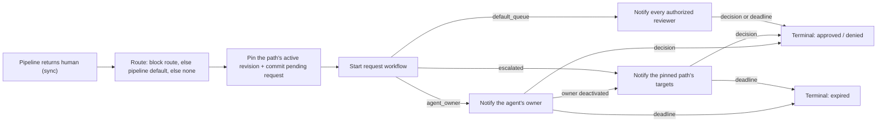

# withHuman: reviewer routing and escalation

Status: implemented · Last updated: 2026-09-29 (agent-owner route;
self-approval policy removed)

## Summary

Routing answers **who should decide** a request after the request approval
pipeline returns `human`. Escalation answers **what happens when they do not
respond**. Both are provider-side configuration, invisible to AAP: the
adapter still sees only `pending` and then a terminal decision.

The earlier design carried a third object, an organization-wide ordered
list of routing rules that re-classified a request after the pipeline had
already classified it. It is gone. The pipeline that decides *whether* a
human is needed also says *which* escalation path handles it:

1. **Escalation paths stay first-class.** An escalation path is an
   organization-owned, revisioned document with a stable key and a name,
   listed and edited on its own screen. It decides who is notified, in
   what order, on what timers.
2. **A path on the exit.** Every block whose outcome can be `human` (a
   conditions block with `on_match: human`, a judge verdict mapped to
   `human`, a webhook that may answer `human`) may name the escalation
   path it hands the request to.
3. **A pipeline default.** Each pipeline revision (organization scope and
   agent scope) may carry `default_escalation_path`. A request that
   falls through the pipeline, or exits through a human outcome that names
   no path, goes there. The agent section's default wins over the
   organization's; with neither, the request waits for any authorized
   reviewer in the queue.
4. **Paths can read the request.** A branch in a path tests the clock,
   the urgency, or the request itself with the same condition envelope
   pipeline blocks use.
5. **Or the agent's owner.** Wherever a path can be named, the exit may
   instead ask the person who owns the agent, naming a fallback path for
   requests from agents that have no owner. See
   [Agent-owner route](#agent-owner-route).

Two properties still distinguish approval routing from incident paging.
The terminal event is a decision, not an acknowledgement, and every
request carries a hard deadline whose expiry is a terminal denial, so
escalation spends a bounded budget. And routing only chooses who is told
and who may decide; any target of the pinned path can act from the queue
whether or not they were notified yet.

## Why the rule list went away

- The same condition was authored twice: once in the block that decided a
  human was needed, once in the routing rule that decided which path.
- Nothing connected the two screens. A pipeline author saw "Ask a human",
  believed they were done, and every such request landed in the default
  queue until they found Routing.
- Cross-cutting ownership ("any Stripe call goes to the payments path") is
  still one statement: a block in the organization section, whose exit
  names the path. The organization section runs before every agent,
  which is exactly the scope the rule list used to have.

## Position in the lifecycle

Pipeline evaluation is synchronous in the request path. When the outcome is
`human`, the executor also resolves the **route**: the terminal block's
route, else the effective pipeline default, else none
(`application.HumanReviewRoute`). A route is an escalation path, or the
agent's owner with a fallback path. The routing service pins the path's
active revision in the same transaction that commits the pending request,
so later edits never re-route it. A suspended pipeline (judge or webhook
block) is routed by the worker after the resume, and only if it still
needs a human.

The request carries its owner from the moment it is created: the
instance that raised it resolves to its owner's membership during
authentication, and the request records it as `requester_membership_id`
before the pipeline runs. Routing, including a routing after a resume,
reads the owner from the request, never from the instance.



## Concepts

- **Escalation path**: an organization-owned, revisioned node program
  identified by a stable `path_key` and carrying a display name. Exactly
  one revision is active at a time; a path with no active revision cannot
  be named by a pipeline revision that is being activated, and a request
  reaching such a path at routing time falls to the default queue.
- **Block escalation path**: the optional `escalation_path` key inside a
  block's configuration (`cel`, `llm_judge`, `webhook`). A conditions
  block may carry it only when `on_match` is `human`.
- **Pipeline default**: the optional `default_escalation_path` key on a
  pipeline revision.
- **Agent owner**: the membership that owns the personal agent instance
  that raised the request (`agent_instances.membership_id`, recorded on
  the request as `requester_membership_id`). An agent's `kind` is
  `personal` or `service` and never changes; every instance of a
  personal agent belongs to exactly one member, and service agents have
  no owner.
- **Agent-owner route**: `ask_agent_owner: true` beside a block's
  `escalation_path`, or `default_ask_agent_owner: true` beside a
  revision's `default_escalation_path`. The request goes to the agent's
  owner; the named path is the fallback for a request that has no owner
  able to decide.
- **Target**: what a path level notifies. In an organization path: a
  membership (`user`) or a `team`. Team membership resolves at
  notification and decision time, never at authoring time. A team target
  runs the team's escalation policy when it has one, and otherwise
  notifies every current member at once.
- **Team escalation policy**: a team-owned, revisioned node program with
  the same grammar as a path, whose levels name people on that team:
  `user` (a current member) or `broadcast` (everyone). `round_robin` and
  `on_call` are reserved target types the validator rejects. A policy
  never targets another team, so there is no nesting and no cycle.
- **Working-hours set**: a named timezone plus weekday intervals, defined
  inside the path document and referenced by branch and defer nodes.
- **Urgency**: `standard` or `interrupt`. A routed request starts at
  `standard`; a level's `raise_urgency` raises it. Urgency is monotonic
  while a request is pending.

## Resolution at handoff

Given the effective pipeline (organization section, then agent
section):

1. If the terminal block names an escalation path, that path with reason
   `block_escalation`; the snapshot records the block snapshot and the
   revision it came from. A request that ran out of a branch (see
   [15-branch-blocks.md](15-branch-blocks.md)) takes the branch's own
   path; blocks inside a branch never inherit it, and a branch whose
   condition failed takes the pipeline default.
2. Otherwise, if the agent section's revision has
   `default_escalation_path`, that path with reason `pipeline_default`;
   else the organization section's default.
3. Otherwise `no_escalation`: the snapshot's outcome is `default_queue`
   and any active member holding `request.decide` may decide.

The owner flag travels with the path it sits beside: whichever of the
three steps supplies the path also decides whether the owner is asked. A
block that names a path without the flag does not ask the owner, even
when the pipeline default does; a block that names no path takes the
default's path and flag together.

The router then pins the path's active revision. A path without one falls
to `default_queue` with reason `path_inactive`; a lookup error falls to
`default_queue` with `evaluation_error`. Routing never fails a request.

The snapshot (`approval_request_routing`, one append-only row per
request) holds `outcome` (`agent_owner`, `escalated`, or
`default_queue`), `reason`, the path key and pinned revision, the
pipeline revision and block that named it, and for an agent-owner route
the owner (`agent_owner_membership_id`) or the reason it fell back
(`agent_owner_fallback`). A handoff never rewrites the row: it adds one
to `approval_request_agent_owner_handoffs`, and every reader reads the
pair (`readPinnedRouting`): an `agent_owner` row without a handoff
admits its owner alone, and with one reads as the escalated snapshot of
its pinned fallback, or the default queue when the fallback had no
active revision.

## Agent-owner route

Personal agents act as their owner (a coding agent on someone's laptop
calls tools as that person), so the natural first reviewer is the person
running it. The agent-owner route sends the request to that person and
to nobody else.

```json
{
  "outcome": "human",
  "reason": "Pushing to a shared branch needs a person.",
  "ask_agent_owner": true,
  "escalation_path": "platform-review"
}
```

The same pair works on every object that can name a path: an `always`,
`cel`, `llm_judge`, or `webhook` block whose outcome is `human`, a
branch's end ([15-branch-blocks.md](15-branch-blocks.md)), and a
pipeline revision's default (`default_ask_agent_owner` with
`default_escalation_path`). The organization pipeline may use it too:
it runs for every agent, and service agents take the fallback.

**The fallback is required.** Revision creation refuses
`ask_agent_owner` without `escalation_path` on the same object, and
`default_ask_agent_owner` without `default_escalation_path`, as an
invalid document; the database holds the default's rule too. The path is
an ordinary named path, so activation and archive guards treat it
exactly like any other. An edition's block kind joins the route by
implementing `approvalblock.OwnerRoutedConfig` beside `RoutedConfig`.

**Resolution.** At routing time the router reads the request's owner:

| Owner at routing time | Outcome | Recorded |
| --- | --- | --- |
| Active and holds `request.decide` for the request | `agent_owner` | `agent_owner_membership_id` |
| None (a service agent) | `escalated` via the fallback | `agent_owner_fallback: no_agent_owner` |
| Suspended or deprovisioned (possible after a suspended pipeline resumes) | `escalated` via the fallback | `agent_owner_fallback: agent_owner_inactive` |
| Active but without `request.decide` | `escalated` via the fallback | `agent_owner_fallback: agent_owner_cannot_decide` |

For an `agent_owner` outcome the router still pins the fallback path's
active revision, its team policies, and its request-condition facts, in
the same transaction, so a later handoff runs the document that was
active when the request arrived. A fallback with no active revision
leaves the pin empty; a handoff then goes to the default queue with
`path_inactive`.

**Notification and timing.** The owner is paged through their own
notification ladder when the request is routed, at `standard` urgency.
There are no levels, no `escalate_after`, and no repeat: if the owner
does not answer, the request stays with them until they decide or its
deadline expires it. The fallback never takes over because of time. A
claim changes nothing, because there are no timers to freeze.

**Handoff when the owner leaves.** Suspending or deprovisioning a
member, by an administrator or by directory sync, writes a handoff row
for every pending request routed to them as its agent's owner, in the
same transaction (`handOffAgentOwnerRequests`), with a
`routing.agent_owner_handoff` audit event and an outbox event
(`approval.agent_owner_handoff`). From that commit current routing reads
the pinned fallback. The worker's outbox dispatcher turns the event into
the request workflow's `agent_owner_deactivated` signal; the workflow
stops the owner's pages, loads the fallback program, and starts the
executor from its first node, as though the request had just been routed
there. A repeated signal is ignored. Reactivation never routes a request
back to the owner. A role change that removes `request.decide` is not a
handoff: the request waits for a break-glass reviewer or its deadline.

**Rollout.** The route adds a workflow signal and a snapshot outcome, so
the server and worker ship together, and replacing the request workflow
in place needs zero pending requests (or pending requests terminated and
expired by hand), as for any executor change.

## Escalation path

A path revision is a document: named working-hours sets plus an ordered
node array. Branch nodes nest node arrays, making the path a tree.

```json
{
  "working_hours": [
    {
      "id": "uk-office",
      "name": "UK office hours",
      "timezone": "Europe/London",
      "intervals": [
        { "weekdays": ["mon", "tue", "wed", "thu", "fri"],
          "start": "09:00", "end": "18:00" }
      ]
    }
  ],
  "nodes": [
    {
      "id": "…",
      "type": "if_else",
      "conditions": [
        { "type": "request",
          "when": { "id": "…", "field": "/request/arguments/amount_cents",
                    "operator": "greater_than_or_equal", "value": 100000 } }
      ],
      "then": [
        { "id": "…", "type": "level",
          "targets": [{ "type": "user", "id": "…lead membership id…" }],
          "escalate_after": "10m", "raise_urgency": true }
      ],
      "else": []
    },
    {
      "id": "…",
      "type": "level",
      "targets": [{ "type": "team", "id": "…payments approvers…" }],
      "escalate_after": "15m"
    },
    {
      "id": "…",
      "type": "if_else",
      "conditions": [
        { "type": "working_hours", "working_hours_id": "uk-office", "active": false }
      ],
      "then": [
        { "id": "…", "type": "level",
          "targets": [{ "type": "user", "id": "…duty reviewer membership id…" }],
          "escalate_after": "10m", "raise_urgency": true }
      ],
      "else": [
        { "id": "…", "type": "level",
          "targets": [{ "type": "team", "id": "…finance leads…" }],
          "escalate_after": "30m" }
      ]
    }
  ],
  "repeat": { "times": 2, "after": "1h" }
}
```

### Node types

- **`level`**: notify `targets` and start a timer. When `escalate_after`
  elapses without a terminal decision, advance to the next node. Optional
  `raise_urgency: true` raises the request to `interrupt` before
  notifying. Minimum fixed `escalate_after` is 1 minute.
- **`if_else`**: run `then` when every condition holds, else `else`. An
  empty branch is deliberate suppression and falls through to the node
  after the `if_else`. Condition kinds:
  - `working_hours`: a named set, `active` true (window open) or false;
  - `urgency`: the request's current urgency is the given one;
  - `request`: the pipeline's condition envelope (`when`) over
    `/request/tool`, `/request/server`, `/request/arguments/**`, and
    `/agent/*`. Condition ids are unique across the path, as they are
    across a pipeline.
- **`defer`**: park the request until the named working-hours window
  opens (or closes, with `active: false`), notifying nobody. Optional
  `standard_only` lets `interrupt` requests skip it.
- Path-level **`repeat`**: when the node list is exhausted without a
  decision, wait `after`, then re-run the path from the top, at most
  `times` more times, with every condition re-evaluated.

### Team escalation policies

A team owns at most one active policy revision
(`team_escalation_policies`, keyed by team, append-only revisions with
the same advisory-lock and `is_active` rules as paths; `team_id` carries
no foreign key). Archiving a team deactivates its policy and retains
the team, its roster, revisions, and pins as read-only history. The
document has no name: the team's name is the name.

When an organization path level targets a team with an active policy,
the executor starts a walker over that policy in the same tick and lets
it run on its own timers. The walkers are independent: the level's
`escalate_after` advances the organization path regardless of where the
team walker stands, and the team walker keeps going until it exhausts or
the request ends. A team already being walked is not restarted when a
later level names it again; a finished one is. A team without a policy
behaves as before: every current member is notified at once.

The policy only orders and times notification. Decision authority is
unchanged: every current member of a targeted team may decide, because
the path narrows and never grants, and escalation never revokes. A team
policy `user` target who has since left the team is skipped at run time,
never reached, and reported as a `target_not_member` warning on the
policy page.

Policies are pinned with the request: the router records the active
revision of every team the pinned path reaches for the request that had one
(`approval_request_routing_team_policies`), so edits never change a
request in flight.

Management is a team-resource surface: `team.read` reads a policy,
`team.escalation.write` creates revisions, and `team.escalation.activate`
activates, rolls back, and archives, all checked against the team, so a
team-scoped Admin manages only their own team's policy. Removing a member
the active policy names is refused (409
`team_member_in_escalation_policy`) unless forced; suspending them is
refused by the same guard as path targets, with the policies listed in
the details.

### Executor

The pinned path and its team policies are walked by a pure machine
(`internal/escalation`) driven from the request workflow. Every instant
comes from the workflow clock. Request conditions are static for a
request, so the router evaluates every one of them (in the path and in
each pinned team policy) exactly once when it pins the snapshot and
stores the results as facts on `approval_request_routing` (keyed
`<scope>/<condition id>`, scope `""` for the path and the team id for a
policy); the executor loads those facts and never re-evaluates the
request. Working-hours and urgency conditions are evaluated live. A tick records progress and
audit events (`routing.level_entered`, `routing.urgency_raised`,
`routing.deferred`, `routing.repeated`,
`routing.escalation_exhausted`) and pages the people the entered levels
name; each person is then reached through their own notification ladder.
A claim pauses escalation: level and repeat timers freeze with their
remaining time and resume when the claim lapses or is released early
(the release sends a `claim_released` signal), while defer timers keep
running because they are wall-clock windows. The request page reads the
current position from `approval_request_escalation_state` and the team
walkers' rows.

### Which condition goes where

A pipeline block decides whether a human is needed; a path branch decides
who inside the path handles it and when. Nothing stops a path from
repeating a pipeline condition, it is simply never necessary.

## Who may decide

Decide and claim authorization are reachable-targets-decide. An
`escalated` snapshot restricts deciders to the targets the pinned path
**reaches for this request**: walk the document with the pinned facts,
taking `then` of an `if_else` when every `request` condition on it holds
and `else` when one fails, and taking **both** branches of a node that
carries a `working_hours` or `urgency` condition, because those are not
decidable from the request alone. Timing never narrows the set:
`escalate_after`, `defer`, `repeat`, and level order are ignored, so
every reachable level's targets may act from the moment the request is
routed (the manager on rung three may take it at minute two). A `user`
target admits that membership and a `team` target admits the team's
members resolved at decision time. Team escalation policies never change
the set: every current member of a reachable team may decide.

The check runs inside the serializable decision transaction (rejection
code `not_targeted`); `request.decide.unrouted` (break glass, held by
owner) bypasses it with the `outside_routing` acknowledgement. A path
that reaches nobody for a request (every level sits behind a branch the
request does not take) still scopes the request: nobody is targeted, so
only a break-glass reviewer may decide it, regardless of the
`unrouted_requests` policy, and a break-glass reviewer may hand it to a
colleague through the add-reviewer action. The path editor warns
(`path_may_reach_nobody`) when some request could walk a path without
meeting a level. A `default_queue` snapshot, or none, leaves the request
open to any authorized reviewer.

An `agent_owner` snapshot admits exactly the owner it records. The
fallback path is pinned but not reached, so its targets may not decide
until a handoff; from then on the fallback's reachable targets decide as
for any path. Break glass and
added reviewers work the same way for both outcomes.

There is no self-approval rule. A person may decide a request their own
agent raised wherever routing reaches them: as its owner, or as a
target of any path. The organization policy that once forbade it
(`allow_self_approval`) and its settings row are removed.

The routing view (`GET /requests/{id}/routing`, embedded in the review)
carries `targets`: the reachable people and teams in path order, so a
refused reviewer sees who can decide. Notification of a request the
executor does not walk, and routed-only visibility, follow the same set.
The editor's own target checks (resolvable targets, roster warnings)
stay request-agnostic and walk every branch.

Notification is per level: the executor pages the people a level names
when it enters the level, expanding a policy-less team to its current
members and a team policy level's `broadcast` to the team. A person is
paged through their own notification ladder from that moment.

## Application APIs

Escalation path keys travel inside the pipeline API
(`/api/v1/request-approval-pipelines/...`): `escalation_path` and
`ask_agent_owner` in block configurations, `default_escalation_path` and
`default_ask_agent_owner` on the document and on revision responses, and
`escalation_path`, `escalation_path_reason`, and `ask_agent_owner` on a
preview result so the editor's test replay can show where a human outcome
goes. A preview has no real instance, so it reports the route ("the
agent's owner, else this path"), never a person. Gated by `pipeline.read` for reads and `pipeline.write` for revision creation, checked against the agent slug (`pipeline.write` at `agent:<slug>`, see [10-rbac.md](10-rbac.md)); revision creation
requires every named path to exist and activation requires each to have
an active revision.

Escalation paths themselves are gated by `escalation_path.read` (reads), `escalation_path.write` (revision creation), and `escalation_path.activate` (activate, roll back, deactivate):

| Method and path | Behavior |
| --- | --- |
| `GET /escalation-paths` | Path keys with names and active revisions; `status=live` (default), `archived`, or `all` |
| `POST /escalation-paths` | Create the path and its first inactive revision (`path_key` in the body); 409 when the key was ever used |
| `GET /escalation-paths/{path_key}` | The active revision (404 when none) |
| `DELETE /escalation-paths/{path_key}` | Archive the path, revisions included; refused while used; final |
| `POST /escalation-paths/{path_key}/revisions` | Create the next immutable inactive revision of a live path |
| `GET …/revisions` · `GET …/revisions/{revision}` | History |
| `POST …/revisions/{revision}/activate` | Activate or roll back, `If-Match` |
| `GET /escalation-paths/{path_key}/uses` | Active pipeline revisions naming the path |
| `GET /requests/{id}/routing` | The snapshot with the path's name, the owner (`agent_owner`, with `agent_owner_handed_off_at` after a handoff) or the reason the owner was skipped (`agent_owner_fallback`), who current routing admits (`targets`), the pinned team policies, and the executor's position |

Team escalation policies live under the team, gated by `team.read`,
`team.escalation.write`, and `team.escalation.activate` on that team:

| Method and path | Behavior |
| --- | --- |
| `GET /teams/{id}/escalation-policy` | The active revision (404 when none) |
| `POST /teams/{id}/escalation-policy/revisions` | Create immutable inactive revision |
| `GET …/revisions` · `GET …/revisions/{revision}` | History |
| `POST …/revisions/{revision}/activate` | Activate or roll back, `If-Match` |
| `DELETE /teams/{id}/escalation-policy/active` | Archive, `If-Match`; never refused, the team falls back to notify-all |

`GET /teams` and `GET /teams/{id}` carry `escalation_policy` (active and
latest revision), and `PUT /teams/{id}/members` accepts `force`.

The `routing.manage` permission and the `/routing-policy` endpoints no
longer exist.

## Invariants

- Pipeline revisions and path revisions are pinned per request at routing
  time; configuration changes never re-route in-flight requests.
- A pipeline revision cannot be activated while a path it names has no
  active revision, and a path cannot be archived while an
  active pipeline revision names it (as a block's path or as the
  revision's default). Both guards run inside their transactions under
  the path's advisory lock, so the two writes serialize and neither can
  slip past the other.
- Archiving is the only way a path ends, and it is final. It keeps every
  revision row (`escalation_paths.archived_at`), because routing snapshots
  pin revision ids: a request already routed keeps the document it
  pinned. An archived path stays readable, marked archived, in the list
  (`status=archived` or `all`) and through its revisions, but it is never
  active again, resolution reports the key as missing, it refuses new
  revisions and activation (409 `escalation_path_archived`), and its key
  cannot be created again.
  `GET /escalation-paths/{path_key}/uses` lists the revisions that would
  refuse an archive. Should a path still end up inactive at routing time
  (the guard never covered it, or a deployment predates it), new requests
  go to the default queue with `path_inactive`, never silently nowhere.
- `deadline_at` caps every timer; `expired` is the only exhaustion outcome.
  There is no state where a pending request has nobody able to find it:
  the queue always lists it, whatever routing did.
- Urgency is monotonic while pending.
- Escalation widens the notified set; it never revokes.
- Routing and notification failures degrade to the default queue and
  operational logs; they can delay attention but never change or block a
  decision.
- Team deletion is refused while an active path revision or a pending
  request's pinned revision targets the team; it deactivates the team's
  escalation policy. Team policy revisions are pinned per request with
  the path revision.
- Removing a member from a team is refused while the team's active policy
  names them (409 `team_member_in_escalation_policy`) unless forced;
  directory sync removes without asking and the executor skips them.
- Suspending or deprovisioning a member is refused while an active path
  revision names them as a user target (409 `membership_in_escalation_path`
  with the paths in the details). The administrator can force it (`force`),
  accepting that those steps notify nobody until the path is edited; the
  audit event records the bypass and the path keys left behind.
  Reactivation is never guarded, and directory sync applies its own
  deactivations without consulting the paths, because the directory is
  authoritative for the people it manages.
- Owning a personal agent never blocks suspending or deprovisioning:
  the owner's pending `agent_owner` requests hand off to their pinned
  fallbacks in the same transaction, and the handoff table is append-only
  like the snapshot.
- A request is routed to its agent's owner only when that owner can
  decide it at routing time; otherwise it takes the fallback then, and
  never waits on an owner who cannot act.
- All routing behavior is invisible to AAP.

## Product surfaces

- Escalation paths: their own screen under Policy (list, new path, editor
  with the working-hours, steps, and repeat cards; branches take request,
  working-hours, and urgency conditions).
- The pipeline editor: the "Ask a human" exit carries an escalation path
  chip; an expanded block gains an Escalation path picker only while its
  outcome is human; the terminus card is where the pipeline default is set
  and reads "End of pipeline: escalate via <path>" (the organization
  pipeline's continue card carries its own default). The picker shows each
  path's tree beneath it. The picker's first choice is "The agent's
  owner"; choosing it asks for the fallback, labelled "If the agent has
  no owner", and the chip reads "Agent owner, else <path>".
- Guided setup ([09-onboarding.md](09-onboarding.md)) creates personal
  agents whose starting pipeline asks the agent's owner, with the
  setup's own path as the fallback.
- Teams: an escalation policy column on the teams table and a policy
  screen per team (the same document editor with a team vocabulary:
  everyone on the team, then members). A team chip in the path editor and
  the pipeline editor opens the team's policy tree inline.
- The request page shows "Sent to" with the path and the reason, the
  current level and when it escalates next, one line per running team
  policy, and the escalation steps in the history. An `agent_owner`
  request reads "Sent to <name>, the agent's owner", and a fallback says
  why ("This agent has no owner", "The agent's owner was deactivated").
- Organization policies no longer show a self-approval setting.

## Non-goals (v1)

- **Schedules and rotations**: `round_robin` and `on_call` target types
  are reserved for team policies and rejected until they exist; a round
  robin needs a rotation cursor per team.
- **Quorum and multi-reviewer chains**: one decision terminates the
  request.
- **Forwarding rules** and reviewer out-of-office.
- **Expression-based target navigation** ("the team that manages this
  agent") from a pipeline default. Teams hold roles at agents
  (`agent:<slug>`), but nothing navigates from an agent to the teams
  holding roles on it. The agent-owner route is the one navigation that
  exists, and only for personal agents; an accountable owner for service
  agents is future work.
- **Escalating away from the owner on a timer.** The owner is the only
  reviewer of an `agent_owner` request; the fallback covers a missing
  owner, never a slow one. A pipeline that wants a team to act on a
  schedule names a path instead.
- **Owner facts in conditions.** Pipeline and path conditions do not see
  the agent's kind or owner; the fallback already handles agents without
  one.

## Prior art

The four-layer decomposition (routing, escalation, schedules, personal
notification rules) and the snapshot, monotonic-urgency, minimum-timeout,
and skip-empty-level invariants come from PagerDuty; typed-node paths,
named working-hours sets, window-relative timers, re-evaluated repeats,
and pass-to-advance from incident.io; deferral windows and
never-silently-drop fallbacks from Rootly; escalate-on-no-decision from
Opsgenie. The one deliberate departure: routing is not a separate rule
list keyed on the request but a property of the policy that already
classified it, because in an approval product the classifier and the
router look at exactly the same facts.
