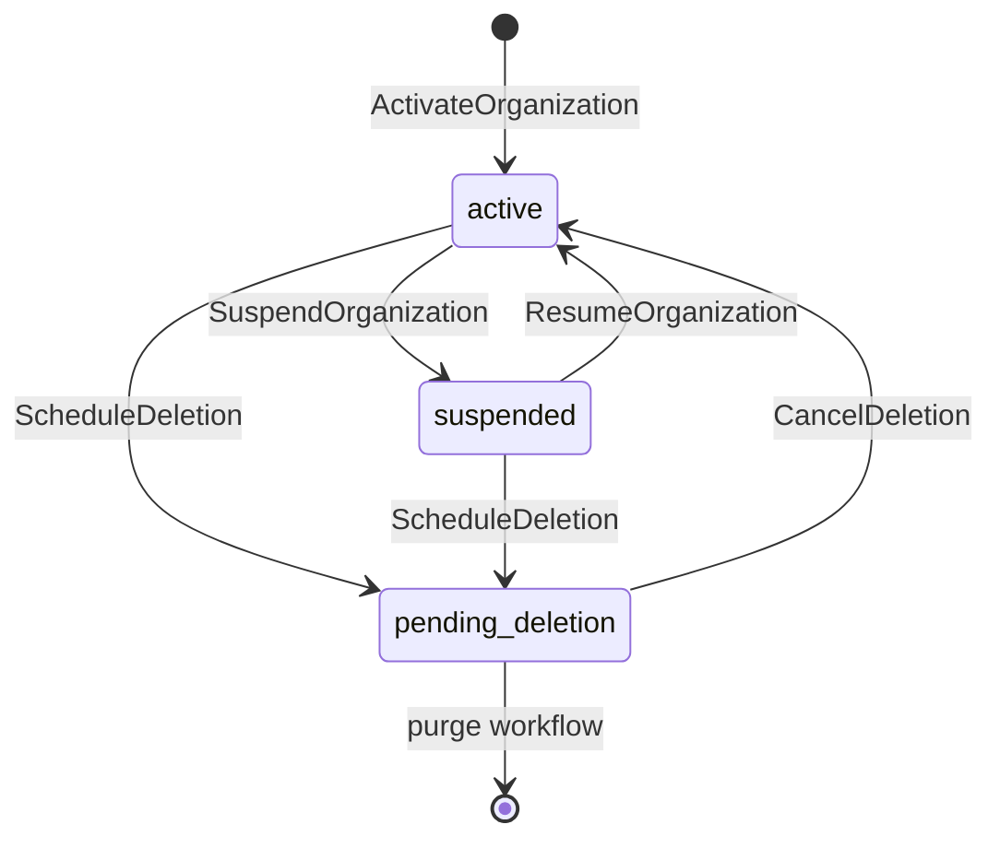

# Tenant lifecycle

Status: draft · Last updated: 2026-08-28

> **Prototype.** Same caveat as
> [00-general-design.md](00-general-design.md): everything here can change
> without migration paths or backwards-compatibility constraints. Optimize for
> the right model.

## Summary

This document designs how organizations come into existence, get suspended,
get resumed, and leave existence. It supersedes the `TenantLifecycle` port
sketch in [05-saas-plugin-points.md](05-saas-plugin-points.md).

The shape: **core owns the lifecycle state machine and every canonical
write; editions differ only in which entry surfaces their composition root
wires.** Core exports a `tenants` application service whose centerpiece is
one activation transaction. The open edition drives it through the existing
bootstrap ceremony and nothing else. The hosted edition drives it through a
self-serve signup flow that lives in the SaaS repository, together with
email verification, abuse checks, and billing linkage. A thin hooks port
lets the hosted repository observe lifecycle transitions without wrapping
call sites.

After this design, one deployment supports many organizations. The schema
always did; the deployment-wide bootstrap guard was the only thing in the
way.

## Goals

- Multi-organization deployments: organization creation becomes a repeatable
  operation, not a once-per-deployment ceremony.
- One activation transaction shared by every path that creates an
  organization, so bootstrap and hosted signup cannot drift.
- Instant, organization-wide, fully reversible suspension that touches
  nothing but the organization row and the audit log.
- Deletion with a grace period, executed durably, that actually deletes.
- Keep signup machinery (verification email, abuse checks, billing) out of
  core, per the editions-are-wiring rule.

## Non-goals

- Self-serve signup in the open edition. Open stays bootstrap-then-invite,
  as decided in
  [06-invitations-and-membership.md](06-invitations-and-membership.md).
- An organization switcher in the product frontend. Sessions are
  organization-scoped and login already selects an organization by slug; a
  switcher is a later frontend concern that this design enables but does
  not require.
- The billing plan model. Plan gating stays behind the existing
  `Entitlements` port; this design only gives the hosted adapter its
  attachment points.
- Data export before deletion, legal holds, or audit retention carve-outs.
  For the prototype, deletion means deletion. Compliance may force a
  carve-out later; it will be additive.

## Decision: a service and hooks, not a do-everything port

The sketch in 05 had the port producing organizations
(`ActivateOrganization(input) -> organization + owner membership`), which
implies each adapter performs creation itself. That predates the Option A
decision in 06: users, organizations, and memberships are canonical in
core's PostgreSQL in both editions. Activation is a serializable
transaction across seven tables and it already exists as `BootstrapOwner`.
A port that owns those writes would force the closed adapter to reimplement
core's admission transaction against core's schema, the provider-leakage
problem inverted.

So the seam splits in two:

1. **Which entry surfaces exist** is composition-root wiring. The open main
   mounts the bootstrap route; the hosted main mounts its own signup
   routes. No interface needed; this is the "editions are wiring, not
   flags" rule doing its job.
2. **Observing transitions** is a port, because billing linkage must not be
   copy-pasted after every call site.

```text
tenants.Service (core, exported package)
  ActivateOrganization(input) -> organization, owner principal
  SuspendOrganization(input)
  ResumeOrganization(input)
  ScheduleDeletion(input)
  CancelDeletion(input)

TenantHooks port
  OnOrganizationActivated(organization, ownerUserID)
  OnOrganizationSuspended(organization, reason)
  OnOrganizationResumed(organization)
  OnDeletionScheduled(organization, scheduledFor)
```

- Open adapter for `TenantHooks`: no-op.
- Hosted adapter: creates the billing customer on activation, tears down
  billing on deletion scheduling, emits whatever the revenue stack needs.
- Hooks fire after the canonical commit and are lossy-tolerant: a hook
  failure is logged and surfaced operationally, never rolled back into the
  product action. Same posture as usage metering on the entitlements port.
- Suspension **policy** lives with the caller. Dunning-driven suspension is
  SaaS-repository code (its billing webhooks call
  `SuspendOrganization`/`ResumeOrganization`); core supplies the mechanism
  and does not know what dunning is.

## Lifecycle states

`organizations.active` (boolean) is replaced by a status column. Prototype
rules: change it directly, update every reference, no shim.



New columns: `status text CHECK (status IN ('active', 'suspended',
'pending_deletion'))`, `status_reason text`, `suspended_at`,
`deletion_scheduled_for`. There is no `deleted` state; a deleted
organization has no row.

Enforcement is already centralized: human session resolution, agent
credential authentication, and organization lookup by slug all join on the
organization's liveness today. Those joins become `o.status = 'active'`,
which makes both `suspended` and `pending_deletion` cut off humans, agents,
SSO logins, and invitation redemption at the next request, with zero new
enforcement sites and no session revocation needed.

## Activation

`ActivateOrganization` is the generalized `BootstrapOwner` transaction. Its
input carries the founding owner's identity (verified email, display name,
and either a password hash for the local path or an external identity
triple) and the organization name. One serializable transaction:

- Find-or-create the user. An existing user simply gains a new
  organization; their credentials and identities are never overwritten.
- Create the organization, its `organization_policies` row, the owner
  membership, and the `owner` role.
- Append `organization.activated` to the new organization's audit log.

The deployment-wide has-an-owner guard moves **out** of the transaction and
into the bootstrap caller, where it always belonged conceptually: it is the
open edition's "this ceremony runs once" rule, not a property of
organization creation.

`admission_source` gains a `signup` value for founders admitted through
hosted signup; bootstrap keeps `manual`.

**Slug allocation is automatic.** The slug derives from the organization
name (lowercased, hyphenated, trimmed), with a short random suffix appended
on collision. Users never choose slugs at creation, which removes both the
bikeshed and the availability-check enumeration surface. A rename-slug
affordance can come later in organization settings, with the caveat that
the slug is a login handle (SSO begin, organization selection at login), so
changing it changes sign-in URLs.

## Bootstrap refit (open edition)

Externally identical: `POST /auth/bootstrap` with the deployment secret,
disabled forever once any active owner exists. Internally it becomes secret
check, has-owner guard, then `ActivateOrganization`. The server main's hard
requirement of `WITHHUMAN_BOOTSTRAP_SECRET` becomes open-edition wiring;
the hosted main does not set it and does not mount the bootstrap route.

## Hosted signup (SaaS repository)

The signup flow lives in the SaaS repository for now: pending-signup
storage, the verification email, abuse and rate checks, the
`/auth/signup/*` HTTP surface, and billing-customer creation via the hooks
port. During the monorepo phase that repository is the sibling
`withhuman_saas/` Go module, which imports core exactly the way the
extracted private repository will; core never imports it back. Its contract with core is exactly `ActivateOrganization` plus
`TenantHooks`. Design constraints it must honor even though the code lives
elsewhere:

- **Email verification is mandatory for a founding owner.** An invitee's
  address is vouched for by the inviter; a self-serve founder's address is
  vouched for by nobody, so the verification click is the vouch. Only a
  verified email may reach `ActivateOrganization`. A social provider
  (Google, GitHub) that verified the email is the second accepted vouch:
  the founder skips the link and the password, and the activation input
  carries the provider identity triple instead of a password hash, so the
  activation transaction binds the identity to the founder (new or
  existing) in the same commit. The social flow record is that path's
  single-use claim.
- Token discipline matches core: `whi_`-style opaque tokens, hash at rest,
  token in the request body never the URL path, and no account-existence
  oracle (begin-signup always answers 202).
- A signed-in existing user creating an additional organization skips
  verification (their email is already bound to an authenticated identity)
  and goes straight through the same activation path.
- When the surface stabilizes it may fold into the shared OpenAPI contract
  as additive hosted-only routes, per the one-contract invariant in 05. It
  must never fork the API.

## Suspension and resumption

`SuspendOrganization` flips status, records the reason and timestamp, and
appends `organization.suspended`. That is the entire write set: memberships,
invitations, enterprise and directory connections, agents, requests, and
audit history are untouched, which is what makes `ResumeOrganization` a
one-column flip plus `organization.resumed`. This satisfies the
reversibility requirement carried over from 05.

Effects are immediate because principals are re-resolved per request:
humans get 401, agent credentials stop authenticating, SSO login refuses,
and invitations stop redeeming. Directory webhooks for a suspended
organization are still accepted into the provider event inbox but their
workflows halt before applying, so a resumed organization reconciles
cleanly instead of losing events.

## Deletion

`ScheduleDeletion` sets `pending_deletion`, stamps `deletion_scheduled_for`
(default thirty days out), fires the hook, and appends
`organization.deletion_scheduled`. Until the date, `CancelDeletion` restores
`active`. Access-wise, `pending_deletion` behaves exactly like `suspended`.

The purge is a Temporal workflow started at scheduling time with a durable
timer until `deletion_scheduled_for`; cancellation cancels the workflow.
Activities delete organization-scoped rows in foreign-key order, ending
with the organization row itself, and are idempotent so the workflow can
retry through partial progress. The audit log is organization-scoped data
and goes with it. Users are global and remain: other memberships are
unaffected, and a user left with no memberships is simply an account with
nowhere to sign in, reachable again by a future invitation.

## Edition wiring

| Concern | Open edition | Hosted edition |
| --- | --- | --- |
| Organization creation entry | Bootstrap ceremony (once per deployment) | Self-serve signup in the SaaS repository |
| Additional organizations | None (single-org by policy, not schema) | Signed-in creation through the same activation path |
| `TenantHooks` | No-op adapter | Billing linkage |
| Suspension trigger | Nobody today (operator SQL; an admin surface can come later) | Dunning and operator tooling in the SaaS repository |
| Deletion trigger | Operator | Customer offboarding and operator tooling |

## Testing

- `tenants` service integration tests against real PostgreSQL: activation
  creates the full write set and never overwrites an existing user's
  credentials; suspension cuts off human, agent, and SSO access on the next
  request; resume restores all three; purge removes every
  organization-scoped row and only those rows.
- A deterministic `TenantHooks` fake and a contract suite (hooks fire after
  commit, hook failure does not fail the action), run by the hosted adapter
  in the SaaS repository's CI per the rule in 05.
- The bootstrap ceremony's existing tests keep passing unchanged, proving
  the refit preserved behavior.

## Decisions and open questions

Decided in this design:

- Core exports the lifecycle service; the port is hooks only. The 05 sketch
  is superseded.
- Signup machinery lives in the SaaS repository for now.
- Slugs are auto-generated, never user-chosen at creation.
- Invite links stay reachable from the members surface (amendment recorded
  in 06); signup links are the SaaS repository's concern.

Open:

- Whether purge needs an export or legal-hold step before it runs. Out of
  scope for the prototype; the grace period is the current answer.
- Where the withHuman-operator admin surface (suspend, resume, delete on
  behalf of support) lives. Current assumption: the SaaS repository.
- When the hosted signup routes fold into the shared OpenAPI contract.
