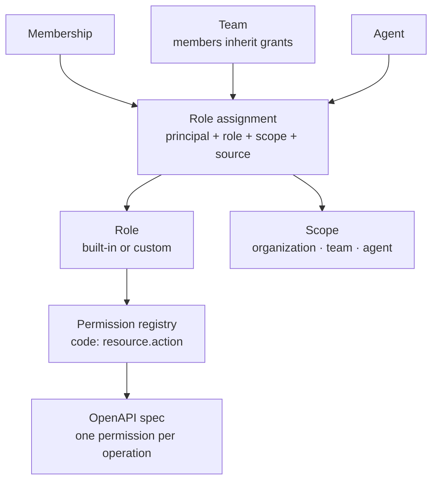
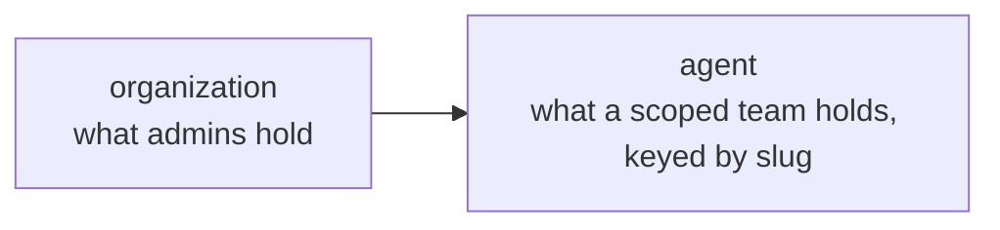
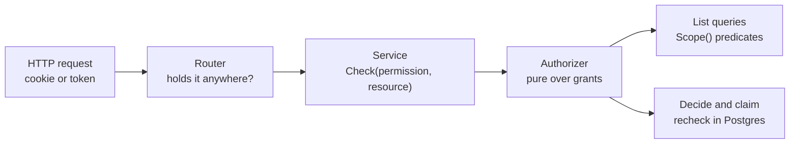
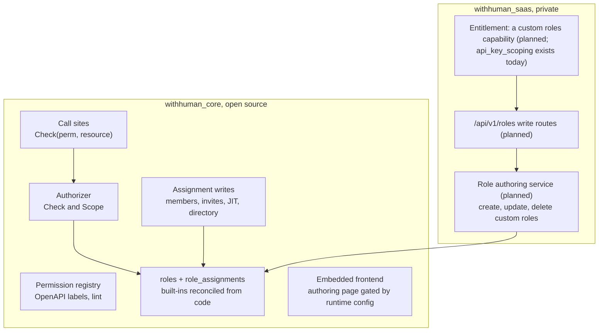

# Roles, permissions, and scoped grants

Status: implemented (branch claude/rbac-architecture-planning-2730ff) · Last updated: 2026-09-18

> **Prototype.** Same caveat as
> [00-general-design.md](00-general-design.md): everything here can change
> without migration paths or backwards-compatibility constraints. Optimize for
> the right model.

## Summary

withHuman already checks permissions rather than role names, and already
resolves roles to permissions on every request. What it lacks is the shape
that lets access control grow without a rewrite: roles are a code map
frozen by a CHECK constraint, every grant applies to the whole
organization, and a dozen services call `principal.Has(permission)` with no
resource in hand. This document designs the model that replaces those three
things and nothing else.

The shape, in one sentence: **permissions are a code-owned vocabulary,
roles are rows that bundle permissions, and a role assignment pins one role
to one principal at one scope.** A role answers what; an assignment answers
who and where. One authorizer evaluates every check and every list filter
from the grants a principal holds, and the decide and claim kernels keep
their serializable recheck in Postgres.

The load-bearing decision about approvals: **RBAC is the ceiling, routing is
the selector.** Whether a person may decide requests at all is a grant.
Which person decides a particular request is the pinned routing snapshot,
because that answer depends on attributes of the request (the tool, the
target, the amount) and withHuman already has the engine for predicates
over requests. The two never overlap, so no scope kind for tools or targets
exists and `request.decide` binds at organization scope only.

The second load-bearing decision: **the small organization and the
enterprise write the same rows.** A three-person company sees a three-choice
invite picker and never reads the word "scope". An enterprise reveals
scoped grants, team-held roles, custom roles, and directory mapping one at
a time, each of which is an additive surface over the same tables. There
is no simple mode.

The third: **the edition line sits at role authorship, not at the
mechanism.** Core owns the registry, the built-in roles, the authorizer,
the tables, and scoped assignment of built-in roles. The hosted edition
owns the ability to define roles: custom roles, their assignment to teams,
and directory group mapping onto them. This is the line Grafana (basic
roles free, custom roles in Enterprise) and GitLab (default roles free,
custom roles in Ultimate) both settled on, and it means one grant store
and one set of tables rather than a port with two implementations.

Status (2026-09-24, repository split step 10): the line is drawn but the
hosted side of it is not built. No edition has a role authoring service,
write routes or a Roles page; the only plan capability that exists on this
axis is `api_key_scoping`, which gates narrowing a personal API key to a
permission list. The passages below that describe custom role authoring
describe the intended shape.

## Goals

- Roles as data: built-in roles seeded from code and immutable, custom
  roles owned by an organization.
- Grants that carry a scope, so a team can edit the pipeline for one agent
  and not another, without a role per agent.
- One authorizer that answers both "may this principal do this to that" and
  "which of these may this principal see", so list endpoints and the event
  stream filter from the same source as single checks.
- One place where the permission vocabulary, the OpenAPI operations, and the
  enforcement points are tied together, with a lint that fails when they
  drift.
- Agents and humans on one vocabulary and one check path.
- A no-escalation rule: nobody can grant more than they hold.
- Progressive disclosure, so small organizations never meet the model and
  enterprises can use all of it.

## Non-goals

- A relationship engine (OpenFGA, SpiceDB). Every check here is inside one
  organization over a handful of structural scope kinds; a Zanzibar-shaped
  service would add infrastructure to the single-binary edition for no
  expressiveness the product needs.
- Roles as policy documents (permission plus resource on every statement,
  the AWS IAM shape). It is the most expressive design and exactly what a
  permission matrix cannot render. Conditions over request content belong
  to the CEL engine and routing, not to grants.
- Runtime-defined permissions. A permission that no handler enforces is a
  lie in the UI; the vocabulary stays in code.
- Permission implication (`write` implying `read`). Roles bundle; keys do
  not imply each other.
- Cross-organization roles. A principal is always organization-scoped, as
  [02-auth-architecture.md](02-auth-architecture.md) already requires.
- A pluggable grant store with one implementation per edition. Considered
  and rejected in "Edition wiring": it would put two implementations under
  the audit substrate and reopen the decision-authorization seam that
  [05-saas-plugin-points.md](05-saas-plugin-points.md) closes.

## Starting point

What exists today, so the deltas below are legible:

- Fourteen permission strings in `domain/identity.go`, mostly coarse
  `manage` verbs, and four roles (owner, admin, reviewer, auditor) mapped
  to them in code.
- `membership_roles(membership_id, role, source, source_key)` with the role
  vocabulary frozen by a CHECK constraint. The source columns already
  record whether a role came from a manual grant or a directory group
  link; that instinct is kept.
- A request principal carrying a flat permission list, team IDs, and
  policy scopes, rebuilt from canonical storage on every request.
- Boolean, organization-wide checks: `principal.Has(permission)` in
  roughly a dozen services and the router, and `permissions.includes(...)`
  in the product frontend.
- Scoping only inside the decide and claim kernels in
  `internal/authorization`: policy scopes and routed targets narrow who
  may act on a given request. Nothing narrows who may manage a given
  agent, pipeline, or team.
- Agents carrying their own `scopes` list, a second permission system for
  machine principals.

## Model



### Permissions

A permission is a code-owned constant with metadata, not a bare string.
The registry entry says four things: the key, who may hold it, what kind
of resource a check on it takes, and whether granting it deserves
ceremony.

```text
key:          pipeline.write
description:  Create and edit request approval pipeline revisions
holders:      human
resource:     agent             (the resource kind a Check passes)
dangerous:    false
```

The `resource` line is what keeps call sites stable: a handler always
passes a resource of that kind, and the authorizer maps the resource to
the scopes that could cover it. A pipeline maps to its organization and
its agent, by slug. A request maps to its organization only, for the reasons
in "Deciding and routing" below. The set of scope kinds a permission can
be checked at is therefore derived from `resource`, never hand-maintained.

Naming is `resource.action`, with a third segment only when a sub-resource
is a real gate. Verbs are `read`, `write`, `activate`, `issue`, `revoke`,
`decide`, `claim`, `assign`, `create`, `call`, `delete`. There is no
`manage`: it hides whether a viewer role is possible. Read is separated
from write wherever a read-only role is plausible.

| Area | Permissions |
| --- | --- |
| organization | `organization.read`, `organization.settings.write`, `organization.delete` |
| membership | `membership.read`, `membership.invite`, `membership.write`, `membership.role.assign` |
| roles | `role.read`, `role.write` |
| team | `team.read`, `team.write`, `team.member.write`, `team.escalation.write`, `team.escalation.activate` |
| agent | `agent.read`, `agent.write`, `agent.credential.issue`, `agent.credential.revoke` |
| pipeline | `pipeline.read`, `pipeline.write`, `pipeline.activate` |
| escalation path | `escalation_path.read`, `escalation_path.write`, `escalation_path.activate` |
| request | `request.create` (agents), `request.read`, `request.claim`, `request.decide`, `request.decide.unrouted` |
| gateway | `gateway.read`, `gateway.write`, `gateway.call` (agents) |
| webhook | `webhook.read`, `webhook.write` |
| connection | `connection.read`, `connection.write` |
| audit | `audit.read` |
| hosted only | `billing.read`, `billing.write`, registered by the SaaS module |

Two rules about permissions:

- **Static per build.** Adding a route adds a permission, its handler, and
  its OpenAPI label in the same commit. Built-in roles pick it up through
  the reconciler at next boot; custom roles do not, because nobody granted
  it. Removing a permission deletes the constant, and the reconciler strips
  it from stored role rows on boot and audits that it did. The hosted
  edition registers its keys at startup through the composition root:
  still static, assembled from two modules.
- **Never constructed from user data.** `pipeline.write.refund-bot` must
  not exist. The moment a key encodes an instance the vocabulary stops
  being finite, and the matrix, the lint, and the no-escalation rule all
  lose their footing. Instances live on the scope.

### Roles

A role is a row bundling permissions. The four built-in roles are seeded
from the code registry with no organization, are immutable through the
API, and are reconciled on every boot so `owner` always holds every
registered permission including hosted-only ones. Custom roles are
organization-owned rows built from the same matrix.

A role also declares the scope kinds it may be bound at, without naming
instances. This is what stops assignments from producing nonsense such as
"owner of the Payments team":

| Role | Bindable at |
| --- | --- |
| owner | organization |
| admin | organization, team, agent |
| reviewer | organization |
| auditor | organization |
| agent | organization |
| custom, e.g. pipeline-editor | declared by the author, e.g. organization, agent |

A built-in role bound at a narrow scope carries only the permissions that
have a resource of that kind. `admin` at `agent:refund-bot` grants
`agent.*` and `pipeline.*` for that agent; `membership.write` and
`connection.write` have organization resources, so the grant never
satisfies them. Nothing special-cases this: the authorizer matches a
grant's scope against the resource's scopes, and an organization resource
is never covered by an agent grant. This is what lets the open
edition express "Payments manages refund-bot only" with built-in roles
alone.

The choice to put scope on the assignment rather than the role is the one
every mature system converged on (Google Cloud IAM bindings, Kubernetes
`ClusterRole` plus `RoleBinding`, GitHub custom repository roles). Scope
on the role means one role per capability times target, which forecloses
built-in roles, since core cannot know a customer's agent slugs, and makes
directory mapping need a role per group. Kubernetes shipped namespaced
roles first and had to add `ClusterRole` afterwards; this design skips
that detour.

Doc 02 says an admin is not automatically a reviewer. That stays true for
the built-in definitions. The invite picker's "can set things up" preset
grants admin plus reviewer, because in a three-person company the person
who configured the system also approves; enterprises separate the two on
the Roles page. Same rows, different preset.

### Role assignments

An assignment is one row: principal, role, scope, source. Principals are
memberships, teams, and agents. A grant to a team is inherited live by its
members, which is what directory sync needs (an Okta group maps to a role
at a scope, not a bare role) and what makes leaving a team take effect on
the next request with no fan-out.

Scope kinds are structural, meaning things with an identity that exist
before any request does: `organization`, `team`, `agent`. The scope id of
an `agent` grant is the agent's slug, which is chosen once, immutable, and
never reused in the organization even after the agent is archived, so a
grant keeps pointing at the same agent for its whole life.

Granting is itself a checked action. The actor must hold
`membership.role.assign` at the target scope or wider (its registry
resource kind is `scope`, so a grant of it at an agent lets a scoped
admin delegate within that agent), and for a custom role must hold every
permission in the role at that scope or wider. An owner grants anything; a
Payments lead scoped to `refund-bot` can delegate `refund-bot` editing and
nothing broader. Only holders of the built-in owner role grant owner.
Built-in roles other than owner are exempt from the per-permission rule:
they are the product's fixed vocabulary, meant to be handed out by
administrators who do not hold them, so an admin invites reviewers without
being one. The per-permission rule exists to stop people composing a
custom role wider than themselves.

### The scope ladder

A grant at a wider scope satisfies a narrower check, never the reverse.



An admin holding `pipeline.write` at organization scope passes the
`refund-bot` check with no per-agent row. A team holding it at
`agent:refund-bot` fails a `release-bot` check and fails an
organization-level operation such as editing the organization pipeline.

### Worked example

The Payments team may edit the pipeline for the `refund-bot` agent and not
the `release-bot` agent. Every agent owns exactly one pipeline, keyed by
the agent's slug, so the scope kind is `agent`.

| principal | role | scope kind | scope id | source |
| --- | --- | --- | --- | --- |
| team: Payments | pipeline-editor | agent | `refund-bot` | manual |
| team: Payments | reviewer | organization | | manual |

A Payments member's principal carries the flattened grants:

```text
pipeline.read      @ agent:refund-bot
pipeline.write     @ agent:refund-bot
pipeline.activate  @ agent:refund-bot
request.read       @ organization
request.claim      @ organization
request.decide     @ organization
```

Saving a `refund-bot` revision calls
`Check(principal, pipeline.write, Resource{agent, "refund-bot"})` and
finds the grant. The same call for `release-bot` finds nothing and fails
with `forbidden`. The pipelines index calls `Scope(principal,
pipeline.read)`, receives the set `{refund-bot}`, and the repository adds
`agent_slug = ANY(...)`; an organization-scope grant returns "all" and the
predicate disappears. Nothing about `release-bot` crosses the wire.

In the open edition the same outcome uses the built-in `admin` role at
`agent:refund-bot` instead of a custom `pipeline-editor`; the team
additionally gets `agent.*` for that agent, which is the coarser cut the
free edition accepts.

Agents carry no owning team. Which team manages an agent is an
ordinary assignment, the built-in `admin` role at `agent:<slug>`,
made on the Teams page like any other grant, so the audit trail and the
Roles page always tell the whole story.

### The principal and the authorizer

The request principal carries grants, not a flat permission list:

```text
principal
  actor type and canonical actor ID
  organization ID
  membership or agent-instance ID
  grants: [{permission, scope kind, scope id}]
  team IDs
  authentication method, assurance, time, session or credential ID
```

`policy_scopes` is deleted from the principal and from memberships. A
policy scope is an agent-supplied attribute on the request, which makes it
a routing condition, not a grant. Agents' `scopes` column is deleted too:
an agent is a principal that holds assignments, typically one built-in
`agent` role at organization scope, and the registry's `holders` field
keeps human-only permissions out of it.

The authorizer lives in the existing `internal/authorization` package and
has two operations:

- `Check(principal, permission, resource) error`: is there a grant of this
  permission whose scope covers the resource. Returns the typed rejection
  the decision kernel already uses.
- `Scope(principal, permission) ScopeSet`: the scopes the principal holds
  the permission in, either "all" or a set of `(kind, id)` pairs, which
  repositories translate into predicates.

Both are pure over the loaded grant set, in the style of `EvaluateDecision`
today, so the serializable recheck inside the decision transaction reuses
the same functions against grants loaded in the transaction. Navigation
gating uses a third, cheap form, "holds it anywhere", which is `Scope`
being non-empty.

### Dangerous permissions

A flag on the registry entry meaning "granting or using this changes what
other people can do, or cannot be undone". Roughly six keys:
`membership.role.assign`, `role.write`, `agent.credential.issue`,
`organization.delete`, `connection.write`, `request.decide.unrouted`.
`request.decide` is not dangerous: consequential to the business, but it
is the product's job and has its own freshness rules.

The flag changes four things, each defined once in the registry rather
than against a hardcoded key list in four places:

1. Adding a dangerous permission to a custom role asks for confirmation and
   is named plainly on the Roles page.
2. A directory group mapping or a JIT default role may not point at a role
   containing a dangerous permission. Access that arrives without a human
   deciding stays ordinary.
3. Exercising a dangerous permission requires fresh, strong authentication,
   the same `approval_reauth_window` and assurance rules decisions already
   get.
4. Audit events for dangerous grants and uses are marked so an auditor can
   filter to "who changed who can do what" without knowing the vocabulary.

## Deciding and routing

### RBAC is the ceiling, routing is the selector

The two mechanisms answer different questions and must not overlap:

| Question | Answered by |
| --- | --- |
| Is this person a reviewer at all? | RBAC: `request.decide` at organization scope |
| Who reviews this particular request? | routing: conditions over request attributes, pinned snapshot ([06-routing-and-escalation.md](06-routing-and-escalation.md)) |
| Can Payments decide something they were not routed to? | no; the snapshot is the inner bound |
| Can someone edit the `refund-bot` pipeline? | RBAC: `pipeline.write` at `agent` scope |

"The Payments team approves every tool call to Stripe regardless of the
agent" is a predicate over the request, so it is a routing rule: target
equals Stripe, route to Payments. Payments members hold `reviewer` at
organization scope. Every Stripe call from any agent lands with them
and only them, and they cannot decide a non-Stripe request because the
snapshot does not name them. Exclusivity comes from the inner bound; a
scoped `request.decide` grant would add nothing except a second place
where the answer could disagree. Hence `request.decide` and
`request.claim` bind at organization scope only.

Scoped grants earn their place on management permissions, which act on
configuration objects that are structural.

### Who may decide

A person decides only if both hold: they have `request.decide` at a scope
covering the request, and the pinned path reaches them for this request,
directly or through a team resolved at decision time. "Reaches" means the
branches the request's own conditions select, with both branches of any
working-hours or urgency test counted and timing ignored
([06-routing-and-escalation.md](06-routing-and-escalation.md), "Who may
decide"); a lead who sits only behind "amount over 100000" cannot decide
a small request. The authority is path membership, not delivery:
notifications can fail, and the manager on rung three who sees the
request in the queue at minute two may take it. A path that reaches
nobody for a request leaves it to break-glass reviewers. The path narrows, it never grants, so the path
editor validates a team target's roster against RBAC and says "two of five
members of Payments cannot decide requests".

Three places where the rule bends become named, audited actions:

1. **Break-glass.** Today `organization.manage` bypasses targeting as a side
   effect. It becomes `request.decide.unrouted`, dangerous, held by owner by
   default and grantable to an on-call role. Every use is audited as a
   decision made outside routing.
2. **Handoff.** A targeted reviewer pulls a colleague in through an explicit
   "add reviewer" action on the request, audited, which appends to the
   pinned snapshot. This is the widen-not-move rule at request granularity
   and keeps the snapshot the whole authority.
3. **Unrouted requests.** When no path matches, any in-scope reviewer may
   decide today, which is right for an organization without routing.
   `organization_policy.unrouted_requests` chooses between `any_reviewer`
   and `break_glass_only`.

### Who may read

Routing selects deciders, not readers, so visibility is an organization
policy rather than a scope: `organization_policy.request_visibility` is
either `all_readers` (everyone with `request.read` sees every request) or
`routed_only` (readers see what was routed to them plus what they
created). Owners and auditors see everything either way. This keeps
`request.read` structural too.

## Schema

New `roles`:

| column | notes |
| --- | --- |
| `id` | uuid |
| `organization_id` | null for built-in roles, set for custom ones (no authoring service writes them yet; the private role snapshots permission policies make are core's) |
| `key` | `owner`, `admin`, `reviewer`, `auditor`, `agent`, or a custom slug; unique per organization |
| `name`, `description` | display |
| `permissions text[]` | validated against the code registry on write |
| `bindable_scope_kinds text[]` | see "Roles" |
| `built_in bool` | true for seeded rows; immutable through the API |
| timestamps | |

New `role_assignments`:

| column | notes |
| --- | --- |
| `id` | uuid |
| `organization_id` | every row belongs to one tenant |
| `principal_kind` | `membership`, `team`, `agent` |
| `principal_id` | FK enforced per kind with the composite `(id, organization_id)` reference the schema already uses; for an agent principal this is the `agents` table's internal uuid key, which the API never exposes |
| `role_id` | FK to roles |
| `scope_kind` | `organization`, `team`, `agent` |
| `scope_id` | empty for organization, team id, or the agent slug |
| `source`, `source_key` | `manual`, or `directory` plus the group link key, carried over from `membership_roles` |
| `granted_by_membership_id` | provenance |
| `created_at` | |

Unique on `(principal_kind, principal_id, role_id, scope_kind, scope_id,
source, source_key)`. A CHECK keeps `scope_kind` within the role's
bindable kinds at write time (enforced in the service; the database keeps
the simpler check that organization scope has an empty `scope_id`). The
last-owner trigger moves here: no delete or update may remove the final
active membership holding the built-in owner role at organization scope.

Deleted: `membership_roles`. Its rows become assignments with
`principal_kind = membership` at organization scope.

Existing tables that change:

- `memberships` loses `policy_scopes`.
- `agents` loses `scopes`.
- `invitations` replaces `roles text[]` with a jsonb list of `{role_id,
  scope_kind, scope_id}` so an invite can say "reviewer on Payments" once
  team-scoped roles exist; the invite picker writes organization scope.
- `organization_domains` replaces `jit_default_role` with
  `jit_default_role_id`, constrained to roles without dangerous
  permissions.
- `directory_object_links` gains an optional role id and scope on group
  links, so a group maps to a grant rather than only to a team.
- `organization_policy` gains `unrouted_requests` and `request_visibility`.

Unchanged: `users`, `organizations`, `teams`, `membership_teams`,
`agent_instances`, `agent_credentials`, sessions, and the audit table. Audit
gains event types (`role.created`, `role.updated`, `role.deleted`,
`role_assignment.granted`, `role_assignment.revoked`,
`request.reviewer_added`, `decision.unrouted`) but no schema.

Permissions are not a table. See "Permissions".

## Enforcement points



- **OpenAPI.** Every operation in `openapi.yaml` carries
  `x-withhuman-permission` naming one registry key, or an explicit marker
  for public and self-service routes (`/auth/*`, `/api/v1/me/*`).
  `make api-lint` fails on an unlabelled operation and on a label that is
  not in the registry. The docs reference renders "requires
  `pipeline.write`" from the same field.
- **Router.** Reads the label and rejects early when the principal holds
  the permission nowhere. This keeps navigation gating and the 403
  consistent without the router knowing about resources.
- **Services.** Every current `principal.Has` call becomes
  `Check(principal, permission, resource)` where the resource comes from
  what the operation already has: the path parameter for pipeline routes,
  the loaded agent's slug for agent routes, the team id for team routes,
  the request row for request routes.
- **Repositories.** List queries and the `/api/v1/events` stream take a
  `ScopeSet` and translate it into predicates. This is the point that
  retrofits usually get wrong, so it is a first-class output, not a
  per-handler afterthought.
- **Decision transaction.** The kernels take the RBAC verdict as input and
  keep their own rules (self-approval, freshness, MFA, routed targets). The
  recheck loads grants inside the serializable transaction.
- **Clients.** `/api/v1/me` returns grants using registry keys. The web app
  gates navigation on "holds anywhere" and actions on `can(permission,
  resource)`; the iPhone and Android apps follow the same contract.

## Progressive disclosure

The small organization and the enterprise write the same rows. Enterprise
features are additive surfaces that reveal a choice the small organization
never had to make.

What a small organization sees:

- Sign up or bootstrap: you are the owner. No roles page, no permissions.
- Invite someone: three plain choices, "can approve requests", "can set
  things up", "can do everything". Each is a built-in role (or the
  admin-plus-reviewer preset) at organization scope; scope is not shown.
- Members page: one column, the role name, changed with the same picker.
- Settings shows no Roles page today. When the hosted edition builds
  custom role authoring it adds one, with the built-ins read-only and one
  "create custom role" action when the plan entitles it.

What the enterprise unlocks, in the order they ask:

| Ask | Surface that appears | Rows written | Edition |
| --- | --- | --- | --- |
| "Only Payments should manage refund-bot" | a "limit to" affordance on the assignment picker, default "everywhere" | scoped assignment of a built-in role | both |
| "Grant by Okta group" | directory group links gain a role and scope | assignments with source `directory` | both |
| "Auditors need a read-only pipeline reviewer" | custom roles from the permission matrix | roles row | hosted |
| "Team leads manage their own team's access" | scoped `membership.role.assign`, bounded by the no-escalation rule | scoped assignment of a custom role | hosted |

Each surface is hidden until the organization has the shape that needs it:
"limit to" appears once there is more than one team or agent,
directory mapping once a directory connection exists. Custom roles, once
built, appear only when the deployment reports them in runtime config and
the organization's plan entitles them, so the edition line, the plan gate,
and the disclosure line coincide.

Guardrails so the simple path cannot hurt anyone: owner is always a
superset, the last-owner trigger stays in the database, removing your own
`membership.role.assign` or `organization.settings.write` warns before
saving, and a denial for an organization-scoped admin is impossible by
construction.

## Edition wiring

The line sits at role authorship. Everything that makes the mechanism work
is core; the ability to define a role is hosted.



**Core owns:**

- The permission registry, the OpenAPI labels, and the lint.
- The four human built-in roles plus `agent`, seeded and reconciled from
  code, bindable at the kinds in "Roles". This is what gives the open
  edition scoped access with no custom roles: `admin` at an agent,
  `admin` at a team.
- The authorizer and every call site, list filter, and transaction
  recheck. Decision authorization keeps no seam, as
  [05-saas-plugin-points.md](05-saas-plugin-points.md) requires.
- The `roles` and `role_assignments` tables and every assignment write:
  members page, invitations, JIT admission, directory group mapping. Core
  validates an assignment against whatever role row it finds, built-in or
  custom, so it never needs to know whether the hosted edition exists.
- Read routes for roles (`GET /api/v1/roles`) so the assignment picker can
  list what is assignable in either edition.

**The hosted edition owns:**

- The role authoring service: creating, editing, and deleting custom role
  rows, validating permissions against the registry, enforcing bindable
  scope kinds and the dangerous-permission confirmation. It writes
  through core's exported `RoleRepository` (`runtime.Server.Roles`), the
  way signup activates through `tenants`, so audit stays atomic with the
  row write and core remains the only writer of its tables.
- The write routes under `/api/v1/roles`, registered by the SaaS router and
  gated by a custom roles capability on the entitlements port (planned;
  the capability that exists today is `api_key_scoping`).
- Registration of `billing.*` permissions at boot.

**What is deliberately not split:**

- The frontend. The plugin-points doc keeps one embedded frontend, so the
  Roles authoring page, once built, ships behind a runtime-config flag
  the hosted edition sets, exactly as the billing page does (since the
  repository split it would live in the hosted overlay). The page is not the valuable part; the routes it calls do not
  exist in the open edition.
- The grant store. A `GrantStore` port with a fixed-roles implementation
  in core and a scoped implementation in SaaS was considered. It would
  make core's membership flows write roles through a port, need a
  transaction-scoped grant loader inside the serializable decision
  transaction, and leave two implementations of audit substrate held
  together by contract tests. Authorship is a smaller surface, and it is
  the one customers pay for.

Core never imports the SaaS module. The SaaS module reaches core's tables
through its own repository code and core's registry through the exported
domain package.

## Invariants

- Every active organization has at least one active membership holding
  the built-in owner role at organization scope.
- Built-in roles are immutable through the API and reconciled from code on
  boot; the owner role holds every registered permission.
- Custom role rows are written only by the hosted authoring service; core
  reads and assigns any role row it finds without knowing its origin.
- A custom role cannot be deleted while assigned.
- An assignment's scope kind is within its role's bindable kinds.
- Nobody grants a permission they do not hold at that scope or wider; only
  owners grant owner.
- No permission key is ever derived from user data.
- A dangerous permission never arrives through directory mapping or JIT.
- `request.decide` binds at organization scope only; who decides a
  particular request is the pinned routing snapshot, and the snapshot never
  grants.
- Every OpenAPI operation names a registry permission or is explicitly
  public or self-service.
- Team-held grants are inherited live, never copied.

## Delivery sequence

The structural change that prevents the retrofit is phase one; the rest is
incremental and each phase ships on its own.

1. **Registry and authorizer.** Registry with metadata, OpenAPI labels and
   the lint, `Authorizer` with `Check` and `Scope`, grants on the principal,
   every `Has` call site migrated to `Check` with a resource. Behaviour
   identical; nothing user-visible.
2. **Roles and assignments as rows.** `roles` and `role_assignments` with
   seeded built-ins, `membership_roles` deleted, role read routes and the
   read-only Roles page, invitations, JIT and directory mapping repointed
   at role ids. Organization scope only.
3. **Scoped grants.** Team principals and team-held roles, `agent`
   scope, the "limit to" affordance, `Scope()` wired through list queries
   and the event stream, `policy_scopes` and agent `scopes` deleted. All
   in core.
4. **Approval policy knobs.** `request.decide.unrouted`, "add reviewer",
   `unrouted_requests` and `request_visibility` on the organization policy.
5. **Custom roles, hosted.** The authoring service and write routes in the
   SaaS module, a custom roles entitlement, the runtime-config flag,
   and the authoring page in the hosted overlay. As demand appears; not
   started as of 2026-09-24.

Testing follows the disclosure promise. One smoke test from the small
organization's point of view: bootstrap, invite two people with the plain
picker, approve a request, and assert the UI never rendered "scope" or
"permission". One from the enterprise's: Payments edits `refund-bot`, is
refused on `release-bot`, and cannot decide a request routed elsewhere.
Both run against the same schema and services.

## Decisions and open questions

Decided:

- Scope lives on the assignment, not the role; roles declare bindable
  scope kinds.
- Permissions are static per build and never a table.
- No implication between permission keys.
- `request.decide` is organization scope only; routing selects deciders.
- `policy_scopes` and agent `scopes` are deleted rather than migrated into
  scope kinds.
- Break-glass is a dangerous permission, not a side effect of
  `organization.manage`, and is exercised only with an explicit
  `outside_routing` acknowledgement on the decision.
- `membership.role.assign` has the `scope` resource kind, so a scoped admin
  can delegate within its scope; built-in roles other than owner are
  exempt from the per-permission no-escalation rule.
- A reviewer hands off through `GET /requests/{id}/reviewer-candidates`
  (gated like deciding) rather than the members list.
- The legacy columns and `membership_roles` are dropped in a follow-up
  migration after this release is live everywhere; the three migrations
  here only expand.
- The edition line is role authorship: mechanism, built-in roles, scoped
  assignment, and the tables in core; custom roles in the hosted edition.
  Not a pluggable grant store.
- `admin` is bindable at team and agent scope so the open edition can
  express scoped management with built-in roles alone.

Open:

- Whether `request.read` should later accept team scope as a shortcut for
  `routed_only`, or whether the policy toggle is enough.
- Whether the `dangerous` flag ships in phase one or is added when the
  first custom role does. Recommendation: ship it, because the directory
  mapping rule is the kind of thing that gets forgotten until an enterprise
  asks.
- Whether the invite picker's admin-plus-reviewer preset should instead be
  a fifth built-in role. Recommendation: preset, so the built-in vocabulary
  stays four roles and the matrix stays honest.
