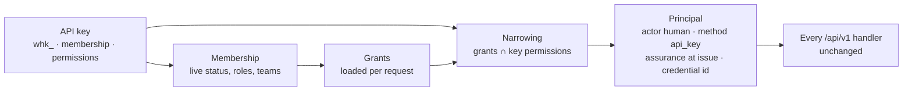
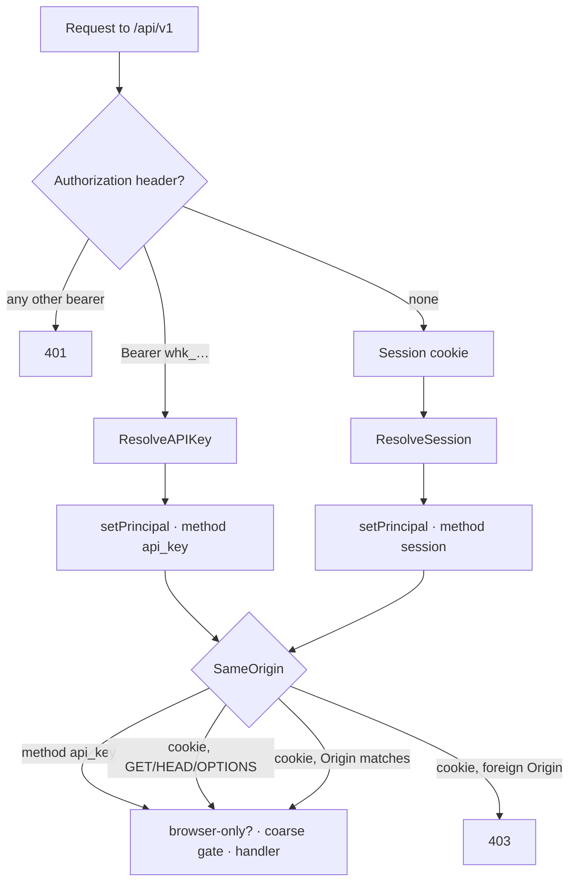

# Personal API keys

Status: implemented (branch claude/public-api-org-keys-design-0aab34, MET-1123) · Last updated: 2026-09-29

> **Prototype.** Same caveat as
> [00-general-design.md](00-general-design.md): everything here can change
> without migration paths or backwards-compatibility constraints. Optimize for
> the right model.

## Summary

Every `/api/v1` route used to require the browser session cookie plus a
same-origin check. None of the bearer credential classes (`whc_` agent,
`whp_` provisioner, `who_` onboarding) could touch it, so
scripts, Terraform, chat bots, and compliance exporters had no way in, and
nothing in the management tier could ship in the public OpenAPI spec.

This document adds the first of two key kinds, the **personal API key**
(`whk_`), and defines it in one sentence: **a personal API key is a second
way for an existing person to authenticate, narrowed to a subset of what
that person may do.** It is Cloudflare's user API token: a key acts as the
member who minted it, with their user id, membership, audit attribution,
and a subset of their grants, and it dies when their membership does. The
second kind, the **organization API key** (a service principal that
outlives people, Cloudflare's account-owned token), is designed for but not
built; the table, the token parser, and the principal shape leave the door
open, and "Organization keys, later" says what is missing.

A request carrying `Authorization: Bearer whk_...` resolves to the same
`domain.Principal` the session cookie would produce for the key's creator,
with three differences: the grant set is intersected with the permissions
chosen at mint time, the authentication method reads `api_key`, and the key
id rides in the auth context.

Permissions, in one paragraph: a key borrows its creator's permissions and
can only shrink them. At mint time you pick a subset of the permissions you
already hold, and the key stores that list. On every request the server
loads your current grants exactly as it would for your browser session,
keeps only the ones whose permission is in the key's list, and hands that
narrowed set to the same authorizer every handler already uses. Scope comes
from your grants, not from the key, so a team-scoped admin's key is
team-scoped. If your roles change, the key changes with them on the next
request. If you are removed, the key is revoked. Three new permissions
govern the keys themselves: `api_key.issue` to mint your own,
`api_key.read` to see everyone's, `api_key.revoke` to revoke anyone's, and
a key can never hold any of those three.

Two edition rules follow from the roles model. **The open edition does
not author custom roles, so its keys inherit the member's role
unchanged**: a key stores no permission list and there is no picker. **The
hosted edition lets a person scope a key down** to individual permissions,
behind the `api_key_scoping` plan capability. And **an organization can
turn personal keys off** with one policy switch, the way a GitHub
organization restricts personal access tokens: existing keys are refused
immediately without being deleted, and come back when the switch is turned
on.

The load-bearing decision about the decision endpoint: it applies two rules
to whoever decides, the session must be younger than the organization's
re-authentication window, and under an MFA mode it must be rated `strong`.
A key breaks both, because it never signs in and cannot do MFA. So **the
checks move to the moment the key is created.** The age rule is skipped for
keys; a key's version of "sign in again" is expiry and revocation. The MFA
rule is inherited: to mint a key that can decide, or that carries any
dangerous permission, you must be in a session that would pass both rules
right now, and the key remembers whether that session was `strong`. When
the key later decides, the kernel treats it as having that assurance. Net
effect: a key can decide only if the person could have decided at the
moment they minted it, and the decision record shows method `api_key` and
the key id.

## Goals

- Programmatic access to every public `/api/v1` operation with one header
  and no browser.
- A key whose authority is a subset of a real person's authority, changing
  live as that person's roles change, and dying with their membership.
- Immediate revocation: resolution is a live lookup, never a cached token.
- Raw secret shown once, hash stored, prefix listable.
- A truthful OpenAPI spec: every operation says whether a key may call it,
  and a conformance test keeps the router and the spec in agreement.
- A settings page in the shape of Cloudflare's user API tokens: create with
  a permission picker and expiry, reveal once with a verify command, list
  with status and last use, revoke.
- A schema and a token format that admit organization keys later without
  a migration of what exists.

## Non-goals

- Organization-owned keys that outlive people. Deferred, not rejected; see
  "Organization keys, later". The workaround today is a dedicated
  automation membership.
- Keys for agents. Agents have `whc_` credentials and the Agent Approval
  Protocol. A key never calls `/api/aap/v1`.
- OAuth clients, scoped user consent, or third-party apps acting on behalf
  of many users. One key, one person, one organization.
- Cloudflare's edit, roll, and disable actions. The defined set is issue,
  list, revoke, and verify. Rotate by minting a new key and revoking the
  old one.
- Client IP restrictions and token templates.
- Per-request audit events for key use. `last_used_at` and ordinary
  attribution cover it; see "Audit".
- Mobile app work. The iPhone and Android apps use sessions.

## Starting point

What existed, and what the design reuses:

- `HumanAuth` and `SameOrigin` were the two middlewares on the `/api/v1`
  group. `HumanAuth` read the `withhuman_session` cookie and called
  `authn.Service.ResolveSession`, one query joining sessions, users,
  organizations, and memberships, then `loadGrants` live. Both were
  exported so the hosted edition's additive routes authenticate the same
  way.
- `SameOrigin` refuses state-changing requests whose `Origin` header names
  another site. It exists only because cookies are ambient.
- Every bearer class shares `MintOpaqueToken(prefix, id)`,
  `ParseOpaqueToken`, `HashToken` (SHA-256), and a constant-time compare.
  The id is inside the token, so resolution is a primary-key lookup.
- The onboarding CLI's `who_` bearer ([09-onboarding.md](09-onboarding.md))
  is the nearest precedent: a time-boxed grant tied to the member who
  started the session, accepted only by `/api/onboarding/v1`, resolving to
  a session rather than a principal. It is structurally an API key with a
  fixed permission set and a ten-minute expiry.
- `gateway_credentials` (migration `0013`) is the closest table: named,
  organization-owned, hashed, with expiry, last use, and revocation.
- `authorization.RequireFresh` in `internal/authorization/decision.go` is
  the single freshness and MFA rule, shared by the decision kernel and by
  dangerous role grants in `internal/members`.
- The permission registry in `domain/permissions.go` carries a `Holders`
  list per permission. Built-in owner holds every registered human
  permission, so new keys reach owners at next boot.
- Key scoping is gated twice: the edition flag
  `authn.ServiceConfig.APIKeyScopingEnabled` (the hosted composition root
  sets it) and the plan capability `api_key_scoping` through
  `application.Entitlements`. Custom role authoring, when built, gets a
  capability of its own.

## Model



### The principal

Resolving a key yields:

```text
principal
  actor type:        human
  actor id:          the creator's user id
  organization id:   the key's organization
  membership id:     the creator's membership
  team ids:          the membership's current teams
  grants:            membership grants whose permission is in the key's list
  auth
    method:          api_key
    assurance:       the key's assurance_at_issue
    authenticated at: now (see "Decisions and freshness")
    credential id:   the key id
```

`domain.NarrowGrants(grants, permissions)` is the intersection, computed on
every request. A nil list means no narrowing. Scope travels with the grant,
so a team-scoped admin's key is team-scoped. A permission the key names but
the membership no longer holds contributes nothing. A permission the key
names that has since been removed from the registry is ignored, matching
how the reconciler strips dead keys from role rows.

### What a key may hold

The open edition and the hosted edition differ here, and the difference is
one nullable column.

**Open edition: the key inherits the member's role.** The mint request
carries no `permissions`, the row stores `NULL`, and resolution narrows by
nothing. A reviewer's key is a reviewer; an admin's key is an admin. This is
deliberate: without custom roles there is no vocabulary for "a bit less than
my role", and a hardcoded role is exactly what the person already
understands.

**Hosted edition: the key may be scoped down.** When
`authn.ServiceConfig.APIKeyScopingEnabled` is set (the hosted composition
root sets it) and the organization's plan allows `api_key_scoping`, the
mint request may carry a `permissions` list. The server
refuses a list otherwise: 403 `api_key_scoping_unavailable` in the open
edition, 403 `plan_required` on a hosted plan without the capability. The
API is honest, not just the UI.

A hosted list is validated entry by entry. Each must be:

1. A registered permission key. Unknown strings are refused, never stored.
2. Key-bearable: the registry marks it `HolderAPIKey`. Every human
   permission is, except the `api_key.*` family, so a key can never mint or
   revoke keys.
3. Held anywhere by the caller at mint time, checked with `HoldsAnywhere`
   over their live grants. No escalation, the same rule the role grant
   path already enforces.

Any failure refuses the whole mint. Duplicates collapse and the list is
stored sorted. It carries nothing about scope, because the key has nothing
to say about scope: it inherits whatever scopes the membership's grants
carry. There is no scope picker in the UI for the same reason.

The picker's vocabulary comes from `GET /api/v1/me/api_keys`, whose
`bearable_permissions` is the registry filtered to what the caller holds
and what a key may bear, so a reviewer without `role.read` still sees their
own choices.

Three consequences follow from narrowing being a live intersection:

- Scope is inherited, not chosen. An admin on the `payments` team only who
  mints a key with `pipeline.write` gets `pipeline.write` at team scope
  `payments`.
- Changes to the person change the key immediately. Losing a role removes
  those grants from the key on the next request. Gaining a role adds
  nothing to a scoped key, because the permission is not in its list, and
  adds everything to an inherit-all key.
- An admin cannot mint a key for someone else. The binding is always the
  caller's own membership.

### Permissions and roles

Three registry entries, all at organization scope, human-only:

| Key | Description | Holders | Resource | Dangerous |
| --- | --- | --- | --- | --- |
| `api_key.issue` | Mint personal API keys and manage your own | human | organization | no |
| `api_key.read` | List every API key in the organization | human | organization | no |
| `api_key.revoke` | Revoke any API key in the organization | human | organization | no |

Built-in roles: `api_key.issue` goes to owner, admin, reviewer, and auditor.
The auditor exporting the audit log from a script is a headline use case,
and the reviewer deciding from a chat bot is the most-requested one.
`api_key.read` goes to owner, admin, and auditor. `api_key.revoke` goes to
owner and admin. Owner picks all three up through `BuiltInRoles()`.

Listing and revoking one's own keys needs no permission beyond being a
member (the routes are labelled `self`): a person whose role changed still
has to see and revoke the keys they minted. Minting needs `api_key.issue`.
The organization-wide list and revoke are separate routes behind
`api_key.read` and `api_key.revoke`.

### Worked example

Priya is an admin at organization scope in the hosted edition. She mints
two keys:

- `terraform` with `agent.read`, `agent.write`, `agent.credential.issue`,
  `pipeline.read`, `pipeline.write`, `pipeline.activate`, no expiry.
  Because `agent.credential.issue` is dangerous, the mint requires her
  session to be fresh and, under an MFA mode, strong.
- `slack-approver` with `request.read` and `request.decide`, one-year
  expiry. Same ceremony because of `request.decide`.

Under `terraform`, `POST /api/v1/agents` succeeds; `GET /api/v1/members`
returns 403 because `membership.read` is not on the key even though Priya
holds it; `POST /api/v1/me/api_keys` returns 403 `api_key_not_allowed`
because issuing keys is browser-only. Under `slack-approver`, a decision
succeeds only if Priya could decide that request herself: the routing
snapshot must reach her, and the kernel sees the key's stored assurance for
the MFA rule.

Six months later Priya is moved from admin to reviewer. `terraform` now
narrows to nothing and every call under it returns 403, with no key edit
and no revocation. `slack-approver` keeps working because reviewer holds
`request.decide`. When Priya leaves and her membership is removed, both
keys are revoked in the same transaction with reason
`membership_deprovisioned`.

In the open edition Priya's keys would have no list and simply be "Priya":
admin today, reviewer after the change, gone when she leaves.

### Token and storage

Token format is `whk_<key_id>_<secret>` through
`MintOpaqueToken("whk", id)`, 32 random bytes base64url-encoded, SHA-256 of
the secret stored. The raw token is returned once from the mint call and
never stored. `authn.IsAPIKeyToken` is the prefix test the middleware
routes on.

The "prefix" the list shows is `whk_<key_id>`. It is public, unique, and
what a person sees at the start of the value in their configuration, so
matching a config entry to a row needs nothing secret.

Migration `0031_api_keys.sql`, one table for both kinds:

```sql
ALTER TABLE organization_policies
    ADD COLUMN personal_api_keys_allowed boolean NOT NULL DEFAULT true;

CREATE TABLE api_keys (
    id uuid PRIMARY KEY,
    organization_id uuid NOT NULL REFERENCES organizations(id),
    kind text NOT NULL CHECK (kind IN ('personal', 'organization')),
    membership_id uuid,                      -- personal only
    name text NOT NULL,
    permissions text[],                      -- NULL inherits everything
    secret_hash bytea NOT NULL,
    assurance_at_issue text NOT NULL,
    created_at timestamptz NOT NULL,
    expires_at timestamptz,                  -- NULL lives until revoked
    last_used_at timestamptz,
    revoked_at timestamptz,
    revoked_by_membership_id uuid,
    revocation_reason text CHECK (revocation_reason IN ('manual', 'membership_deprovisioned')),
    CHECK ((kind = 'personal') = (membership_id IS NOT NULL)),
    CHECK ((revoked_at IS NULL) = (revocation_reason IS NULL)),
    FOREIGN KEY (membership_id, organization_id) REFERENCES memberships(id, organization_id),
    FOREIGN KEY (revoked_by_membership_id, organization_id) REFERENCES memberships(id, organization_id)
);
```

Expiry is the person's choice, the Cloudflare way: none by default, any
future instant if they want one. `WITHHUMAN_API_KEY_MAX_TTL` (unset by
default) caps it for deployments that want GitHub's 366-day rule; with a
cap, a missing expiry is filled in at the cap and a later one is refused.

`revocation_reason` is `manual` or `membership_deprovisioned`, so the list
and the audit trail can say why a key stopped.

### Resolution

`Store.ResolveAPIKey` is one query joining `api_keys`, `organizations`,
`organization_policies`, `memberships`, and `users`:

```sql
WHERE k.id = $1
  AND k.revoked_at IS NULL
  AND (k.expires_at IS NULL OR k.expires_at > $2)
  AND o.status = 'active'
```

Then, in order: constant-time compare of the presented secret hash; a
non-personal kind is unauthenticated (organization keys are not resolvable
yet); `ErrAPIKeysDisabled` when the organization's switch is off;
unauthenticated for a missing or inactive user; `ErrMembershipInactive` for
a membership that is not active; `loadGrants` for the membership; the
intersection; the principal. `last_used_at` is updated fire-and-forget, as
agent credentials do.

Suspension and reactivation therefore need no key handling: the membership
status check refuses a suspended member's keys and admits them again on
reactivation. Role changes take effect on the next request. Flipping the
organization switch takes effect on the next request.

### Lifecycle coupling

- **Membership removal** (`SetMembershipStatus` to `deprovisioned`, and the
  directory-sync `Removed` event) revokes the member's keys in the same
  transaction with `revocation_reason = membership_deprovisioned` and one
  audit event per key. Removal already signs the person out everywhere;
  keys are part of "everywhere".
- **Membership suspension** leaves rows alone. Resolution refuses them.
- **Password reset** and **sign out everywhere** leave keys alone. Keys are
  not sessions, and Terraform must not break because someone rotated a
  password.
- **The organization switch** (`organization_policies.personal_api_keys_allowed`)
  refuses minting and resolution while off and deletes nothing.
- **Organization deletion** takes the keys with the membership rows.

## Middleware



`PrincipalAuth` replaced `HumanAuth` on the `/api/v1` group and in the
`runtime.Server` exports the hosted edition uses. It branches on the
request once:

1. An `Authorization` header is present: it must be `Bearer whk_...`, which
   resolves the key. Any other value is a 401. There is no fall-through to
   the cookie, so a stray agent credential never authenticates a browser
   route and a stray cookie never rescues a bad key.
2. Otherwise the cookie path, unchanged (`sessionAuth`, which `/auth/logout`
   keeps on its own because it acts on the session itself).

`SameOrigin` skips when the resolved principal's auth method is `api_key`.
The guard exists because cookies are ambient; a bearer header never is.

Authentication is orthogonal to publication: every `/api/v1` route accepts
a key whether or not it is tagged for the public docs, unless it is
browser-only. Tags decide what the docs site renders; the browser-only table
decides what a key may call.

### Browser-only routes

`browserOnlyRoutes` in `internal/httpapi/access.go` is the one table of
`/api/v1` operations a key may not call:

- `/me/password`, `/me/contact-methods/*`, `/me/devices/*`,
  `/me/notification-rules/*`, `/me/discord/*`: personal self-service.
- `/me/api_keys` (list, create, revoke) and `/api_keys` (list, revoke):
  issuing and revoking keys stays a human act. `/api_keys/verify` is the
  exception, key-only by nature.
- `/agent_enrollments/authorize`: a person is at the keyboard.
- `/gateway/servers/{slug}/oauth/start`, `/enterprise/sso/setup-links`,
  `/enterprise/directory/setup-links`, `/enterprise/slack/install`,
  `/enterprise/discord/install`: browser hand-offs.

`handle` prepends a middleware that answers 403 `api_key_not_allowed` to a
key principal on those routes. The conformance test
(`TestContractSecurityMatchesBrowserOnlyRoutes`) ties the table to the
contract: an operation that lists `apiKeyAuth` must not be browser-only, one
that lists `cookieAuth` alone must be, every `/api/v1` operation must list
one of the two, and a table entry that matches no registered route fails.

## Endpoints

Personal keys live under the person, the Cloudflare shape; oversight lives
at the organization level, the GitHub shape.

| Method and path | Label | Auth | Behaviour |
| --- | --- | --- | --- |
| `GET /api/v1/me/api_keys` | `self` | cookie only | Your keys, newest first, plus `personal_api_keys_allowed`, `scoping_enabled`, and `bearable_permissions` for the create form. Never the secret. |
| `POST /api/v1/me/api_keys` | `api_key.issue` | cookie only | Body: `name`, optional `permissions[]`, optional `expires_at`. Validates, runs the ceremony when the effective set warrants it, mints, audits. Returns the key plus `token` once. |
| `DELETE /api/v1/me/api_keys/{id}` | `self` | cookie only | Revokes your own key. Idempotent. Another person's key is 404. |
| `GET /api/v1/api_keys/verify` | `self` | key only | The first call a script makes: the key's row and `effective_permissions` after narrowing and current roles. A session answers 400. |
| `GET /api/v1/api_keys` | `api_key.read` | cookie only | Every personal key in the organization with `created_by`. |
| `DELETE /api/v1/api_keys/{id}` | `api_key.revoke` | cookie only | Revokes anyone's key. |

Each key row carries `id`, `prefix`, `kind`, `membership_id`, `name`,
`permissions` (a list or `null`), `assurance_at_issue`, `status` (`active`,
`expired`, `revoked`, derived at read time), `created_at`, `expires_at`,
`last_used_at`, `revoked_at`, and `revocation_reason`.

`GET /api/v1/me` under a key returns the person, the membership, and the
narrowed grants with `auth.method = api_key`.

The organization policy (`/api/v1/organization/policy`) gained
`personal_api_keys_allowed`, read with `organization.read` and changed with
`organization.settings.write`, audited like every other policy field.

## Decisions and freshness

`POST /api/v1/requests/{id}/decision` runs `EvaluateDecision`, whose last
step is `RequireFresh(auth, approval_reauth_window, mfa_mode, now)`: refuse
a session older than the window, and under `reviewers_required` or
`everyone_required` refuse anything whose assurance is not `strong`. The
same function guards the use of dangerous permissions. A key cannot
reauthenticate, so both halves need an answer.

**The window does not apply to a key.** `RequireFresh` has an explicit
branch: method `api_key` skips the age check. A key's equivalent of "sign
in again" is expiry and revocation, both of which are checked live. The
branch is explicit rather than stamping `AuthenticatedAt: now` and letting
the arithmetic pass, which is what agent and gateway principals do today
and which reads as an accident in the kernel.

**The MFA rule applies through lineage.** The mint call computes the key's
effective set (the caller's grants narrowed by the requested list, or all
of them in the open edition). If it contains `request.decide` or any
dangerous permission, the mint runs `RequireFresh` against the caller's
session with the organization's window and MFA mode, the ceremony
dangerous role grants already get. The key stores `assurance_at_issue`
from the session that minted it and presents it as the principal's
assurance. So:

- Under `optional`, any session may mint a deciding key, and the key
  decides.
- Under `reviewers_required` or `everyone_required`, only a fresh strong
  session may mint a deciding key, and that key decides with assurance
  `strong`. A key minted earlier from a weaker session is refused with
  `authentication_weak`, exactly as a weak session would be.
- Tightening the MFA mode after keys exist immediately refuses every
  deciding key minted under `single_factor`. The settings page shows
  assurance per key so an admin can see which ones to reissue.
- In the open edition a reviewer's, admin's, or owner's key inherits
  `request.decide` or a dangerous permission automatically, so under an MFA
  mode every such mint needs the fresh strong session. An auditor's key
  never does.

The decision's stored authentication context already records method,
assurance, and credential id, so an auditor sees that the decision came
through a key and which one.

Alternatives considered and rejected:

- Forbid `request.decide` on keys. Safe, but it kills deciding from a chat
  bot or custom screen, the most-requested integration.
- Treat keys as always fresh and strong. Silently bypasses organization
  policy.
- A new organization policy knob, `api_key_decisions: allow | deny`. Adds
  a setting whose answer is derivable from the MFA mode plus lineage.

## Audit

Two event types, following the `<subject>.<past-tense verb>` convention,
subject type `api_key`:

- `api_key.created`: actor the minting person; data `kind`, `name`,
  `assurance_at_issue`, `permissions` when narrowed, `expires_at` when set.
- `api_key.revoked`: actor the revoking person, or the removing admin for a
  manual deprovision, or `system` for a directory-driven one; data
  `revocation_reason`, and `name` plus `membership_id` for a cascade.

Use is `last_used_at` on the row, plus ordinary attribution: every audit
event a key produces names the person, because the principal's actor id is
their user id. No per-request event; a key polling the request list would
drown the log.

One gap: audit rows written by services other than decisions do not carry
the credential id, so "which key activated this pipeline revision" is not
answerable today. The fix is a nullable `credential_id` on `audit_events`
stamped from the principal by `appendAuditEvent`, listed as an open item
rather than bundled here because it touches every writer.

## OpenAPI

- `components.securitySchemes` has `apiKeyAuth` (`http`, `bearer`,
  `bearerFormat: whk_`) alongside `bearerAuth` and `cookieAuth`.
- Every `/api/v1` operation declares
  `security: [{ cookieAuth: [] }, { apiKeyAuth: [] }]`, two alternatives,
  except the browser-only ones, which keep `cookieAuth` alone, and verify,
  which lists `apiKeyAuth` alone. The conformance test ties the lists to
  the router.
- The `API keys` tag gives the six operations a docs page. Operation labels
  use the three new permission keys, and `make openapi-permissions`
  regenerated the `x-withhuman-permissions` block, whose `holders` now
  read `[human, api_key]` for every key-bearable permission.
- The marketing site's `authOf` in `marketing_website/lib/openapi.ts`
  renders "Session or API key", "API key", and "Session cookie" (browser
  only), and the curl example for the first two sends
  `Authorization: Bearer $WITHHUMAN_API_KEY`.
- `make api-lint` is green (the thirteen warnings are the pre-existing
  OAuth redirect operations without a 2xx or 4xx).

## Product UI

Cloudflare's user API tokens page, in the design system.

- **Settings, You, Personal API keys** (`/settings/personal-api-keys`). Header, then a
  Callout when an administrator turned personal keys off (existing keys
  kept but refused, no create button).
- **Create API key** is its own page, not a dialog: name; a permissions section that is a
  read-only sentence in the open edition ("This key inherits everything you
  can do") and, in the hosted edition, a choice between "Everything I can
  do" and "Only these permissions" with a checklist of the caller's
  bearable permissions grouped by area, dangerous ones and `request.decide`
  badged "Needs a fresh sign-in"; an expiry choice between never and a
  date; a one-line summary; Create.
- **One-time reveal**: a warn Callout, the token in a code block with a
  copy affordance, and the verify command exactly as Cloudflare shows it:
  `curl "<origin>/api/v1/api_keys/verify" -H "Authorization: Bearer <token>"`.
- **One table**: a search box (name, prefix, permission, and who minted
  it), a My keys / Everyone's keys switch for holders of `api_key.read`
  (own keys open by default), and a status filter that opens on active
  keys; live keys sort above expired and revoked ones. Rows show name and
  prefix, a Created by column in the Everyone view, permission summary, a
  labelled status Badge (Active, Expired, Revoked), created, expires, last
  used, and a revoke button behind a confirm dialog, shown for your own
  keys and, with `api_key.revoke`, for anyone's. A hosted key whose listed
  permissions are no longer all held shows a "Narrowed" badge, which
  Cloudflare does not do.
- **Settings, Organization, Programmatic access**: the switch "Let members
  create personal API keys".

Every screen uses the design-system `Page` component and follows the
frontend rules in `withhuman_core/CLAUDE.md`.

## Organization keys, later

> The concrete proposal is now in
> [12-organization-api-keys.md](12-organization-api-keys.md). It supersedes
> the speculative choices in this section, including a separate prefix and
> live role assignments. Organization keys are still unimplemented.

The second kind is designed so that adding it is additive:

- The `api_keys` row already has `kind = organization` with a null
  `membership_id`; resolution currently answers unauthenticated for it.
- The token gets its own prefix so scanners can tell the kinds apart, the
  way Cloudflare's `cfat_` does; `PrincipalAuth` routes on the prefix.
- An organization key is a principal in its own right, like an agent: a
  new `api_key` principal kind in `role_assignments`, so admins grant it
  built-in or custom roles at any scope rather than picking permissions
  one by one, and `loadGrants` serves it unchanged.
- The registry gains a holder value for it that excludes the decision
  family (`request.decide`, `request.claim`, `request.decide.unrouted`) and
  the `api_key.*` family: organization keys get the management plane,
  personal keys get everything the person can do including decisions.
- The audit actor join gains an `api_key` case so events name the key, and
  `requireHuman` widens to "human or service principal" for management
  calls.
- Issuing one is a dangerous permission, so it takes fresh strong auth, and
  the key records that assurance for any dangerous permission it later
  exercises.
- The organization-level routes `/api/v1/api_keys` already exist for
  oversight and become the home of organization-key creation.

## Invariants

- A key never authenticates outside `/api/v1`, and no other credential
  class authenticates inside it.
- A key's grants are always a subset of its membership's grants at the
  moment of the request.
- A key cannot hold `api_key.issue`, `api_key.read`, or `api_key.revoke`.
- The open edition stores no permission list; the hosted edition refuses a
  list its plan does not allow.
- The raw secret exists only in the mint response.
- Revocation, expiry, the organization switch, membership status, user
  status, and organization status are checked on every request.
- Removing a membership revokes its keys in the same transaction.
- A key presents the assurance it was minted under, never more.
- Every `/api/v1` operation says whether a key may call it, and the router
  agrees.
- The same-origin guard applies to cookie-authenticated requests only.

## Delivery

Shipped together on this branch:

1. Domain and storage: registry keys and `HolderAPIKey`, built-in role
   updates, migration `0031`, `Store.CreateAPIKey`, `ListAPIKeys`,
   `GetAPIKey`, `RevokeAPIKey`, `ResolveAPIKey`, the deprovision cascade in
   both removal paths, the policy column end to end.
2. Authentication: `authn.Service.CreateAPIKey`, `ListAPIKeys`,
   `RevokeAPIKey`, `VerifyAPIKey`, `ResolveAPIKey`, `APIKeyBearable`,
   `APIKeyScopingEnabled`; `PrincipalAuth`; the `SameOrigin` skip; the
   browser-only table; the conformance rule.
3. Routes and spec: six handlers, `apiKeyAuth`, security on every `/api/v1`
   operation, the `API keys` tag, the docs renderer.
4. Decisions: the `RequireFresh` branch and the mint-time ceremony.
5. The settings page and the organization switch.

Tests: unit tests for narrowing, the kernel branch, and every service rule
(`authn/api_keys_test.go`); an integration test against embedded
PostgreSQL covering mint, resolve, narrow, role change, the switch, expiry,
revocation, suspension, and the cascade
(`internal/postgres/api_keys_integration_test.go`); HTTP tests for the
two front doors, the same-origin skip, and browser-only refusals
(`internal/httpapi/api_keys_test.go`); and the conformance test.

## Decisions and open questions

Decided:

- A personal key is a human-side principal bound to one membership, never
  an agent identity and never organization-owned. Organization keys are a
  separate kind, deferred.
- Narrowing is a live intersection with the membership's grants, not a
  copy taken at mint time. This is the whole answer to permission drift.
- The open edition's keys inherit the member's role; the hosted edition
  scopes down behind the `api_key_scoping` capability.
- One organization switch, `personal_api_keys_allowed`, default on; off
  refuses without deleting.
- Personal keys live under `/api/v1/me/api_keys`; oversight at
  `/api/v1/api_keys`.
- The operation set is issue, list, revoke, verify. No edit, roll, or
  disable.
- Expiry is optional with no default; `WITHHUMAN_API_KEY_MAX_TTL` caps it.
- Password reset and sign-out-everywhere leave keys alive; membership
  removal revokes them.
- Every built-in human role may issue keys for itself.
- Keys cannot hold the `api_key.*` family.
- The re-authentication window is skipped for keys; MFA is satisfied
  through assurance at issue, with no new policy knob.
- No per-request audit event for key use.
- Issuance, listing, and revocation are browser-only operations.

Open:

- Whether `audit_events` should carry a nullable `credential_id` so every
  event names the key, not only decisions. Recommendation: yes, as a
  follow-up once the writers are consolidated onto `appendAuditEvent`.
- Whether the hosted edition's `billing.*` permissions should be
  key-bearable. The SaaS module registers them and can decide with its own
  `Holders` list; today they are human-only.
- Whether the onboarding CLI should mint a short-lived `whk_` key carrying
  the onboarding permissions instead of keeping its own `who_` class. The
  two are structurally the same idea, and one opaque token class fewer is
  a simplification.
- Organization keys: see "Organization keys, later".
